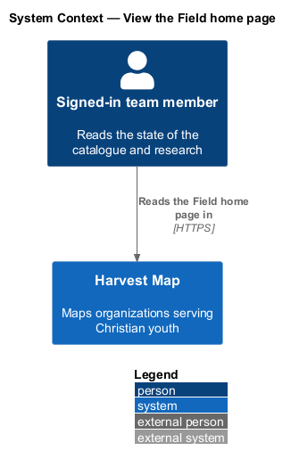
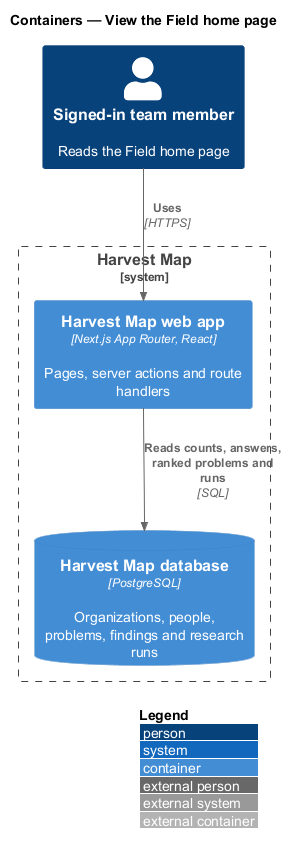
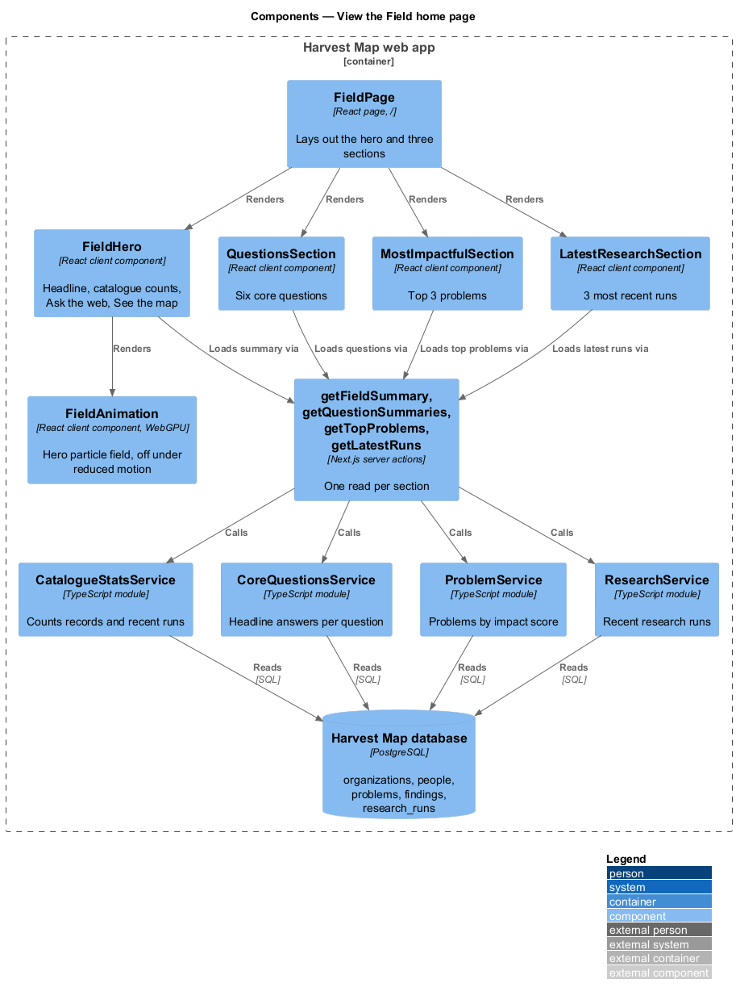
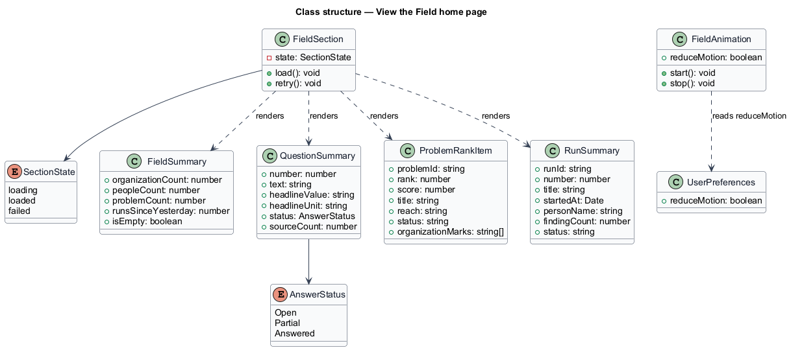
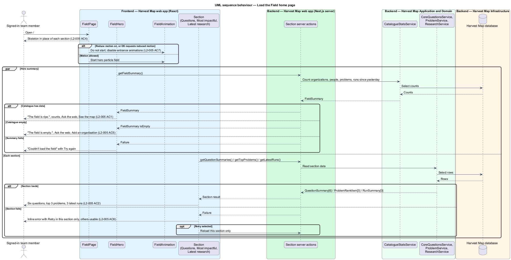
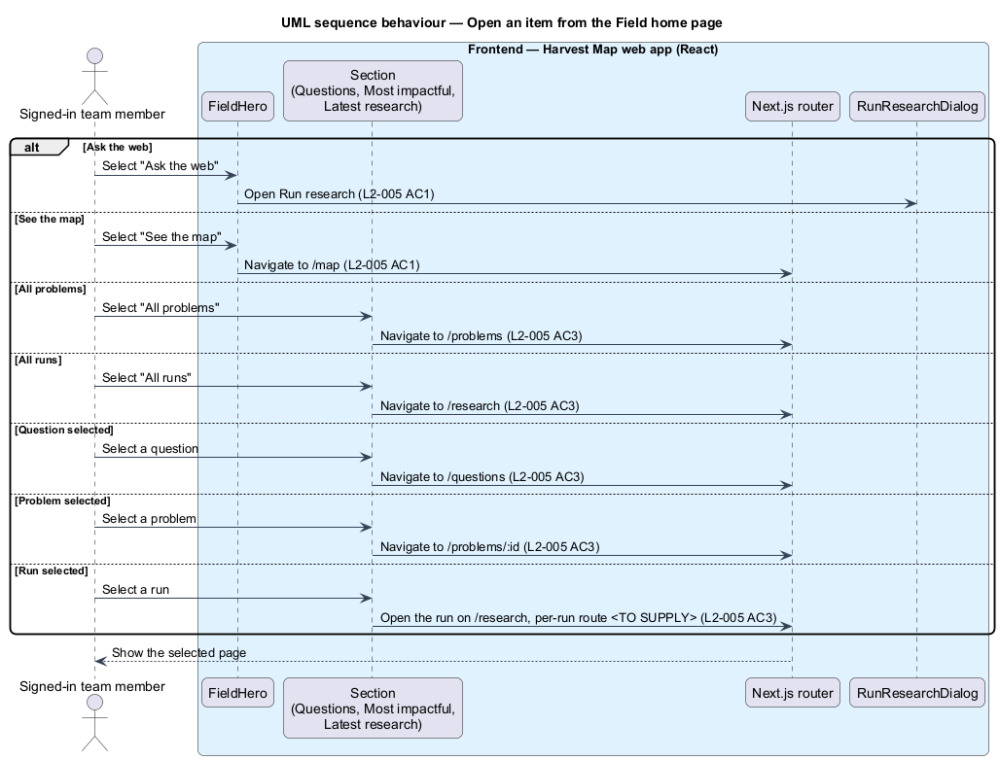

# View the Field home page

## Overview

Harvest Map is a web application that maps organizations serving Christian youth. Its catalogue holds organizations, the key people in them, the problems they target, and the web research runs that find them. This feature covers the Field home page, the first page a signed-in team member sees.

**catalogue** — set of organization, person and problem records held in Harvest Map

**core question** — one of the six fixed research questions Harvest Map answers from the catalogue, such as "Who is targeting moonshot problems?"

**research run** — numbered web search job that a team member starts and that returns findings

**finding** — research result that a person accepts, edits or rejects before it changes a record

The Field home page lives at `/` in the field subsystem. It summarises the catalogue in one line, lists the six core questions with their headline answers, lists the three most impactful problems, and lists the three latest research runs. Each section loads on its own, so one failed section does not block the others. The mocks in `docs/mocks/pages/field/` show the default, loading, empty, error and partial states.

## Description

The slice runs from a React page in the Next.js web app to the PostgreSQL database. It reads the catalogue and does not change it.

- **`FieldPage`** — React page at `/`. It renders the hero and the three sections, and each section loads independently.
- **`FieldHero`** — client component. It shows the headline "The field is ripe.", the summary line (for example "14 organisations · 16 people · 9 problems. 2 research runs since yesterday."), "Ask the web" (opens the Run research dialog) and "See the map" (`/map`). With an empty catalogue it shows "The field is empty.", "Add an organisation or let a research run find the first ones.", "Ask the web" and "Add an organisation". The route behind "Add an organisation" is `<TO SUPPLY>`. When the summary fails it shows "We couldn't load your workspace." and the alert "Couldn't load the field — The request timed out. Try again, or share reference HM-4F2A with support." with "Try again". How the support reference is generated is `<TO SUPPLY>`.
- **`FieldAnimation`** — client component behind the headline. It runs the WebGPU particle field and falls back to a CSS gradient without WebGPU. It does not run, and section entrance animations are off, when the "Reduce motion" preference is on or the OS requests reduced motion.
- **`QuestionsSection`** — client component. It lists the six core questions, each with number, text, headline answer (for example "9 organisations" or "8 of 16 verified"), status (Answered or Partial) and source count. Selecting a question opens `/questions`.
- **`MostImpactfulSection`** — client component. It lists the top 3 problems, each with rank, score, title, reach, status (for example "Tracked") and linked organization marks, plus "All problems" (`/problems`). Selecting a problem opens `/problems/:id`. On failure it shows "Couldn't load the ranking — The problems service didn't answer in time." with "Retry".
- **`LatestResearchSection`** — client component. It lists the 3 most recent runs, each with number, title, time, person, finding count and status (Running or Done), plus "All runs" (`/research`). Selecting a run opens it on `/research`; a per-run route is `<TO SUPPLY>`.
- **`SectionSkeleton`** and **`SectionError`** — shared client components. Each section shows a skeleton while loading and, on failure, an inline alert with "Retry" that reloads only that section.
- **`getFieldSummary`**, **`getQuestionSummaries`**, **`getTopProblems`** and **`getLatestRuns`** — Next.js server actions, one per section. Each returns a typed result for its section.
- **`CatalogueStatsService`** — server module. It counts organizations, people and problems, and counts research runs since yesterday. Whether "since yesterday" means the start of the previous calendar day or the last 24 hours is `<TO SUPPLY>`.
- **`CoreQuestionsService`** — server module designed in `questions/answer-core-questions`. It supplies the headline answer, status and source count per question.
- **`ProblemService`** — server module designed in `problems/browse-ranked-problems`. `listRanked` returns problems ordered by impact score (reach × severity × tractability).
- **`ResearchService`** — server module designed in `research/monitor-research-runs`. `listRuns` returns the runs, newest first.
- **`UserPreferences`** — preferences saved in `settings/manage-settings`; this page reads `reduceMotion`.

## Requirements

| L2 ID | Refines (L1) | Requirement |
|-------|--------------|-------------|
| `L2-005` | `L1-002` | AC1. Given the catalogue has data, when the page loads, then it shows the headline "The field is ripe.", counts of organizations, people and problems, the count of research runs since yesterday, and actions "Ask the web" (opens Run research) and "See the map" (`/map`). |
| `L2-005` | `L1-002` | AC2. Given the page, when it renders, then it lists the six questions with number, text, headline answer, status (Answered or Partial) and source count, a "Most impactful" list of the top 3 problems with rank, score, title, reach, status and linked organization marks, and a "Latest research" list of the 3 most recent runs with number, title, time, person, finding count and status. |
| `L2-005` | `L1-002` | AC3. Given the lists, when the user selects "All problems" or "All runs", then they navigate to `/problems` or `/research`; selecting a question, problem or run opens it. |
| `L2-005` | `L1-002` | AC4. Given the data is loading, when the page renders, then skeletons are shown in place of each section. |
| `L2-005` | `L1-002` | AC5. Given the catalogue has no records, when the page loads, then the empty state invites the user to run the first research. |
| `L2-005` | `L1-002` | AC6. Given a section fails to load, when the page renders, then that section alone shows an error with "Retry" while the others remain usable (partial state). |
| `L2-005` | `L1-002` | AC7. Given the user enables "Reduce motion" or the OS requests reduced motion, when the page renders, then the hero animation and entrance animations are disabled. |

## Diagrams

### System context

A signed-in team member reads the Field home page in Harvest Map over HTTPS. No external system takes part in loading the page.

### Containers

The Next.js web app serves the page and runs one server action per section. The actions read the catalogue, problems and research runs from the PostgreSQL database.

### Components

`FieldPage` renders `FieldHero`, `FieldAnimation` and three sections. Each section calls its own server action, which calls the matching service. All services read the database.

### Class structure

Each section renders one typed result: `FieldSummary`, `QuestionSummary`, `ProblemRankItem` or `RunSummary`. `SectionState` records whether a section is loading, loaded or failed.

### Behaviour — load the Field home page

Each section shows a skeleton while its action runs (`L2-005` AC4). Loaded sections show the summary, questions, problems and runs (`L2-005` AC1, AC2). An empty catalogue shows the empty hero (`L2-005` AC5). A failed section shows its own error with "Retry" while the others stay usable (`L2-005` AC6). Reduced motion turns off the hero and entrance animations (`L2-005` AC7).

### Behaviour — open an item from the Field home page

"All problems" and "All runs" navigate to `/problems` and `/research`. A question, problem or run opens its own page (`L2-005` AC3). "Ask the web" opens the Run research dialog and "See the map" opens `/map` (`L2-005` AC1).

