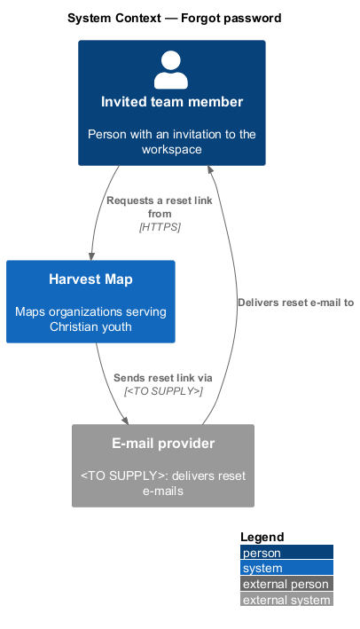
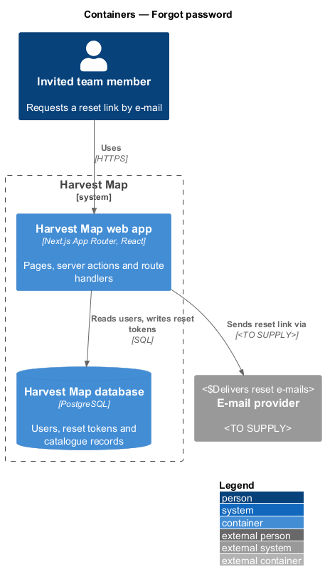
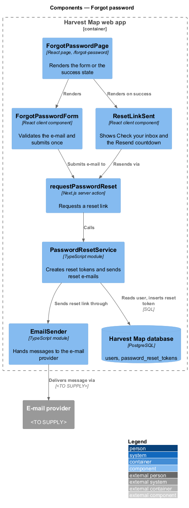
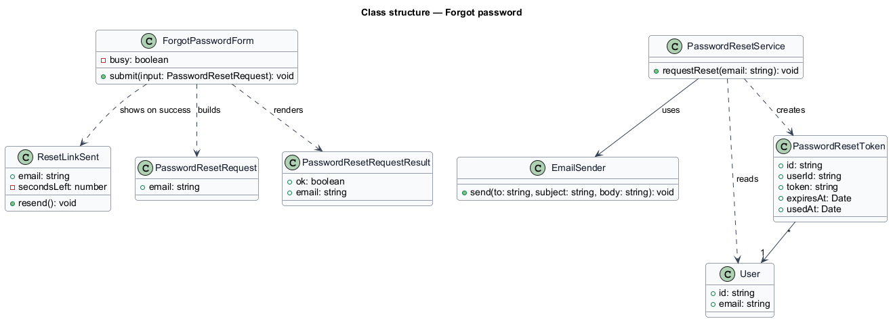
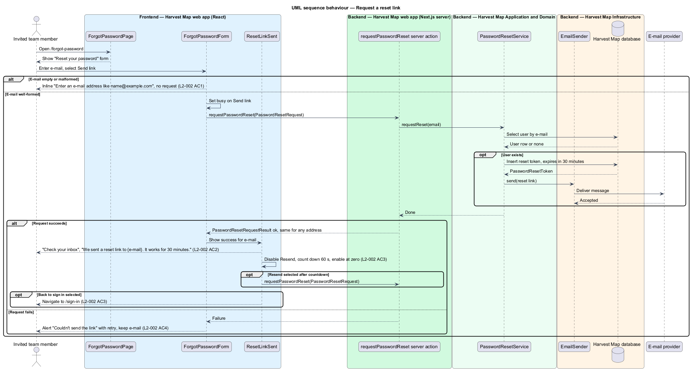

# Forgot password

## Overview

Harvest Map is a web application that maps organizations serving Christian youth. Access is invite-only, and each invited team member signs in with an e-mail address and a password. This feature covers the forgot-password page, where a team member who has lost a password asks for a reset link by e-mail.

**reset link** — single-use URL to `/reset-password` that carries a reset token and works for 30 minutes

**reset token** — secret value stored against a user that proves the holder received the reset e-mail

The page lives at `/forgot-password` in the identity subsystem and is reached from the "Forgot password?" link on the sign-in page. It accepts one e-mail address. For any well-formed address, registered or not, the page shows the same "Check your inbox" confirmation, so the page does not reveal which addresses hold an account. The reset link itself is consumed by the reset-password feature (`L2-003`). The mocks in `docs/mocks/pages/forgot-password/` show the default, invalid, submitting, error and success states.

## Description

The slice runs from a React page in the Next.js web app, through the PostgreSQL database, to an external e-mail provider.

- **`ForgotPasswordPage`** — React page at `/forgot-password`. It renders the heading "Reset your password", the text "We'll e-mail you a link.", the form and the "Back to sign in" link to `/sign-in`.
- **`ForgotPasswordForm`** — client component. It checks the e-mail format before any request. On failure it shows the error summary "Fix 1 thing to save" and the inline message "Enter an e-mail address like name@example.com". While the request runs, "Send link" shows a busy state.
- **`ResetLinkSent`** — client component for the success state. It shows "Check your inbox" and "We sent a reset link to {e-mail}. It works for 30 minutes.", disables "Resend" with a 60 s countdown ("Resend in 58 s"), and enables it at zero.
- **`requestPasswordReset`** — Next.js server action. It receives a `PasswordResetRequest`, calls `PasswordResetService` and returns a `PasswordResetRequestResult`. It returns the same success result whether or not the address belongs to a user.
- **`PasswordResetService`** — server module. It looks up the user by e-mail and, when one exists, creates a `PasswordResetToken` that expires 30 minutes after creation and sends the reset link through `EmailSender`. The token format and how it is stored (plain or hashed) are `<TO SUPPLY>`.
- **`EmailSender`** — server module that hands a message to the external e-mail provider. The provider is `<TO SUPPLY>`.
- **`User`** and **`PasswordResetToken`** — rows in the `users` and `password_reset_tokens` tables of the Harvest Map database.

When the request fails, the form shows the alert "Couldn't send the link — Try again in a moment." and keeps the entered e-mail; selecting "Send link" again retries. "Resend" calls `requestPasswordReset` again with the same address. Whether a resend invalidates the earlier token is `<TO SUPPLY>`. The reset e-mail subject and body are `<TO SUPPLY>`; no mock shows them.

## Requirements

| L2 ID | Refines (L1) | Requirement |
|-------|--------------|-------------|
| `L2-002` | `L1-001` | AC1. Given an invalid or empty e-mail, when the user submits, then an inline message "Enter an e-mail address like name@example.com" is shown and no request is sent. |
| `L2-002` | `L1-001` | AC2. Given any well-formed e-mail (registered or not), when the user submits, then the page shows "Check your inbox" and "We sent a reset link to {e-mail}. It works for 30 minutes.". |
| `L2-002` | `L1-001` | AC3. Given the success state, when it appears, then "Resend" is disabled with a 60 s countdown ("Resend in 58 s") and enables at zero; "Back to sign in" returns to `/sign-in`. |
| `L2-002` | `L1-001` | AC4. Given the request fails, when the user submits, then an error alert with retry is shown and the e-mail is kept. |

## Diagrams

### System context

An invited team member asks Harvest Map for a reset link over HTTPS. Harvest Map sends the link through an external e-mail provider.

### Containers

The Next.js web app serves the page and runs the server action. The action reads the user and writes the reset token in the PostgreSQL database, then sends the e-mail through the provider.

### Components

`ForgotPasswordPage` renders `ForgotPasswordForm`, which submits to the `requestPasswordReset` server action. The action calls `PasswordResetService`, which writes the token and calls `EmailSender`.

### Class structure

`ForgotPasswordForm` builds a `PasswordResetRequest` and renders a `PasswordResetRequestResult`. `PasswordResetService` reads `User`, creates `PasswordResetToken` and uses `EmailSender`.

### Behaviour — request a reset link

The form rejects a malformed e-mail before any request (`L2-002` AC1). A well-formed e-mail always reaches the success state, whether or not a user exists (`L2-002` AC2). The success state counts down 60 s before "Resend" enables (`L2-002` AC3). A failed request shows the retry alert and keeps the e-mail (`L2-002` AC4).

