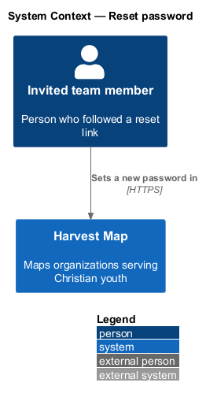
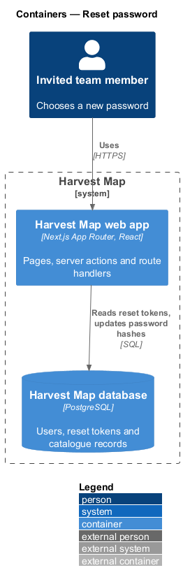
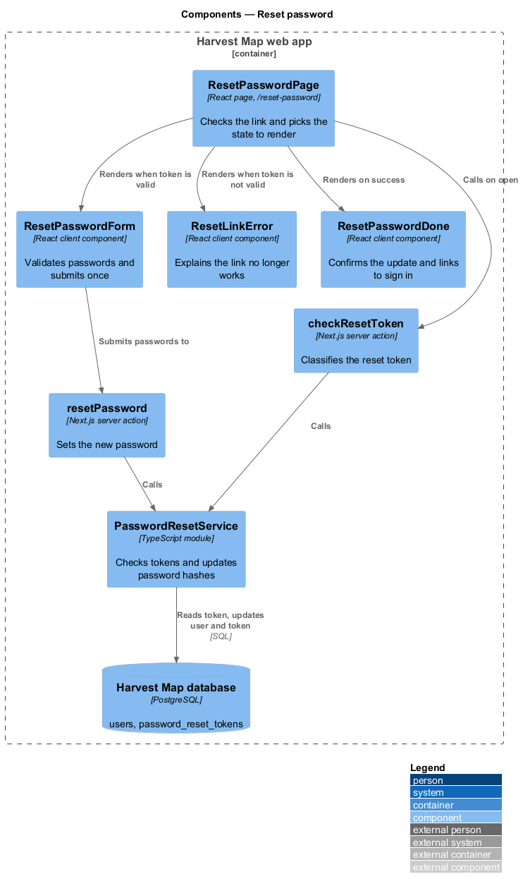
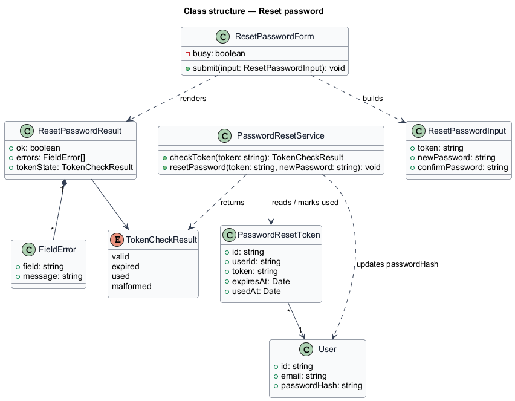
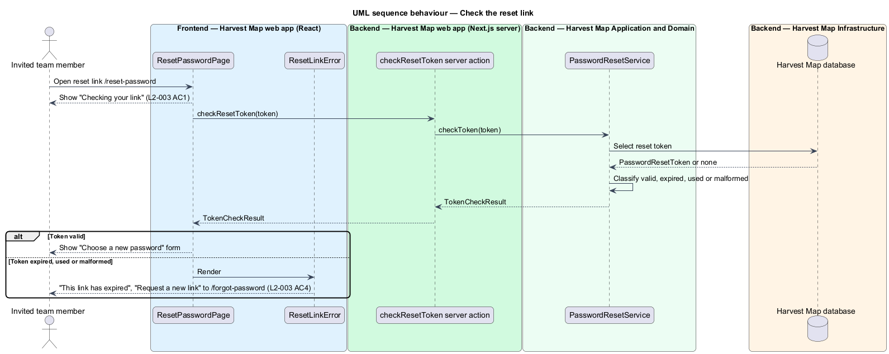
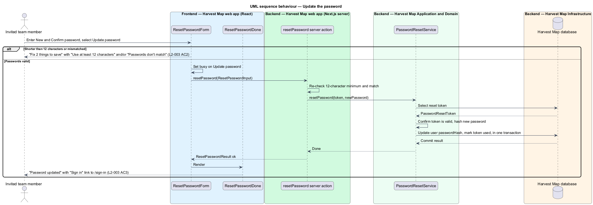

# Reset password

## Overview

Harvest Map is a web application that maps organizations serving Christian youth. Access is invite-only, and each invited team member signs in with an e-mail address and a password. This feature covers the reset-password page, where a team member who followed a reset link chooses a new password.

**reset link** — URL to `/reset-password` that carries a reset token, sent by the forgot-password feature (`L2-002`)

**reset token** — secret value stored against a user that proves the holder received the reset e-mail; it expires 30 minutes after creation and works once

The page lives at `/reset-password` in the identity subsystem. On open it checks the token in the link. A valid token shows a form with New password and Confirm password. An expired, used or malformed token shows an error state that links to `/forgot-password`. After a successful update the page links to sign in. The mocks in `docs/mocks/pages/reset-password/` show the default, loading, invalid, submitting, error and success states.

## Description

The slice runs from a React page in the Next.js web app to the PostgreSQL database.

- **`ResetPasswordPage`** — React page at `/reset-password`. It reads the token from the link, shows "Checking your link" while `checkResetToken` runs, and then renders the form, the link error or the success state.
- **`ResetPasswordForm`** — client component. It shows "Choose a new password", New password with the hint "At least 12 characters.", Confirm password and "Update password". Before any request it checks the length and the match. On failure it shows the error summary "Fix 2 things to save" with "Use at least 12 characters" and/or "Passwords don't match", and the matching inline messages. While the request runs, "Update password" shows a busy state.
- **`ResetLinkError`** — client component for the error state. It shows "This link has expired", "Reset links work for 30 minutes. Request a new one.", "Request a new link" (`/forgot-password`) and "Back to sign in" (`/sign-in`). The mock shows only the expired copy; the copy for a used or malformed token is `<TO SUPPLY>`.
- **`ResetPasswordDone`** — client component for the success state. It shows "Password updated", "Sign in with your new password." and a "Sign in" link to `/sign-in`.
- **`checkResetToken`** — Next.js server action. It receives the token and returns a `TokenCheckResult` of `valid`, `expired`, `used` or `malformed`.
- **`resetPassword`** — Next.js server action. It receives a `ResetPasswordInput`, re-checks the token and the 12-character minimum, calls `PasswordResetService` and returns a `ResetPasswordResult`.
- **`PasswordResetService`** — server module shared with forgot-password. It finds the `PasswordResetToken`, classifies it, hashes the new password, updates `User.passwordHash` and marks the token used in one transaction. The hashing algorithm is `<TO SUPPLY>` and is the same one sign-in verifies against. Whether a reset revokes the user's existing sessions is `<TO SUPPLY>`.
- **`User`** and **`PasswordResetToken`** — rows in the `users` and `password_reset_tokens` tables of the Harvest Map database.
- **`ResetPasswordResult`** and **`FieldError`** — typed result returned to the form; `FieldError` names the field and its message.

The behaviour when the update request fails (for example, the service is unreachable) is `<TO SUPPLY>`; no mock or criterion shows that state.

## Requirements

| L2 ID | Refines (L1) | Requirement |
|-------|--------------|-------------|
| `L2-003` | `L1-001` | AC1. Given a reset link, when the page opens, then a loading state is shown while the token is checked. |
| `L2-003` | `L1-001` | AC2. Given a password shorter than 12 characters or a mismatched confirmation, when the user submits, then "Fix 2 things to save" lists "Use at least 12 characters" and/or "Passwords don't match". |
| `L2-003` | `L1-001` | AC3. Given a valid token and valid passwords, when the user submits, then the password is updated, and the success state links to sign in. |
| `L2-003` | `L1-001` | AC4. Given an expired, used or malformed token, when the page opens, then the error state explains the link no longer works and links to `/forgot-password`. |

## Diagrams

### System context

An invited team member opens the reset link and sets a new password in Harvest Map over HTTPS. No external system takes part in the reset itself.

### Containers

The Next.js web app serves the page and runs both server actions. The actions read the token and write the new password hash in the PostgreSQL database.

### Components

`ResetPasswordPage` calls `checkResetToken` on open and renders `ResetPasswordForm`, `ResetLinkError` or `ResetPasswordDone`. The form submits to `resetPassword`. Both actions call `PasswordResetService`, which reads and writes the database.

### Class structure

`ResetPasswordForm` builds a `ResetPasswordInput` and renders a `ResetPasswordResult` made of `FieldError` entries. `PasswordResetService` returns a `TokenCheckResult`, reads `PasswordResetToken` and updates `User`.

### Behaviour — check the reset link

The page shows the loading state while the token is checked (`L2-003` AC1). A valid token shows the form. An expired, used or malformed token shows the error state with a link to `/forgot-password` (`L2-003` AC4).

### Behaviour — update the password

The form rejects a short or mismatched password before any request (`L2-003` AC2). A valid submit updates the hash, marks the token used and shows the success state with a link to sign in (`L2-003` AC3).

