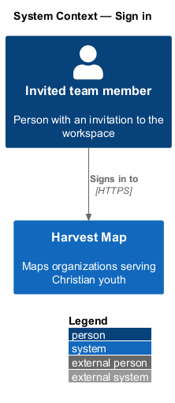
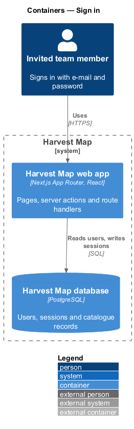
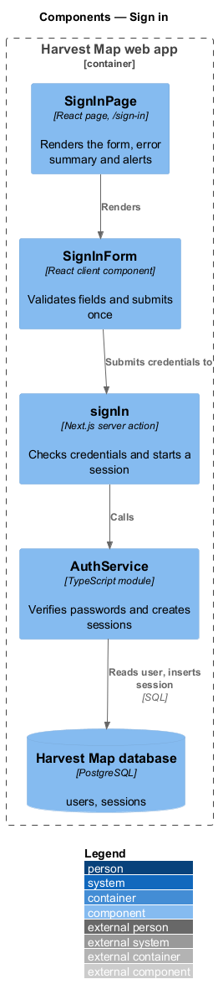
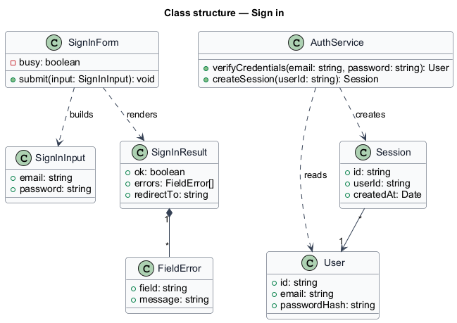
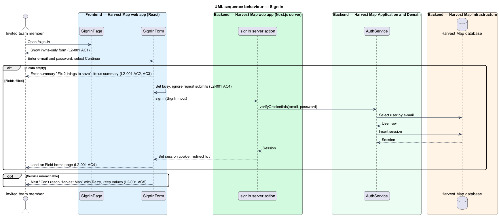

# Sign in

## Overview

Harvest Map is a web application that maps organizations serving Christian youth. Access is invite-only: only a person who received an invitation holds an account. This feature covers the sign-in page, the first page an unauthenticated team member sees.

**invited team member** — person whose e-mail address an administrator added to the workspace

**session** — server-side record that identifies a signed-in team member across requests

The sign-in page lives at `/sign-in` in the identity subsystem. It accepts an e-mail address and a password, starts a session on success, and sends the team member to the Field home page (`/`). It also links to the forgot-password flow. The mocks in `docs/mocks/pages/sign-in/` show the default, invalid, submitting, error and success states.

## Description

The slice runs from a React page in the Next.js web app to the PostgreSQL database.

- **`SignInPage`** — React page at `/sign-in`. It renders the heading, the text "Harvest Map is invite-only.", the form, the "Forgot password?" link and the note "Works in Chrome 125 or newer."
- **`SignInForm`** — client component. It checks that both fields are filled, shows the error summary and inline messages, moves focus to the summary, and ignores repeat submits while busy.
- **`signIn`** — Next.js server action. It receives a `SignInInput`, calls `AuthService`, sets the session cookie on success and returns a `SignInResult`.
- **`AuthService`** — server module. It verifies a password against the stored hash and creates a `Session`. The hashing algorithm is `<TO SUPPLY>`.
- **`User`** and **`Session`** — rows in the `users` and `sessions` tables of the Harvest Map database.
- **`SignInResult`** and **`FieldError`** — typed result returned to the form; `FieldError` names the field and its message.

The message shown for wrong credentials is `<TO SUPPLY>`; the mocks do not show that state.

## Requirements

| L2 ID | Refines (L1) | Requirement |
|-------|--------------|-------------|
| `L2-001` | `L1-001` | AC1. Given the sign-in page, when it loads, then it shows "Harvest Map is invite-only.", E-mail and Password fields, "Forgot password?" and "Continue". |
| `L2-001` | `L1-001` | AC2. Given both fields are empty, when the user submits, then an error summary "Fix 2 things to save" lists "Enter the e-mail address you were invited with" and "Enter your password", each field shows its inline message, and focus moves to the summary. |
| `L2-001` | `L1-001` | AC3. Given the summary is shown, when the user activates an item, then focus moves to the matching field. |
| `L2-001` | `L1-001` | AC4. Given valid credentials, when the user submits, then the button shows a busy state, repeat submits are ignored, and on success the user lands on the Field home page (`/`). |
| `L2-001` | `L1-001` | AC5. Given the service is unreachable, when the user submits, then the alert "Can't reach Harvest Map — Check your connection, then try again." appears with a "Retry" action and entered values are kept. |

## Diagrams

### System context

An invited team member signs in to Harvest Map over HTTPS. No external system takes part in sign-in.

### Containers

The Next.js web app serves the page and runs the server action. The action reads the user and writes the session in the PostgreSQL database.

### Components

`SignInPage` renders `SignInForm`, which submits to the `signIn` server action. The action calls `AuthService`, which reads and writes the database.

### Class structure

`SignInForm` builds a `SignInInput` and renders a `SignInResult` made of `FieldError` entries. `AuthService` reads `User` and creates `Session`.

### Behaviour — sign in

The form rejects empty fields before any request (`L2-001` AC2). A valid submit sets the busy state, starts a session and redirects to `/` (`L2-001` AC4). An unreachable service shows the retry alert and keeps the values (`L2-001` AC5).

