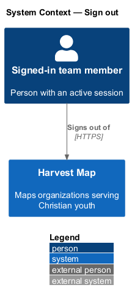
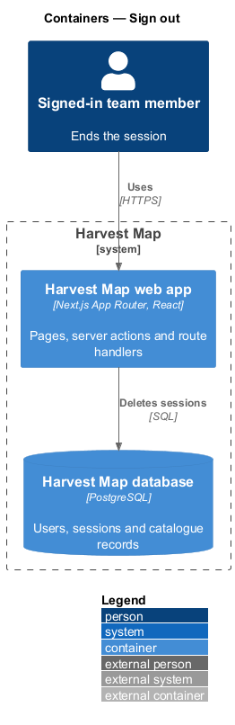
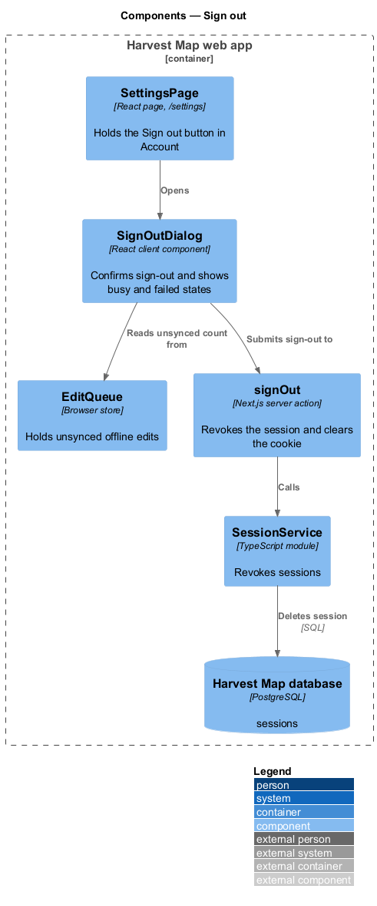
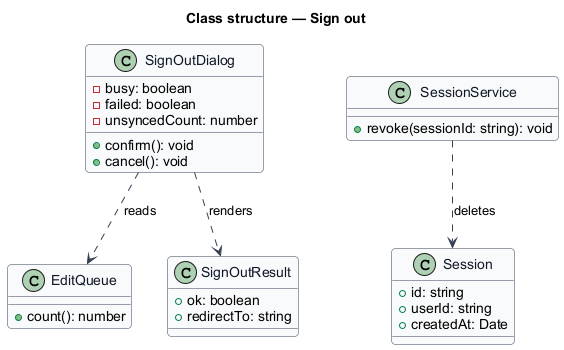
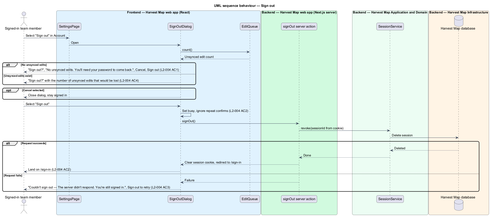

# Sign out

## Overview

Harvest Map is a web application that maps organizations serving Christian youth. A signed-in team member holds a session that identifies them across requests. This feature covers ending that session through the sign-out dialog.

**session** — server-side record that identifies a signed-in team member across requests

**unsynced edit** — change made while offline that the browser holds and has not yet sent to the server

The dialog opens from the "Sign out" button in the Account section of the Settings page (`/settings`). It asks "Sign out?" and states whether unsynced edits exist, because signing out discards them. On confirm, the server revokes the session and the team member lands on `/sign-in`. If the request fails, the team member stays signed in and may retry. The mocks in `docs/mocks/dialogs/sign-out/` show the default, busy and failed states.

## Description

The slice runs from a React dialog in the Next.js web app to the PostgreSQL database.

- **`SettingsPage`** — React page at `/settings`, designed in `settings/manage-settings`. Its Account section holds the "Sign out" button that opens the dialog.
- **`SignOutDialog`** — client component. It shows "Sign out?", the unsynced-edits line and the buttons "Cancel" and "Sign out". With no unsynced edits the line reads "No unsynced edits. You'll need your password to come back." With unsynced edits it states their number; that copy is `<TO SUPPLY>`. While the request runs, the dialog is busy and ignores repeat confirms. On failure it shows "Couldn't sign out — The server didn't respond. You're still signed in." and "Sign out" stays available as the retry.
- **`EditQueue`** — browser-side store of unsynced offline edits, designed in `resilience/offline-and-queued-edits`. The dialog reads its count on open.
- **`signOut`** — Next.js server action. It reads the session cookie, calls `SessionService`, clears the cookie and redirects to `/sign-in`.
- **`SessionService`** — server module. It revokes a `Session` by deleting its row.
- **`Session`** — row in the `sessions` table of the Harvest Map database.

## Requirements

| L2 ID | Refines (L1) | Requirement |
|-------|--------------|-------------|
| `L2-004` | `L1-001` | AC1. Given the user chooses "Sign out", when the dialog opens, then it asks "Sign out?" with "Cancel" and "Sign out", and states whether unsynced edits exist. |
| `L2-004` | `L1-001` | AC2. Given the user confirms, when the request runs, then the dialog is busy, the session is revoked server-side, and the user lands on `/sign-in`. |
| `L2-004` | `L1-001` | AC3. Given the request fails, when it returns, then the dialog shows the failed state with the option to retry and the user remains signed in. |
| `L2-004` | `L1-001` | AC4. Given unsynced offline edits exist, when the dialog opens, then it states the number of unsynced edits that would be lost. |

## Diagrams

### System context

A signed-in team member signs out of Harvest Map over HTTPS. No external system takes part in sign-out.

### Containers

The Next.js web app renders the dialog and runs the server action. The action deletes the session in the PostgreSQL database.

### Components

`SettingsPage` opens `SignOutDialog`, which reads `EditQueue` and submits to the `signOut` server action. The action calls `SessionService`, which deletes the session row.

### Class structure

`SignOutDialog` reads the count from `EditQueue` and renders a `SignOutResult`. `SessionService` revokes `Session`.

### Behaviour — sign out

The dialog states the number of unsynced edits on open (`L2-004` AC1, AC4). A confirm sets the busy state, revokes the session and redirects to `/sign-in` (`L2-004` AC2). A failed request shows the failed state and leaves the session in place (`L2-004` AC3).

