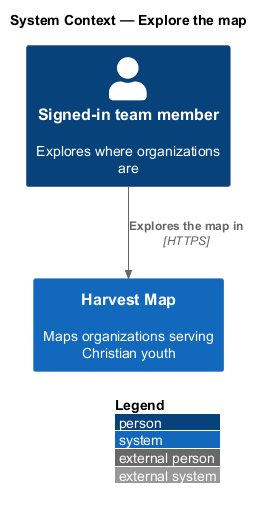
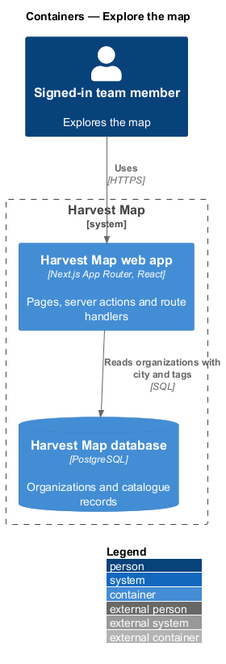
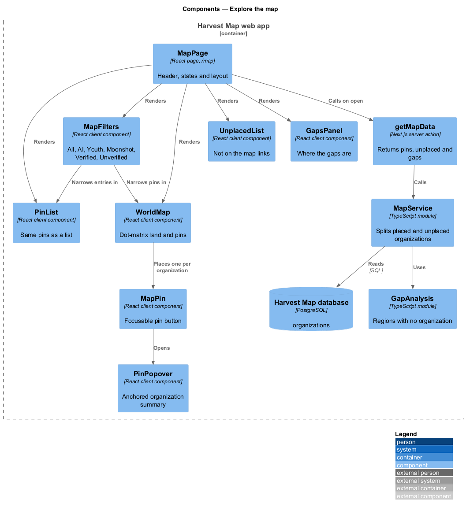
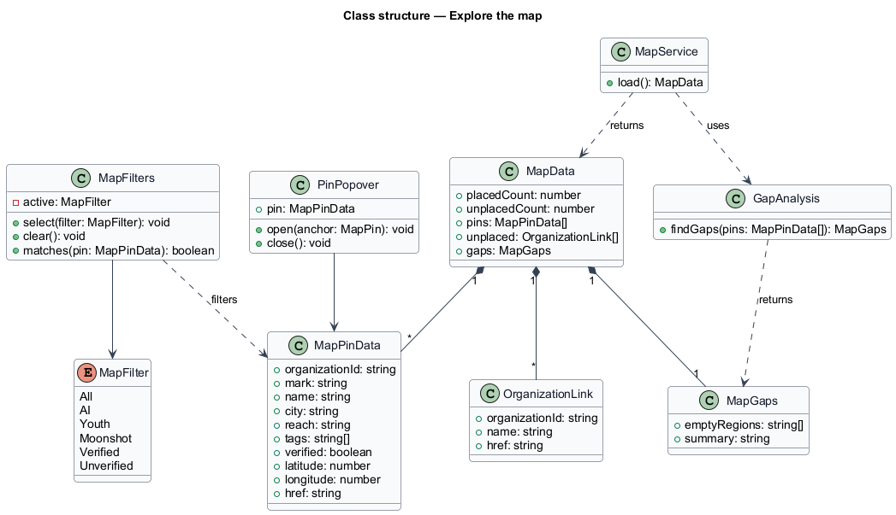
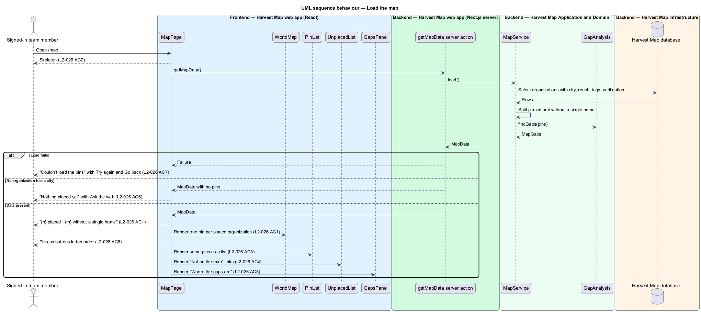
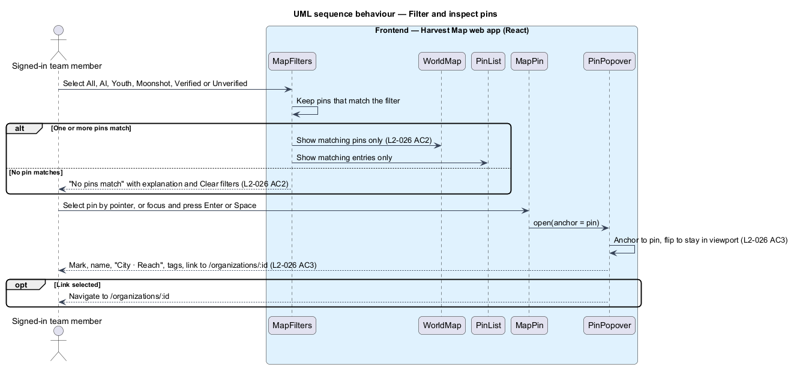

# Explore the map

## Overview

Harvest Map is a web application that maps organizations serving Christian youth. Each organization in the catalogue may have a city. This feature covers the Map page, which places organizations on a world map, lets a team member filter them, and calls out organizations that have no single location and regions that have no organization.

**pin** — marker on the world map for one organization with a city

**placed organization** — organization with a city, shown as a pin

**organization without a single home** — organization with no single city, listed under "Not on the map" instead of shown as a pin

**gap** — world region with no organization in the catalogue

The page lives at `/map` in the map subsystem and is reached from "See the map" on the Field home page. The header reads "{n} placed · {m} without a single home". Filters narrow the pins. Selecting a pin opens a popover with a link to the organization's page. Every pin is reachable by keyboard, and the same information is available as a list. The mocks in `docs/mocks/pages/map/` show the default, loading, empty, error and no-results states.

## Description

The slice runs from a React page in the Next.js web app to the PostgreSQL database. It reads the catalogue and does not change it.

- **`MapPage`** — React page at `/map`. It calls `getMapData` on open and shows the header, `MapFilters`, `WorldMap`, `PinList`, `UnplacedList` and `GapsPanel`. While loading it shows a skeleton. On failure it shows "Couldn't load the pins — The request timed out. Try again, or share reference HM-4F2A with support." with "Try again" and "Go back". When no organization has a city it shows "Nothing placed yet", "No organisations on the map", "Organisations appear here once they have a city." and "Ask the web", which opens the Run research dialog.
- **`MapFilters`** — client component with the filters All, AI, Youth, Moonshot, Verified and Unverified. It filters the loaded pins in the browser. When no pin matches it shows "No pins match" with an explanation and "Clear filters". The mock shows the explanation "Moonshot organisations in this set have no single city."; the rule that builds this text per filter is `<TO SUPPLY>`. Whether more than one filter may be active at once is `<TO SUPPLY>`.
- **`WorldMap`** — client component. It draws the land as a dot-matrix SVG used as a CSS mask so it takes the theme colour, and places one `MapPin` per placed organization.
- **`MapPin`** — button for one pin, in tab order. Selecting it by pointer or keyboard opens `PinPopover`.
- **`PinPopover`** — client component. It shows the organization's mark, name, "City · Reach", tags and a link to `/organizations/:id`. It is anchored to the pin with CSS anchor positioning and flips to stay in the viewport.
- **`PinList`** — client component that lists the same pins and popover information for assistive technology. Whether it is visible to all users or visually hidden is `<TO SUPPLY>`.
- **`UnplacedList`** — client component. It lists organizations without a single home under "Not on the map" as links to `/organizations/:id`.
- **`GapsPanel`** — client component. It shows "Where the gaps are" and the gaps text, for example "Nine of eleven pins are in North America. No organisation in the catalogue is based in Africa, South America or mainland Asia yet."
- **`getMapData`** — Next.js server action. It returns a `MapData` with the pins, the unplaced organizations and the gaps.
- **`MapService`** — server module. It reads organizations with their city, coordinates, reach, tags and verification state, and splits them into placed and unplaced. It passes the pins to `GapAnalysis`. The source of city coordinates (stored or looked up) is `<TO SUPPLY>`.
- **`GapAnalysis`** — server module. It states which regions have no organization. The list of regions and the rule that assigns a city to a region are `<TO SUPPLY>`.
- **`Organization`** — row in the `organizations` table of the Harvest Map database.

## Requirements

| L2 ID | Refines (L1) | Requirement |
|-------|--------------|-------------|
| `L2-026` | `L1-010` | AC1. Given organizations with a city, when the page loads, then a world map shows one pin per located organization and the header reads "{n} placed · {m} without a single home". |
| `L2-026` | `L1-010` | AC2. Given the filters All, AI, Youth, Moonshot, Verified, Unverified, when selected, then only matching pins are shown; no matches shows the no-results state. |
| `L2-026` | `L1-010` | AC3. Given a pin, when the user selects it by pointer or keyboard, then a popover shows the organization's mark, name, "City · Reach", tags and a link to its page, anchored to the pin and repositioned to stay in the viewport. |
| `L2-026` | `L1-010` | AC4. Given organizations without a location, when the page loads, then they are listed under "Not on the map" as links. |
| `L2-026` | `L1-010` | AC5. Given the data, when rendered, then a "Where the gaps are" panel states which regions have no organization. |
| `L2-026` | `L1-010` | AC6. Given no organization has a city, when the page loads, then the empty state "Nothing placed yet" offers "Ask the web". |
| `L2-026` | `L1-010` | AC7. Given loading or error, when rendered, then skeleton or error with retry shows. |
| `L2-026` | `L1-010` | AC8. Given assistive technology, when the map renders, then every pin is reachable in tab order and the same information is available as a list. |

## Diagrams

### System context

A signed-in team member explores the map in Harvest Map over HTTPS. No external system takes part; whether a geocoding service supplies coordinates is `<TO SUPPLY>`.

### Containers

The Next.js web app serves the page and runs the server action. The action reads organizations from the PostgreSQL database.

### Components

`MapPage` calls `getMapData`, which calls `MapService`. `MapService` uses `GapAnalysis`. The page renders `MapFilters`, `WorldMap` with its `MapPin` buttons and `PinPopover`, `PinList`, `UnplacedList` and `GapsPanel`.

### Class structure

`MapData` holds `MapPinData` entries for placed organizations, `OrganizationLink` entries for unplaced ones, and a `MapGaps` value. `MapFilters` applies a `MapFilter` to the pins.

### Behaviour — load the map

The page shows a skeleton, then the pins and header (`L2-026` AC1, AC7). Unplaced organizations appear under "Not on the map" (`L2-026` AC4), and the gaps panel states regions with no organization (`L2-026` AC5). With no placed organization the page shows the empty state (`L2-026` AC6). A failure shows the error with retry (`L2-026` AC7). Pins sit in tab order and repeat in `PinList` (`L2-026` AC8).

### Behaviour — filter and inspect pins

A filter shows only matching pins, or the no-results state (`L2-026` AC2). Selecting a pin by pointer or keyboard opens the anchored popover (`L2-026` AC3).

