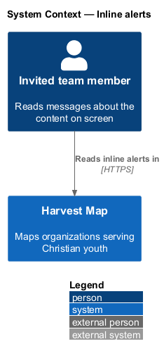
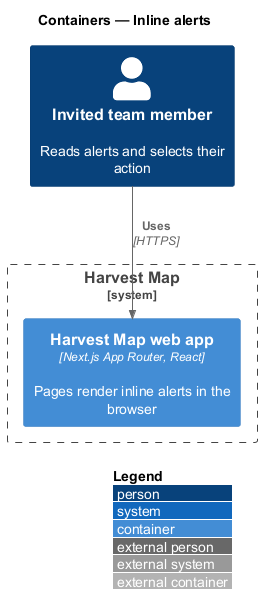
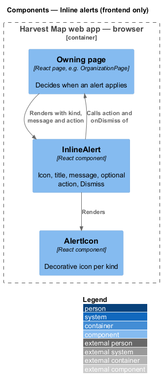
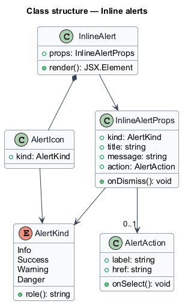
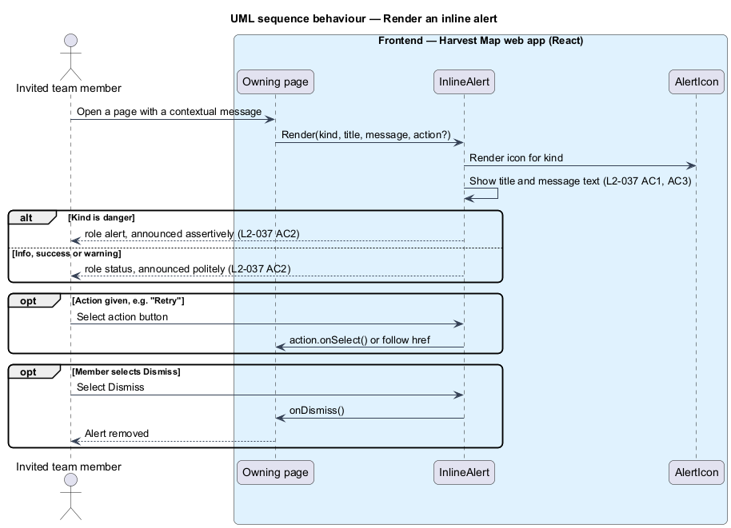

# Inline alerts

## Overview

Harvest Map is a web application that maps organizations serving Christian youth. Some messages belong to one part of one page: a website that stopped answering, sources that disagree, a run that is checking the record on screen. This feature shows such messages in place, next to the content they describe.

**inline alert** — message box inside a page's content that reports information, a warning, a success or a danger about that content, with an icon, a title, a message and at most one action

**alert kind** — one of info, success, warning or danger; the kind sets the colour, the icon and how assertively assistive technology announces the alert

Inline alerts belong to the notifications subsystem. Pages such as the organization detail page (`L2-007`) render them; form pages render the danger kind for failed saves. The mocks in `docs/mocks/notifications/inline-alert/` show the info, success, warning, danger and with-action states on the organization page.

## Description

The slice is frontend-only: one React component in the Next.js web app, rendered by the page that owns the message. The page decides when an alert applies and what its action does.

- **`InlineAlert`** — React component. It takes `InlineAlertProps` and renders the kind icon, the title, the message, an optional action, and a "Dismiss" close button. Danger alerts carry `role="alert"`; info, success and warning alerts carry `role="status"`.
- **`InlineAlertProps`** — `kind`, `title`, `message`, optional `action` (`label` and either `href` or `onSelect`) and optional `onDismiss`.
- **`AlertIcon`** — icon per kind, so the kind is conveyed by icon and text as well as colour. The icon is decorative (`aria-hidden`); the title and message carry the meaning.

Copy from the mocks:

| Kind | Title | Message | Action |
|------|-------|---------|--------|
| danger | Website unreachable since Mon 13 Oct | faithtech.com returned a timeout three times. | Edit website |
| info | Run #48 is checking this organisation | Fields may update in the next few minutes. | none |
| success | 2 findings accepted | Updated Reach and added 1 initiative. | See findings |
| warning | Sources disagree on the founding year | ministrywatch.com says 2010; religionnews.com says 2013. | Resolve |
| info, with action | 1 person has no LinkedIn link | none | Find on LinkedIn |

Whether a dismissed inline alert stays dismissed after reload is `<TO SUPPLY>`; the mocks show the "Dismiss" button but no persisted state.

## Requirements

| L2 ID | Refines (L1) | Requirement |
|-------|--------------|-------------|
| `L2-037` | `L1-012` | AC1. Given contextual information, warning, success or danger, when rendered inside a page, then an inline alert shows an icon, a message and optionally one action button (for example "Retry"). |
| `L2-037` | `L1-012` | AC2. Given an alert of danger kind, when shown, then it is announced assertively; others politely. |
| `L2-037` | `L1-012` | AC3. Given colour alone, when kind is conveyed, then icon and text also convey it. |

## Diagrams

### System context

An invited team member reads inline alerts on Harvest Map pages. No external system takes part.

### Containers

Inline alerts render inside the Harvest Map web app. The database plays no part in this slice and is left out of the view.

### Components

The component view is frontend-only. A page renders `InlineAlert`, which renders `AlertIcon` and, when given, one action.

### Class structure

`InlineAlert` takes `InlineAlertProps`, which hold an `AlertKind` and an optional `AlertAction`. `AlertKind` maps to the ARIA role and the icon.

### Behaviour — render an inline alert

The page passes a kind, a message and an optional action; the alert renders icon and text (`L2-037` AC1, AC3). Danger alerts are announced assertively and the rest politely (`L2-037` AC2).

