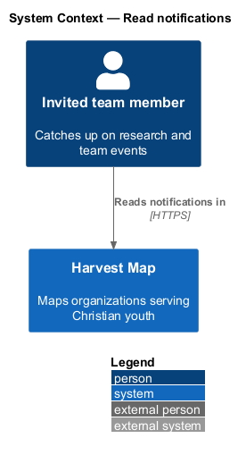
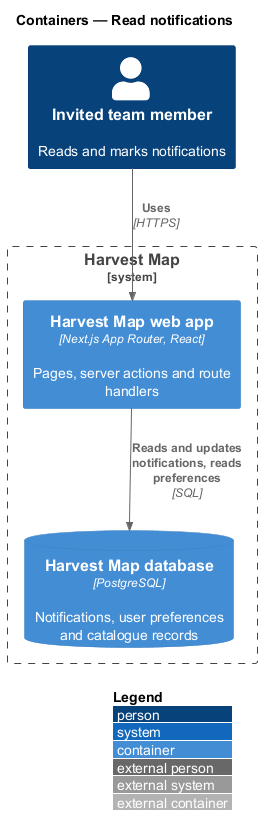
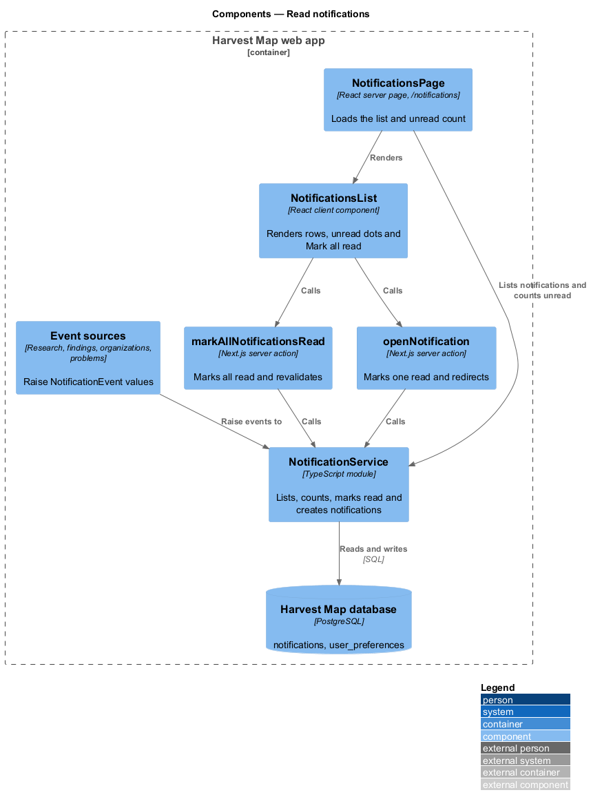
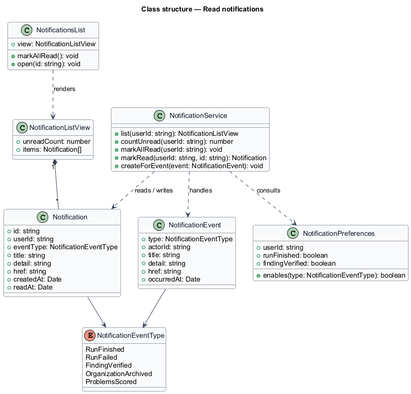
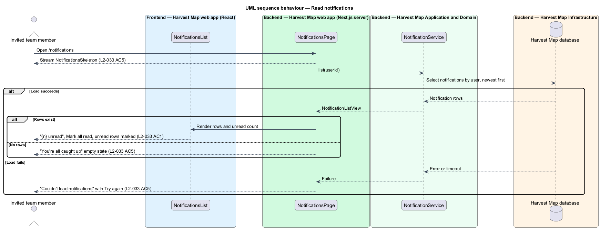
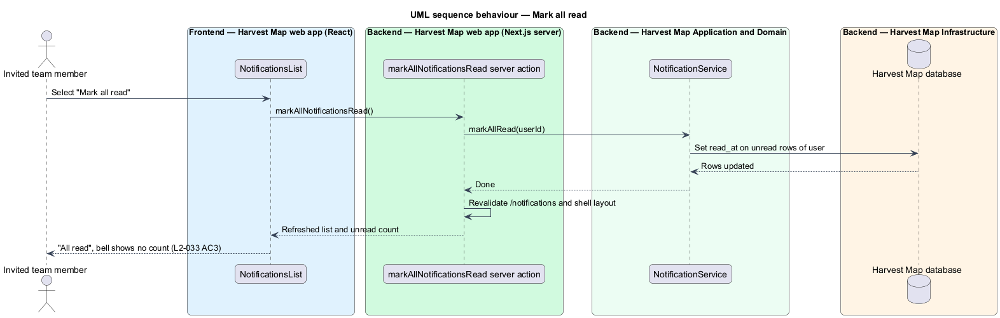
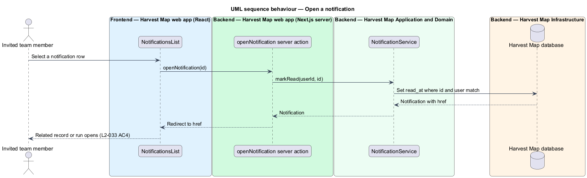
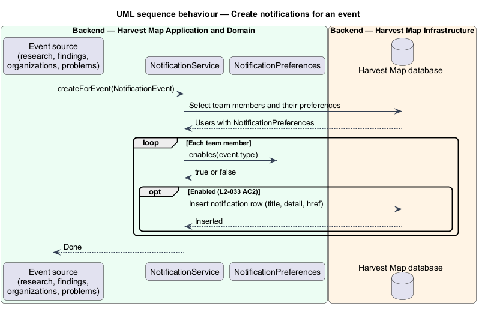

# Read notifications

## Overview

Harvest Map is a web application that maps organizations serving Christian youth. Research runs and teammates change the catalogue while a team member works elsewhere. This feature tells each team member what changed and lets them catch up from one page.

**notification** — stored message to one team member about a research or team event, with a title, a detail, a time and a link to the related record or run

**unread notification** — notification the team member has not yet opened or marked read

**notification preference** — per-user Settings switch that decides whether an event type creates a notification for that user

The notifications page lives at `/notifications` in the notifications subsystem. The notifications bell in the navigation shell opens it and shows the unread count (`L2-030`). The page lists notifications newest first, marks them read one at a time or all at once, and opens the related record or run. The mocks in `docs/mocks/pages/notifications/` show the default, loading, empty, error and read states.

## Description

The slice runs from a React page in the Next.js web app to the PostgreSQL database.

- **`NotificationsPage`** — React server page at `/notifications`. It loads the current user's notifications and unread count and renders the heading "Notifications" with "{n} unread", "All read" when none are unread, or "Nothing yet" when none exist.
- **`NotificationsList`** — client component. It renders each notification as a link row with title, detail and time, marks unread rows with a dot labelled "Unread" to assistive technology, and offers "Mark all read".
- **`NotificationsSkeleton`** — loading placeholder, marked `aria-busy="true"` with the label "Loading notifications".
- **Empty state** — "You're all caught up" with "Research results and teammates' changes show up here." and "Back to the field".
- **Error state** — "Couldn't load notifications" with "The request timed out. Try again, or share reference {reference} with support.", "Try again" and "Go back". The reference format is `<TO SUPPLY>`.
- **`markAllNotificationsRead`** — Next.js server action. It marks every unread notification of the current user read and revalidates the page and the shell so the bell count updates.
- **`openNotification`** — Next.js server action. It marks one notification read and redirects to the notification's `href`.
- **`NotificationService`** — server module. It lists notifications newest first, counts unread ones, marks them read, and creates notifications for events.
- **`NotificationEvent`** — event raised by other subsystems: run finished, run failed, teammate verified a finding, organization archived, problems scored.
- **`NotificationPreferences`** — the current user's Settings switches. Settings offers "When a run finishes" and "When a teammate verifies a finding" (`L2-038`). The switch that governs run failed, organization archived and problems scored events is `<TO SUPPLY>`.
- **`Notification`** — row in the `notifications` table of the Harvest Map database.

Sample rows from the mock: "Run #47 finished — 12 findings to review · Who is helping Christian youth with AI?", "Priya verified Pat Gelsinger on LinkedIn", "Run #45 failed — Moonshot goals with a public deadline · rate limited by 2 sources", "Hannah archived Kingdom Code — Restore from the organisation page" and "Elias scored 9 problems — illumiNations leads with 94". The page size or paging rule for long lists is `<TO SUPPLY>`.

## Requirements

| L2 ID | Refines (L1) | Requirement |
|-------|--------------|-------------|
| `L2-033` | `L1-012` | AC1. Given notifications exist, when the page loads, then it shows "{n} unread", "Mark all read", and a list of notifications (title, detail, time), with unread ones visually distinguished, ordered newest first. |
| `L2-033` | `L1-012` | AC2. Given the events "run finished", "run failed", "teammate verified a finding", "organization archived", "problems scored", when they occur, then a notification is created for the users whose Settings enable it. |
| `L2-033` | `L1-012` | AC3. Given the user selects "Mark all read", when processed, then all become read and the header unread count updates. |
| `L2-033` | `L1-012` | AC4. Given the user selects a notification, when opened, then it is marked read and navigates to the related record or run. |
| `L2-033` | `L1-012` | AC5. Given none exist, when the page loads, then the empty state is shown; given loading or failure, then skeleton or error with retry shows. |

## Diagrams

### System context

An invited team member reads notifications in Harvest Map over HTTPS. No external system takes part.

### Containers

The Next.js web app serves the page and runs the server actions. The actions read and update notifications in the PostgreSQL database.

### Components

`NotificationsPage` renders `NotificationsList`, which calls the `markAllNotificationsRead` and `openNotification` server actions. Both actions call `NotificationService`. Other subsystems raise a `NotificationEvent`, and `NotificationService` checks preferences before it inserts rows.

### Class structure

`NotificationService` reads and writes `Notification` rows, consults `NotificationPreferences` and handles `NotificationEvent` values. `NotificationsList` renders a `NotificationListView` made of `Notification` entries.

### Behaviour — read notifications

The page shows a skeleton while loading, then the list newest first with unread rows marked (`L2-033` AC1). No rows shows the empty state; a failed load shows the error with "Try again" (`L2-033` AC5).

### Behaviour — mark all read

"Mark all read" marks every unread row read and revalidates the page and the shell, so the bell count updates (`L2-033` AC3).

### Behaviour — open a notification

Selecting a row marks it read and redirects to the related record or run (`L2-033` AC4).

### Behaviour — create notifications for an event

When another subsystem raises an event, `NotificationService` inserts one notification per user whose preferences enable that event (`L2-033` AC2).

