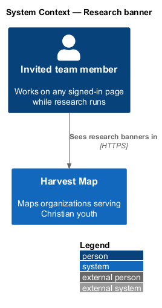
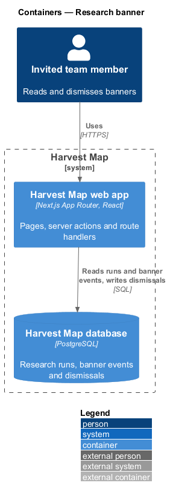
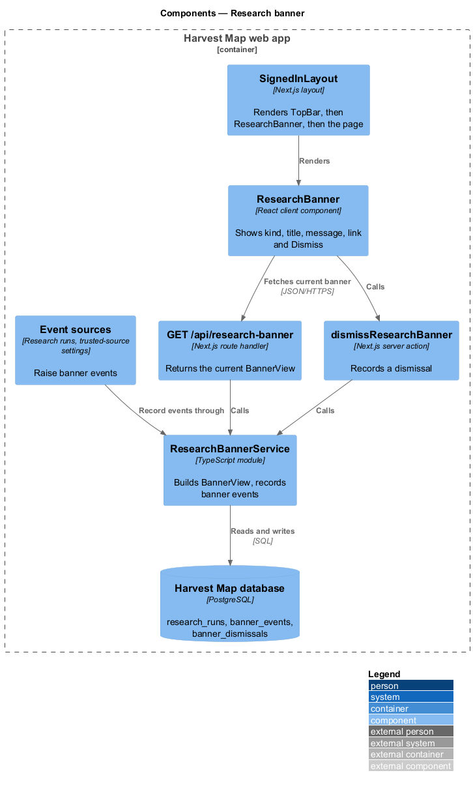
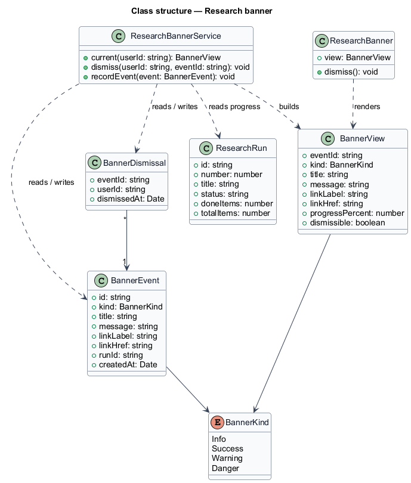
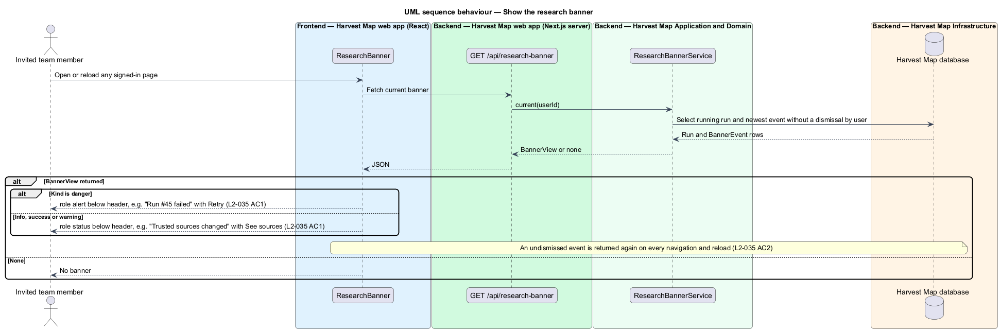
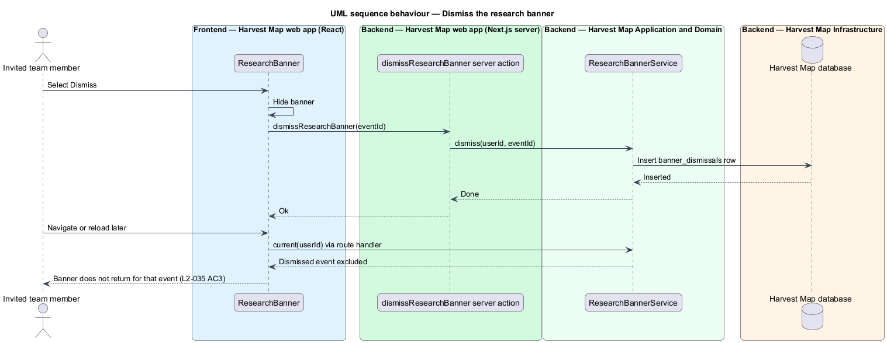
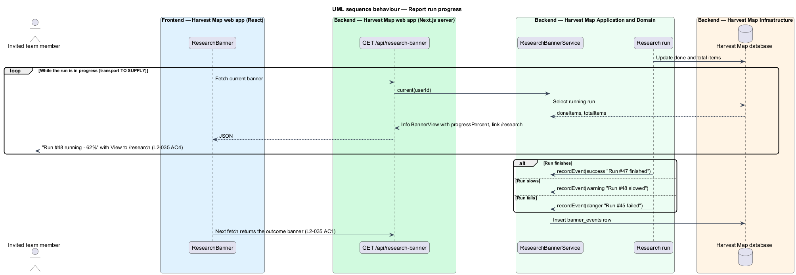

# Research banner

## Overview

Harvest Map is a web application that maps organizations serving Christian youth. Web research runs take from about 1 minute to about 20 minutes, and a team member keeps working on other pages while a run is in progress. Admins also change the trusted sources that decide when findings count as verified. This feature keeps those research events in view on every signed-in page.

**research banner** — full-width message below the header that reports a research run or a trusted-source change, with a kind, a title, a message and one link

**banner event** — stored research or trusted-source event that a banner reports, for example "Run #47 finished" or "Trusted sources changed"

**persistent banner** — banner that stays across navigation and reload until the team member dismisses it

The banner belongs to the notifications subsystem and sits in the navigation shell (`L2-030`) directly below the header. It reports run progress started from Run research (`L2-022`), run outcomes from the research page (`L2-023`) and trusted-source changes saved in Settings (`L2-038`). The mocks in `docs/mocks/notifications/research-banner/` show the info, success, warning, danger and persistent states.

## Description

The slice runs from a React client component in the shell to the PostgreSQL database.

- **`ResearchBanner`** — client component rendered by the signed-in layout below `TopBar`. It renders the current `BannerView` as an alert with a title, a message, one link and a "Dismiss" close button. Danger banners use `role="alert"`; the other kinds use `role="status"`.
- **`BannerView`** — what the banner shows: `eventId`, `kind`, `title`, `message`, `linkLabel`, `linkHref`, optional `progressPercent`, and `dismissible`.
- **`GET /api/research-banner`** — Next.js route handler. It returns the current `BannerView` for the signed-in user, or nothing. The update transport that keeps the banner current while a run progresses (polling interval or a stream) is `<TO SUPPLY>`.
- **`dismissResearchBanner`** — Next.js server action. It records that the current user dismissed one banner event.
- **`ResearchBannerService`** — server module. It builds the `BannerView` from the running run, if any, and from the newest banner event the user has not dismissed. It also records banner events raised by research runs and by trusted-source changes. The precedence between a running run and an undismissed event is `<TO SUPPLY>`.
- **`BannerEvent`** — row in the `banner_events` table: kind, title, message, link, run id when relevant, and creation time.
- **`BannerDismissal`** — row in the `banner_dismissals` table that pairs a user with a dismissed banner event. Storing the dismissal server-side keeps it across navigation and reload.

Copy from the mocks:

| Kind | Title | Message | Link |
|------|-------|---------|------|
| info | Run #48 running · 62% | Finding LinkedIn profiles for 8 people. | View |
| success | Run #47 finished | 12 findings to review. | Review |
| warning | Run #48 slowed | 2 sources are rate-limiting; it will finish later than estimated. | Switch to Quick |
| danger | Run #45 failed | Rate limited by 2 sources after 30%. | Retry |
| info, persistent | Trusted sources changed | Hannah Okafor added 2 domains. 41 findings re-verify tonight. | See sources |

The danger mock shows no "Dismiss" button; whether a failed-run banner is dismissible is `<TO SUPPLY>`. The behaviour of "Switch to Quick" is `<TO SUPPLY>`.

## Requirements

| L2 ID | Refines (L1) | Requirement |
|-------|--------------|-------------|
| `L2-035` | `L1-012` | AC1. Given research or trusted-source events occur, when the user is on any signed-in page, then a banner of kind info, success, warning or danger appears below the header with a message and a link (for example "Trusted sources changed — Hannah Okafor added 2 domains. 41 findings re-verify tonight. See sources"). |
| `L2-035` | `L1-012` | AC2. Given a persistent banner, when the user navigates or reloads, then it remains until the user dismisses it. |
| `L2-035` | `L1-012` | AC3. Given the user dismisses it, when dismissed, then it does not return for that event. |
| `L2-035` | `L1-012` | AC4. Given a run starts, when it is in progress, then the banner shows progress and links to `/research`. |

## Diagrams

### System context

An invited team member sees research banners while working in Harvest Map. Research runs and trusted-source changes happen inside Harvest Map; no external system takes part in showing the banner.

### Containers

The Next.js web app renders the banner, serves its state through a route handler and records dismissals through a server action. Banner events and dismissals live in the PostgreSQL database.

### Components

`ResearchBanner` reads `GET /api/research-banner` and calls `dismissResearchBanner`. Both use `ResearchBannerService`, which also receives events from research runs and trusted-source changes.

### Class structure

`ResearchBannerService` reads `BannerEvent` and `BannerDismissal` rows and the running `ResearchRun`, and builds a `BannerView` for `ResearchBanner`.

### Behaviour — show the banner

On each signed-in page the shell asks for the current banner and renders it below the header with its kind, message and link (`L2-035` AC1). An undismissed event returns after navigation or reload (`L2-035` AC2).

### Behaviour — dismiss the banner

Dismissing stores a `BannerDismissal`, so the same event no longer appears (`L2-035` AC3).

### Behaviour — report run progress

While a run is in progress the banner shows its percentage and links to `/research` (`L2-035` AC4). When the run slows, finishes or fails, the run records a banner event and the next fetch shows it.

