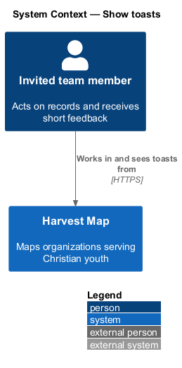
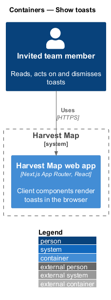
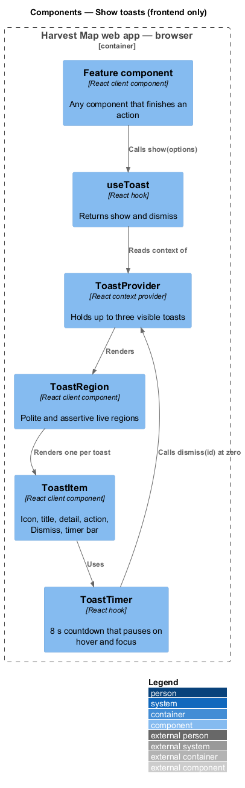
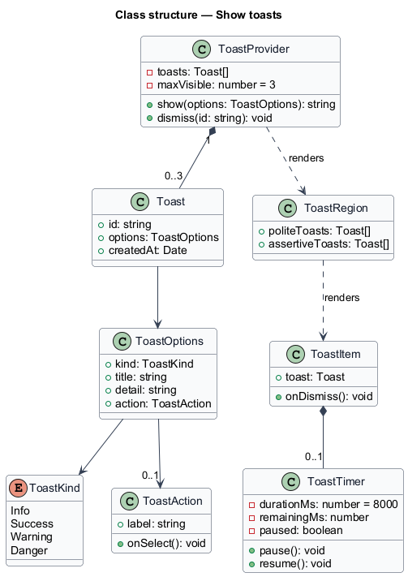
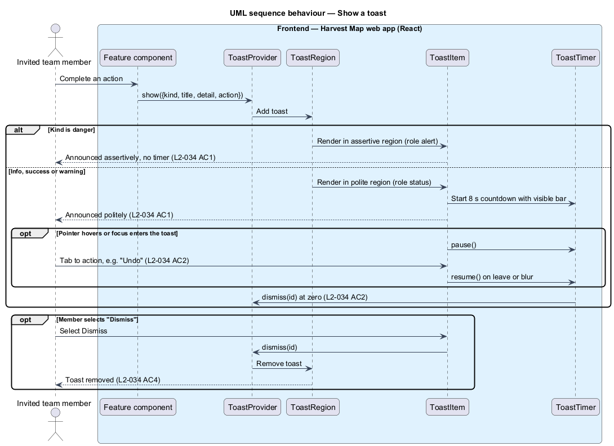
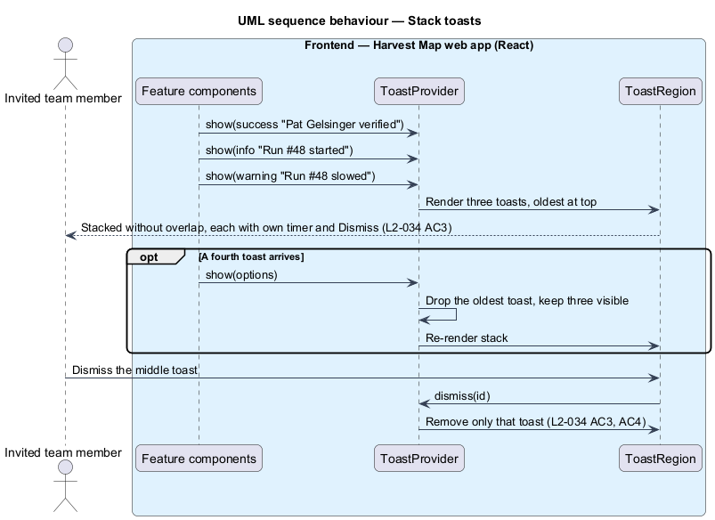

# Show toasts

## Overview

Harvest Map is a web application that maps organizations serving Christian youth. Many actions finish without leaving the page: a save, an archive, a verified finding, a started run. This feature gives short feedback for those actions without interrupting the work on screen.

**toast** — short message that appears at the edge of the screen after an action and leaves on its own or when dismissed

**toast kind** — one of info, success, warning or danger; the kind sets the colour, the icon and how assertively assistive technology announces the toast

**toast action** — single optional button on a toast, for example "Undo" or "Retry"

Toasts belong to the notifications subsystem and appear on every signed-in page. Any feature may raise a toast; for example, archiving an organization raises "{name} archived — Hidden from lists and the map." with "Undo" (`L2-010`). The mocks in `docs/mocks/notifications/toast/` show the info, success, warning, danger, with-action and stacked states.

## Description

The slice is frontend-only: all parts run as React client components in the Next.js web app. No server action or database takes part; the feature that raises a toast owns any server call behind it.

- **`ToastProvider`** — client component mounted once in the signed-in layout. It holds the list of visible toasts and exposes `show` and `dismiss` through React context.
- **`useToast`** — hook that returns `show(options)` and `dismiss(id)` to any client component.
- **`ToastOptions`** — the toast's `kind`, `title`, optional `detail` and optional `action` (`label` and `onSelect`).
- **`ToastRegion`** — fixed container that renders the toasts. It holds two live regions: a polite region (`role="status"`, `aria-live="polite"`) for info, success and warning, and an assertive region (`role="alert"`, `aria-live="assertive"`) for danger. Below 640 px the region spans the bottom of the viewport; at 640 px or more it sits at the bottom right, 24 rem wide (`docs/mocks/assets/ui.css`).
- **`ToastItem`** — one toast. It shows the kind icon, title, detail, optional action button and a "Dismiss" close button, plus a thin timer bar.
- **`ToastTimer`** — countdown of 8 s per toast. It pauses while the pointer hovers the toast or focus is inside it and resumes afterwards. Danger toasts carry no timer: the mock states "Error toasts never auto-dismiss and are announced assertively."

The stacked mock fixes the stacking rule: at most three toasts are visible, a fourth pushes the oldest out, and the oldest sits at the top. Sample copy from the mocks: "FaithTech saved" with "Undo", "Run #48 started — 8 people queued · about 6 minutes", "Run #48 slowed — 2 sources are rate-limiting. It will finish, just later." and "Couldn't save FaithTech — Your changes are still in the form." with "Retry".

## Requirements

| L2 ID | Refines (L1) | Requirement |
|-------|--------------|-------------|
| `L2-034` | `L1-012` | AC1. Given an action completes, when feedback is needed, then a toast of kind info, success, warning or danger is shown, announced politely (danger announced assertively). |
| `L2-034` | `L1-012` | AC2. Given a toast with an action (for example "Undo"), when shown, then it auto-dismisses after 8 s with a visible timer that pauses on hover and focus, and the action is keyboard reachable. |
| `L2-034` | `L1-012` | AC3. Given several toasts at once, when shown, then they stack without overlapping and each dismisses independently. |
| `L2-034` | `L1-012` | AC4. Given the user dismisses a toast, when it is closed, then it is removed. |

## Diagrams

### System context

An invited team member sees toasts while working in Harvest Map. No external system takes part.

### Containers

Toasts live entirely in the Harvest Map web app, rendered in the browser. The Harvest Map database plays no part in this slice and is left out of the view.

### Components

The component view is frontend-only. A feature component calls `useToast`, which reaches `ToastProvider`; the provider renders `ToastRegion`, and the region renders one `ToastItem` per toast, each with its own `ToastTimer`.

### Class structure

`ToastProvider` owns up to three `Toast` values built from `ToastOptions`. Each `ToastItem` renders one `Toast` and owns a `ToastTimer`. `ToastKind` decides the live region and whether a timer runs.

### Behaviour — show a toast

A feature calls `show`, and the toast enters the polite or assertive region by kind (`L2-034` AC1). Non-danger toasts count down 8 s, pause on hover and focus, and expose a keyboard-reachable action (`L2-034` AC2). Selecting "Dismiss" removes the toast at once (`L2-034` AC4).

### Behaviour — stack toasts

Toasts stack oldest at the top without overlap, and each keeps its own timer and close button (`L2-034` AC3). A fourth toast pushes the oldest out.

