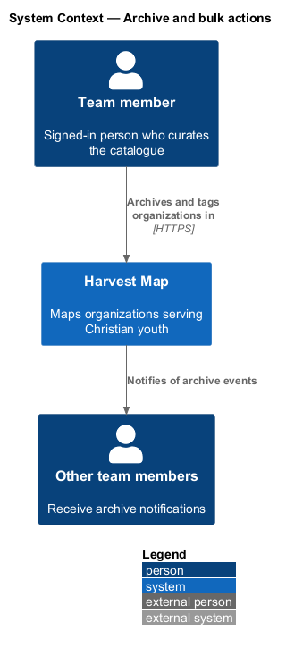
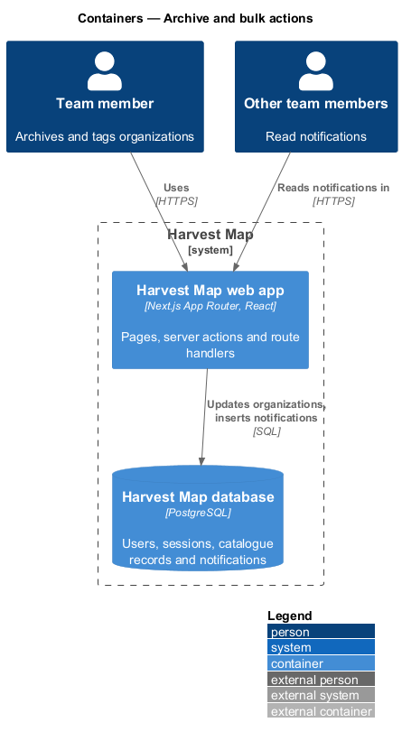
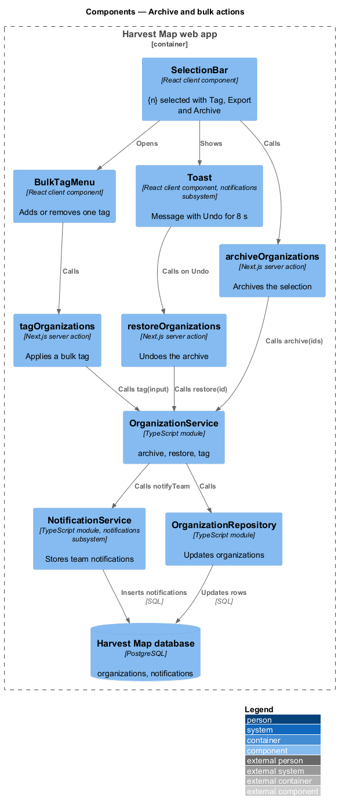
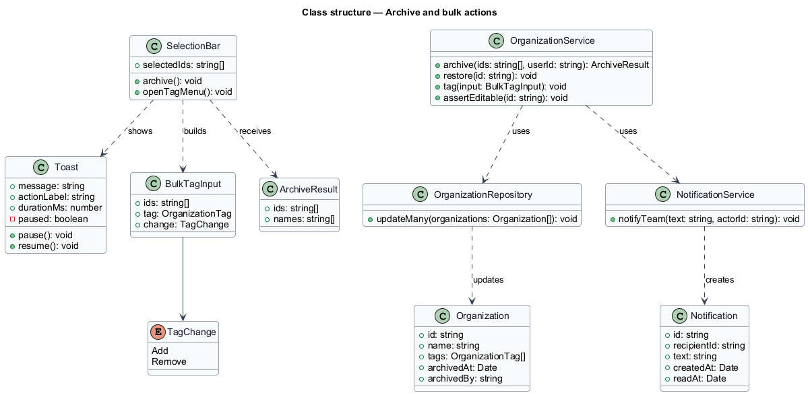
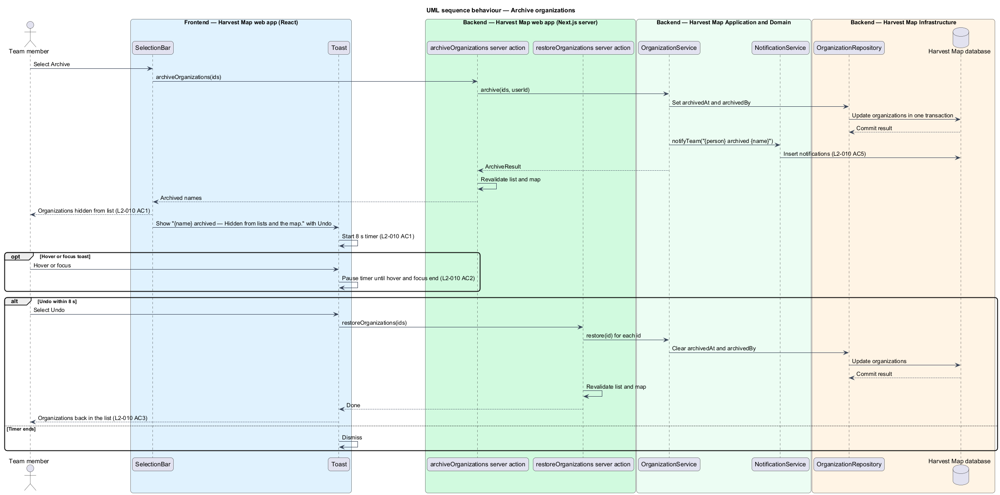
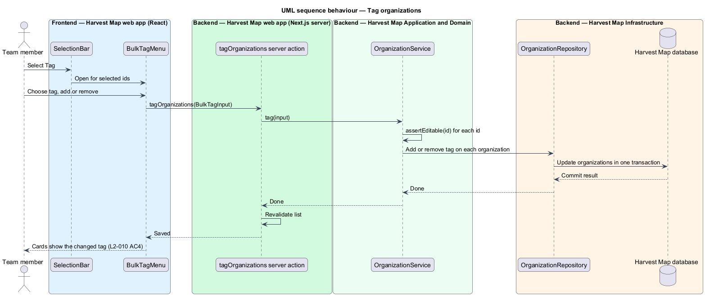

# Archive and bulk actions

## Overview

Harvest Map is a web application that maps organizations serving Christian youth. As the catalogue grows, team members retire organizations that no longer belong and adjust tags across many organizations at once. This feature covers the bulk actions on the organizations list: Archive, with an undo window, and Tag.

**archive** — reversible action that hides an organization from lists and the map and makes it read-only

**undo window** — 8 s period during which the archive toast offers "Undo"

**toast** — transient message that appears over the page and dismisses itself after a set time

**bulk tag** — change that adds or removes one tag on every selected organization

The actions live in the selection bar on `/organizations` in the organizations subsystem. The browse-organizations feature owns the selection itself; the export-records feature owns "Export {n}"; the view-organization feature owns Restore on an archived organization's page. The mocks are `docs/mocks/pages/organizations/selected.html`, `docs/mocks/notifications/toast/with-action.html` and `docs/mocks/pages/organization/read-only.html`.

## Description

The slice runs from the selection bar in the Next.js web app to the PostgreSQL database and the team's notifications.

- **`SelectionBar`** — client component on `/organizations`. It shows "{n} selected" with "Tag", "Export {n}" and "Archive". Archive calls `archiveOrganizations`; Tag opens `BulkTagMenu`.
- **`BulkTagMenu`** — client component. It lets the team member add or remove one tag for all selected organizations and calls `tagOrganizations`. No mock shows its layout; the layout is `<TO SUPPLY>`.
- **`Toast`** — shared client component from the notifications subsystem. For an archive it shows "{name} archived — Hidden from lists and the map." with "Undo" for 8 s. A thin bar shows the remaining time. Hover and focus pause the timer.
- **`archiveOrganizations`** — Next.js route handler. It receives the selected ids, calls `OrganizationService.archive`, revalidates the list and the map, and returns the archived names for the toast.
- **`restoreOrganizations`** — Next.js route handler called by Undo. It calls `OrganizationService.restore` for each id and revalidates the list and the map.
- **`tagOrganizations`** — Next.js route handler. It receives a `BulkTagInput` and calls `OrganizationService.tag`.
- **`OrganizationService`** — server module in the application layer. `archive(ids, userId)` sets `archivedAt` and `archivedBy` on each organization in one transaction, then calls `NotificationService.notifyTeam`. `restore(id)` clears both fields. `tag(input)` calls `assertEditable` and adds or removes the tag on each organization in one transaction.
- **`NotificationService`** — server module of the notifications subsystem. `notifyTeam` stores a notification "{person} archived {name}" for team members.
- **`OrganizationRepository`** — data-access module over the `organizations` table.

The toast copy when more than one organization is archived at once is `<TO SUPPLY>`; the mock shows a single name. Whether the person who archived also receives the notification is `<TO SUPPLY>`. Whether Undo also withdraws the team notification is `<TO SUPPLY>`.

## Requirements

| L2 ID | Refines (L1) | Requirement |
|-------|--------------|-------------|
| `L2-010` | `L1-003` | AC1. Given one or more selected organizations, when the user selects "Archive", then they are hidden from lists and the map and a toast "{name} archived — Hidden from lists and the map." with "Undo" shows for 8 s. |
| `L2-010` | `L1-003` | AC2. Given the toast, when the user hovers or focuses it, then the 8 s timer pauses. |
| `L2-010` | `L1-003` | AC3. Given the user selects "Undo" within the window, when processed, then the organizations are restored. |
| `L2-010` | `L1-003` | AC4. Given selected organizations, when the user selects "Tag", then they can add or remove a tag for all selected and the change is saved. |
| `L2-010` | `L1-003` | AC5. Given an archive event, when it completes, then team members receive a notification "{person} archived {name}". |

## Diagrams

### System context

A signed-in team member archives and tags organizations in Harvest Map over HTTPS. Other team members receive the archive notification inside Harvest Map.

### Containers

The Next.js web app runs the bulk route handlers. They update organizations and store notifications in the PostgreSQL database.

### Components

`SelectionBar` calls `archiveOrganizations` and opens `BulkTagMenu`, which calls `tagOrganizations`. The `Toast` calls `restoreOrganizations` on Undo. All three actions call `OrganizationService`; archive also calls `NotificationService`.

### Class structure

`OrganizationService` changes `Organization` rows through `OrganizationRepository` and creates a `Notification` through `NotificationService`. `BulkTagInput` names the ids, the tag and whether to add or remove it.

### Behaviour — archive organizations

Archive hides the selected organizations, shows the toast for 8 s, and notifies the team (`L2-010` AC1, AC5). Hover and focus pause the timer (`L2-010` AC2). Undo within the window restores them (`L2-010` AC3).

### Behaviour — tag organizations

Tag adds or removes one tag on every selected organization in one transaction (`L2-010` AC4).

