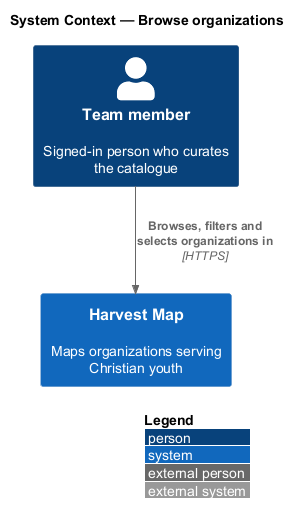
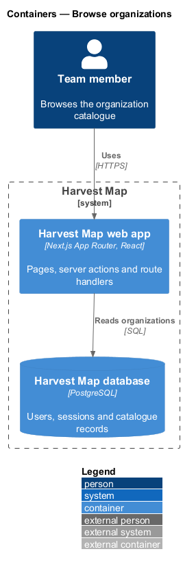
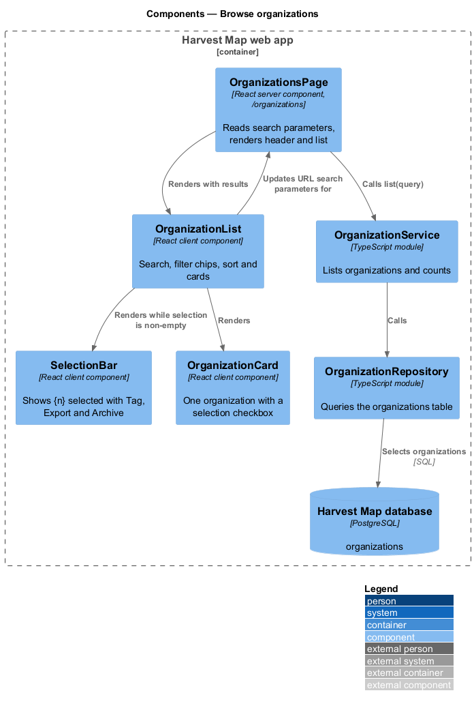
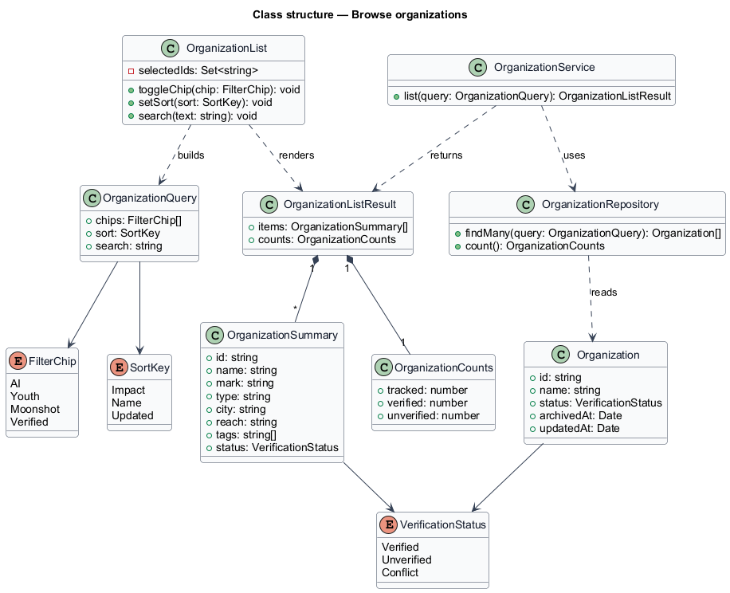
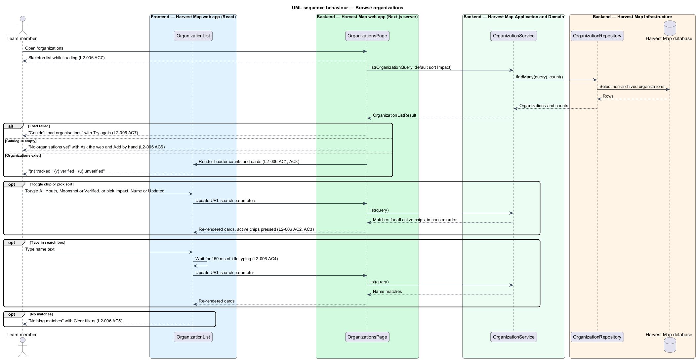
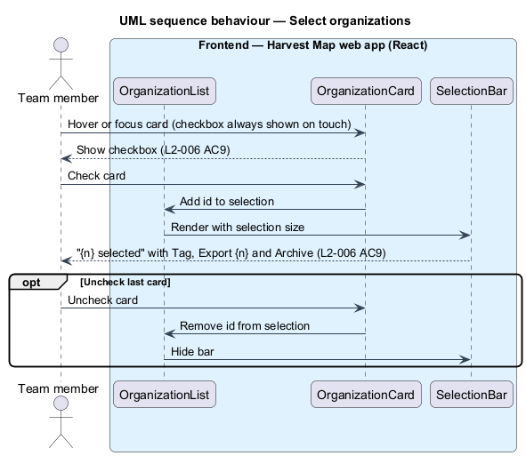

# Browse organizations

## Overview

Harvest Map is a web application that maps organizations serving Christian youth. The catalogue of organizations is the centre of the product: research runs, people, problems and the map all hang off it. This feature covers the organizations list, the page a team member opens to scan, narrow and pick organizations.

**organization** — catalogue record for one group that serves Christian youth, with type, base, reach, tags and a verification status

**verification status** — label that says whether research has confirmed an organization's facts: Verified, Unverified or Conflict

**Conflict** — verification status of a record whose sources disagree

**filter chip** — toggle button above the list that narrows it to organizations with one tag or status

**selection** — set of organization cards the team member has checked for a bulk action

The list lives at `/organizations` in the organizations subsystem. The header counts tracked, verified and unverified organizations. The team member narrows the list with the filter chips AI, Youth, Moonshot and Verified, reorders it with the Sort control (Impact, Name, Updated), and searches by name. Checking cards opens a selection bar whose actions belong to the archive-and-bulk-actions and export-records features. The mocks in `docs/mocks/pages/organizations/` show the default, loading, empty, error, no-results, long, selected and edge states.

## Description

The slice runs from a React client component in the Next.js web app to the PostgreSQL database.

- **`OrganizationsPage`** — React server component at `/organizations`. It reads the active chips, sort and search text from the URL search parameters, calls `OrganizationService.list`, and renders the header "{n} tracked · {v} verified · {u} unverified" with the actions Import, Export and New.
- **`OrganizationsLoading`** and **`OrganizationsError`** — Next.js `loading` and `error` boundaries for the route. The first shows a skeleton list; the second shows "Couldn't load organisations" with "Try again" and "Go back".
- **`OrganizationList`** — client component. It renders the search box, the filter chips (pressed when active), the Sort control and the cards. It writes the chips and sort to the URL at once and writes the search text after 150 ms of idle typing, which makes the server component re-render the list.
- **`OrganizationCard`** — client component for one card: mark, name, "Type · City · Reach", tags, verification status and a checkbox. The checkbox shows on hover, on focus, whenever any card is checked, and always on touch devices. Long, right-to-left and non-Latin names wrap with their direction preserved; a missing mark shows an empty tile.
- **`SelectionBar`** — client component shown while the selection is non-empty. It reads "{n} selected" and offers "Tag", "Export {n}" and "Archive".
- **`OrganizationService`** — server module in the application layer. Its `list(query)` method returns the matching summaries and the header counts. Archived organizations are excluded.
- **`OrganizationRepository`** — data-access module over the `organizations` table. It applies the tag and status filters, the name search and the order.
- **`OrganizationQuery`** — typed input: active chips, sort key and search text.
- **`OrganizationListResult`** — typed output: the `OrganizationSummary` rows and the `OrganizationCounts`.

When no organization exists, the page shows "No organisations yet" with "Ask the web" and "Add by hand". When filters or search match nothing, the page shows "Nothing matches" with "Clear filters" and "Ask the web instead". The long mock shows pages of 25 rows with page links; the page size for production is `<TO SUPPLY>`. The formula behind the Impact order is `<TO SUPPLY>`; the specs rank problems by impact but do not say how an organization's impact derives from its problems. The name search match rule (prefix, substring or other) is `<TO SUPPLY>`.

## Requirements

| L2 ID | Refines (L1) | Requirement |
|-------|--------------|-------------|
| `L2-006` | `L1-003` | AC1. Given organizations exist, when the page loads, then the header shows "{n} tracked · {v} verified · {u} unverified" and each card shows mark, name, "Type · City · Reach", tags and a Verified or Unverified status. |
| `L2-006` | `L1-003` | AC2. Given the filter chips AI, Youth, Moonshot, Verified, when the user toggles chips, then only organizations matching all active chips are listed and the active chips are shown as pressed. |
| `L2-006` | `L1-003` | AC3. Given the Sort control with Impact, Name, Updated, when the user picks an option, then the list reorders accordingly (default Impact). |
| `L2-006` | `L1-003` | AC4. Given the search box, when the user types, then the list filters by name after 150 ms of idle typing. |
| `L2-006` | `L1-003` | AC5. Given a filter or search matches nothing, when the list renders, then the no-results state offers to clear filters. |
| `L2-006` | `L1-003` | AC6. Given there are no organizations, when the page loads, then the empty state offers "New" and "Import". |
| `L2-006` | `L1-003` | AC7. Given loading or load failure, when the page renders, then a skeleton list or an error with "Retry" is shown respectively. |
| `L2-006` | `L1-003` | AC8. Given names that are very long, right-to-left or non-Latin, or a missing mark, when rendered, then text wraps without hiding information, direction is preserved, and an empty mark tile shows rather than a broken image. A record whose sources disagree shows a "Conflict" status. |
| `L2-006` | `L1-003` | AC9. Given the user checks one or more cards (checkboxes appear on hover, focus, always on touch), when selection is non-empty, then a bar shows "{n} selected" with "Tag", "Export {n}" and "Archive". |

## Diagrams

### System context

A signed-in team member browses the organization catalogue in Harvest Map over HTTPS. No external system takes part in browsing.

### Containers

The Next.js web app renders the list and reads organizations from the PostgreSQL database.

### Components

`OrganizationsPage` renders `OrganizationList`, which renders `OrganizationCard` and `SelectionBar`. The page calls `OrganizationService`, which queries `OrganizationRepository`.

### Class structure

`OrganizationList` builds an `OrganizationQuery` and renders an `OrganizationListResult`. `OrganizationService` reads `Organization` rows through `OrganizationRepository` and maps them to `OrganizationSummary` entries.

### Behaviour — browse organizations

The route shows a skeleton while loading and an error with "Try again" on failure (`L2-006` AC7). Chip and sort changes update the URL at once; typing updates it after 150 ms of idle time (`L2-006` AC2, AC3, AC4). An empty catalogue and an empty match each show their own state (`L2-006` AC5, AC6).

### Behaviour — select organizations

Selection lives in the browser. The first checked card shows the `SelectionBar`; unchecking the last card hides it (`L2-006` AC9).

