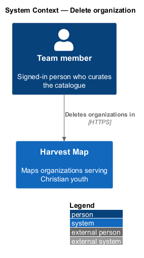
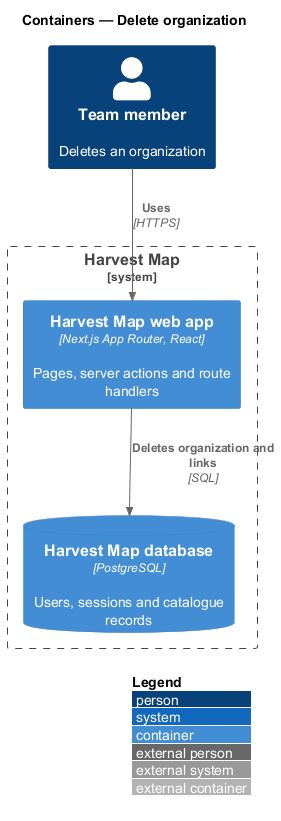
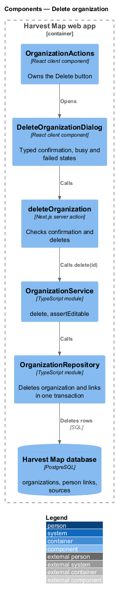
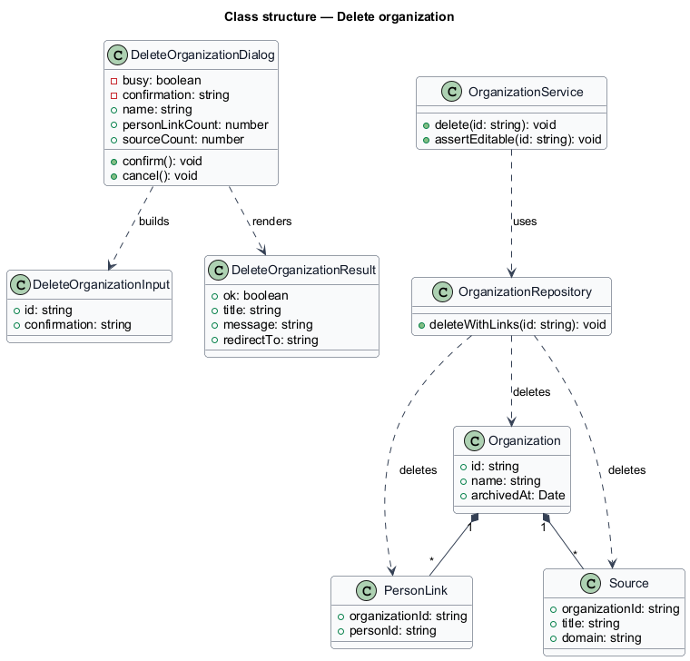
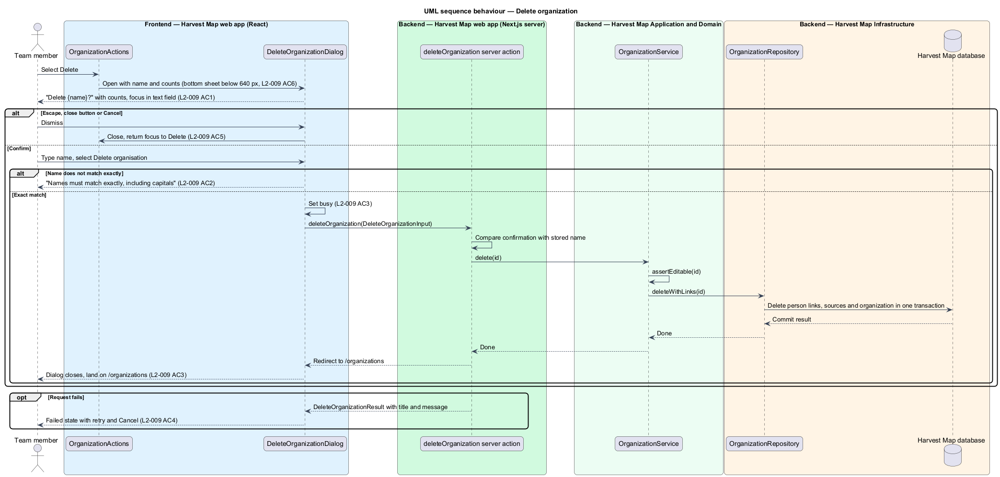

# Delete organization

## Overview

Harvest Map is a web application that maps organizations serving Christian youth. Most removals from the catalogue are reversible archives. Deletion is the exception: it removes an organization and its links for good. This feature covers the confirmation dialog that guards that step.

**typed confirmation** — check that requires the team member to type the organization's exact name before the delete button acts

**person link** — association between the organization and one person in the catalogue

The dialog opens from the Delete action on the organization page (`/organizations/:id`) in the organizations subsystem. It states what the delete removes, asks for the name, and returns the team member to `/organizations` on success. The mocks in `docs/mocks/dialogs/delete-organization/` show the default, invalid, busy and failed states.

## Description

The slice runs from a React dialog in the Next.js web app to the PostgreSQL database.

- **`OrganizationActions`** — client component on the organization page that owns the Delete button. It opens the dialog and receives focus back when the dialog closes without deleting.
- **`DeleteOrganizationDialog`** — client component. It asks "Delete {name}?" and states "Removes the organisation, {n} person link and {m} sources. This can't be undone." It renders the field "Type {name} to confirm" and places initial focus there, never on the danger button "Delete organisation". It compares the typed text with the name, case-sensitive, and shows "Names must match exactly, including capitals" on a mismatch. It shows a busy state while the request runs and a failed state with retry and Cancel. Escape, the close button and Cancel close it. Below 640 px it renders as a bottom sheet.
- **`deleteOrganization`** — Next.js server action. It receives the id and the typed confirmation, checks the confirmation against the stored name again, calls `OrganizationService.delete`, and redirects to `/organizations` on success.
- **`OrganizationService`** — server module in the application layer. `delete(id)` calls `assertEditable`, then removes the organization, its person links and its sources in one transaction.
- **`OrganizationRepository`** — data-access module. `deleteWithLinks(id)` runs the deletes inside one transaction.
- **`DeleteOrganizationInput`** and **`DeleteOrganizationResult`** — typed request and result. The result carries a failure title and message for the failed state.

The counts {n} and {m} come from the `OrganizationDetail` already loaded by the organization page. The failed mock shows one cause, "Couldn't delete FaithTech — It's referenced by run #48, which is still running. Stop the run and try again.", with "Open run #48". The full list of conditions that block a delete is `<TO SUPPLY>`. Whether links to problems are removed with the organization is `<TO SUPPLY>`; `L2-009` names only person links and sources.

## Requirements

| L2 ID | Refines (L1) | Requirement |
|-------|--------------|-------------|
| `L2-009` | `L1-003` | AC1. Given the user selects Delete, when the dialog opens, then it asks "Delete {name}?", states "Removes the organisation, {n} person link and {m} sources. This can't be undone.", and focus starts in the text field, never on the danger button. |
| `L2-009` | `L1-003` | AC2. Given the confirmation text does not exactly match the name (case-sensitive), when the user attempts to delete, then "Names must match exactly, including capitals" is shown and nothing is deleted. |
| `L2-009` | `L1-003` | AC3. Given an exact match, when the user confirms, then the dialog shows busy, the organization and its links are deleted, the dialog closes and the user returns to `/organizations`. |
| `L2-009` | `L1-003` | AC4. Given the request fails, when it returns, then the failed state is shown and the user can retry or cancel. |
| `L2-009` | `L1-003` | AC5. Given Escape, the close button or Cancel, when used, then the dialog closes without deleting and focus returns to the button that opened it. |
| `L2-009` | `L1-003` | AC6. Given viewport width below 640 px, when the dialog opens, then it appears as a bottom sheet. |

## Diagrams

### System context

A signed-in team member deletes an organization in Harvest Map over HTTPS. No external system takes part in this slice.

### Containers

The Next.js web app shows the dialog and runs the delete action against the PostgreSQL database.

### Components

`OrganizationActions` opens `DeleteOrganizationDialog`, which calls the `deleteOrganization` server action. The action calls `OrganizationService`, which deletes through `OrganizationRepository`.

### Class structure

`DeleteOrganizationDialog` builds a `DeleteOrganizationInput` and renders a `DeleteOrganizationResult`. `OrganizationService` removes the `Organization` together with its `PersonLink` and `Source` rows.

### Behaviour — delete an organization

The dialog focuses the text field (`L2-009` AC1) and refuses a mismatched name without a request (`L2-009` AC2). An exact match sets busy, deletes in one transaction and returns to `/organizations` (`L2-009` AC3). A failure shows the failed state (`L2-009` AC4). Escape, close and Cancel return focus to Delete (`L2-009` AC5).

