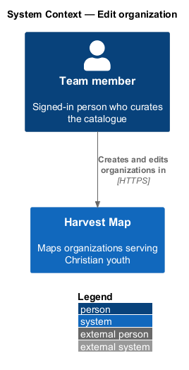
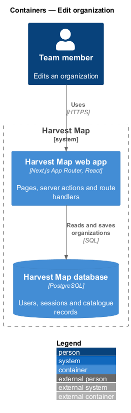
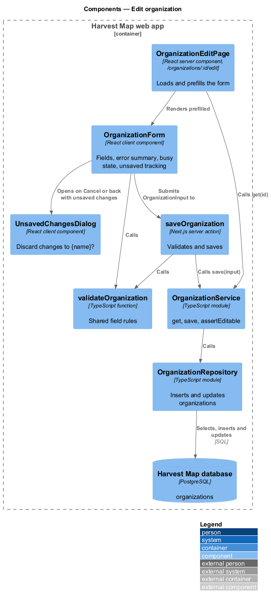
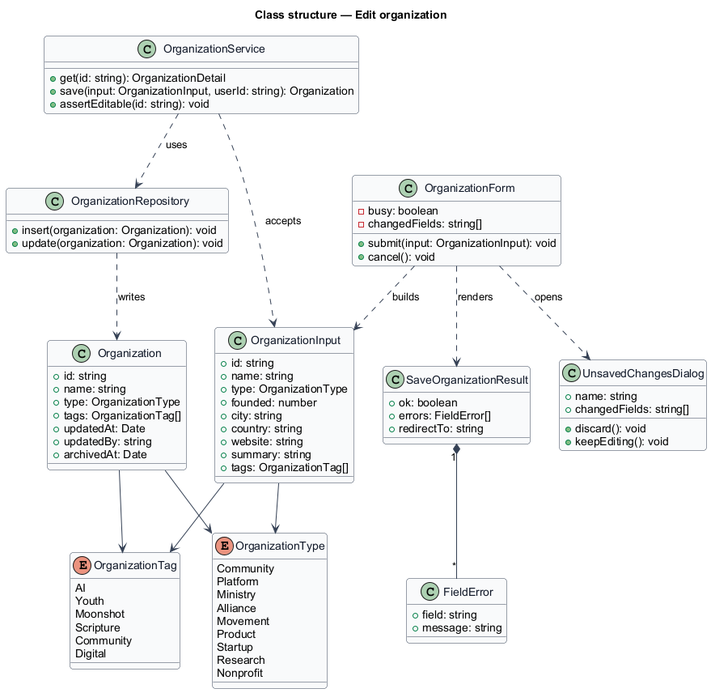
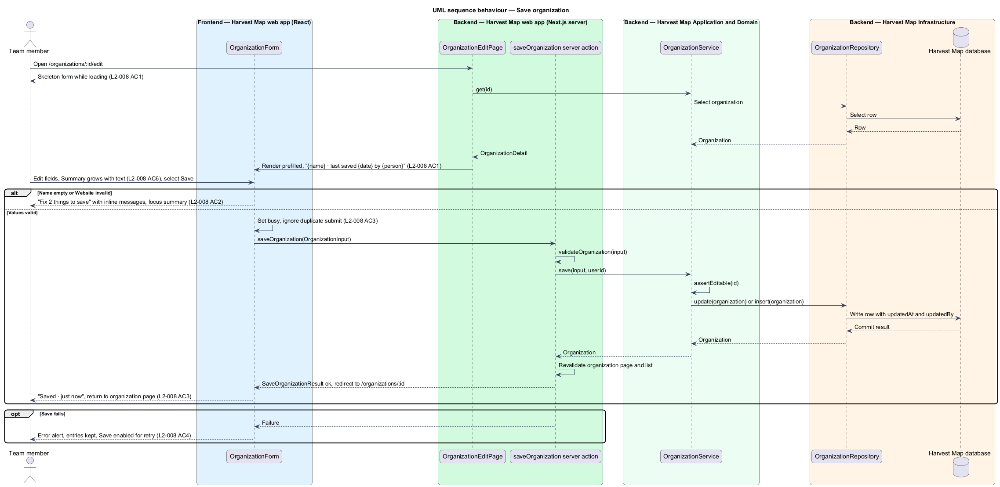
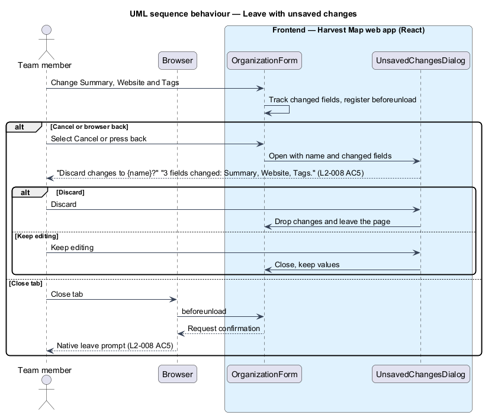

# Edit organization

## Overview

Harvest Map is a web application that maps organizations serving Christian youth. Team members add organizations by hand and correct the facts that research brings in. This feature covers the organization form, which serves both purposes: it edits an existing organization and, with blank fields, creates a new one.

**organization form** — page that holds every editable field of one organization and saves them together

**unsaved changes** — field values in the form that differ from the values last loaded or saved

**error summary** — box at the top of the form that lists each invalid field as a link to that field

The edit form lives at `/organizations/:id/edit` in the organizations subsystem. The new organization form uses the same page with blank fields and the title "New organization"; its route is `<TO SUPPLY>`. The fields are Name (required), Type, Founded (optional, year), City (optional), Country (required), Website (required), Summary and Tags. On save, the team member returns to the organization page. Leaving with unsaved changes asks first. The mocks in `docs/mocks/pages/organization-edit/` show the default, loading, error, invalid, submitting and success states; `docs/mocks/dialogs/unsaved-changes/default.html` shows the discard dialog.

## Description

The slice runs from a React client component in the Next.js web app to the PostgreSQL database.

- **`OrganizationEditPage`** — React server component at `/organizations/:id/edit`. It loads the organization through `OrganizationService.get` and renders `OrganizationForm` prefilled, with the line "{name} · last saved {date} by {person}". For a new organization it renders the form blank under "New organization".
- **`OrganizationEditLoading`** and **`OrganizationEditError`** — Next.js `loading` and `error` boundaries for the route. The first shows a skeleton form; the second shows "Couldn't load the form" with "Try again" and "Go back".
- **`OrganizationForm`** — client component. It renders the fields, runs `validateOrganization` on submit, shows the error summary "Fix {n} things to save" with inline messages, moves focus to the summary, and focuses a field when its summary item is activated. It sets a busy state and ignores a second submit while saving. The Summary field grows with its text. It tracks unsaved changes and registers a `beforeunload` handler while any exist.
- **`UnsavedChangesDialog`** — client component. It asks "Discard changes to {name}?", lists the changed fields (for example "3 fields changed: Summary, Website, Tags."), and offers "Discard" and "Keep editing". Cancel and browser back open it; closing the tab uses the browser's native prompt instead. The way the form intercepts browser back under the App Router is `<TO SUPPLY>`.
- **`validateOrganization`** — shared function used by the form and the route handler. It returns "Enter a name" for an empty Name and "Enter a website like example.org" for a Website that is not a valid domain or URL. The message for an empty Country is `<TO SUPPLY>`; the mocks do not show it.
- **`saveOrganization`** — Next.js route handler. It receives an `OrganizationInput`, validates it again, calls `OrganizationService.save`, revalidates the organization page and the list, and returns a `SaveOrganizationResult`.
- **`OrganizationService`** — server module in the application layer. `save(input, userId)` calls `assertEditable` for an existing organization, then inserts or updates the row and records the saving person and time. A new organization starts Unverified.
- **`OrganizationRepository`** — data-access module over the `organizations` table.
- **`OrganizationInput`**, **`SaveOrganizationResult`** and **`FieldError`** — typed request and result. `FieldError` is the same type used by sign in.

Type takes one of Community, Platform, Ministry, Alliance, Movement, Product, Startup, Research and Nonprofit. Tags take any of AI, Youth, Moonshot, Scripture, Community and Digital. The mocks also show a Research tag that `L2-008` does not list; the correct tag set is `<TO SUPPLY>`. On success the form shows "Saved · just now" and returns to the organization page; whether a toast also appears is `<TO SUPPLY>`. The error alert copy for a failed save is `<TO SUPPLY>`.

## Requirements

| L2 ID | Refines (L1) | Requirement |
|-------|--------------|-------------|
| `L2-008` | `L1-003` | AC1. Given an existing organization, when the edit page loads, then the form is prefilled and shows "{name} · last saved {date} by {person}"; while loading, a skeleton is shown. |
| `L2-008` | `L1-003` | AC2. Given an empty Name and a Website that is not a valid domain or URL, when the user saves, then "Fix 2 things to save" lists "Enter a name" and "Enter a website like example.org", each field shows its message, focus moves to the summary, and each summary item focuses its field. |
| `L2-008` | `L1-003` | AC3. Given valid values, when the user saves, then the button shows busy, a duplicate submit is ignored, the record is saved, the user sees the success state or toast and returns to the organization page. |
| `L2-008` | `L1-003` | AC4. Given the save fails, when the response returns, then an error alert is shown, entries are kept and "Save" can be retried. |
| `L2-008` | `L1-003` | AC5. Given the form has unsaved changes, when the user selects Cancel, browser back, or closes the tab, then the "Discard changes to {name}?" dialog lists the changed fields and offers "Discard" and "Keep editing" (tab close uses the browser's native prompt). |
| `L2-008` | `L1-003` | AC6. Given the Summary field, when the text grows, then the field grows with it. |

## Diagrams

### System context

A signed-in team member creates and edits organizations in Harvest Map over HTTPS. No external system takes part in this slice.

### Containers

The Next.js web app serves the form and runs the save action, which writes to the PostgreSQL database.

### Components

`OrganizationEditPage` renders `OrganizationForm`, which opens `UnsavedChangesDialog` and submits to `saveOrganization`. The form and the action share `validateOrganization`. The action calls `OrganizationService`, which uses `OrganizationRepository`.

### Class structure

`OrganizationForm` builds an `OrganizationInput` and renders a `SaveOrganizationResult` made of `FieldError` entries. `OrganizationService` writes `Organization` through `OrganizationRepository`.

### Behaviour — save an organization

The form rejects an empty Name and an invalid Website before any request (`L2-008` AC2). A valid submit sets the busy state, saves and returns to the organization page (`L2-008` AC3). A failed save keeps the entries and allows a retry (`L2-008` AC4).

### Behaviour — leave with unsaved changes

Cancel and browser back open the discard dialog with the changed fields; tab close raises the browser's native prompt (`L2-008` AC5).

