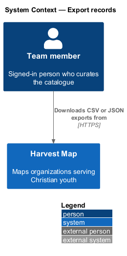
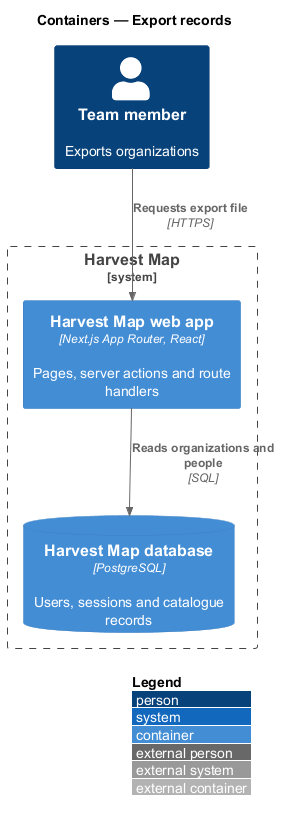
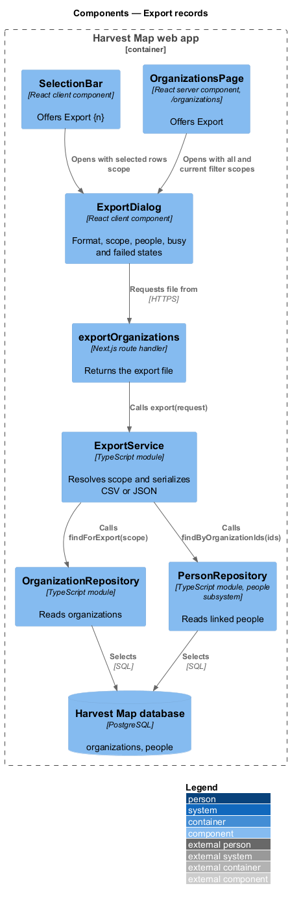
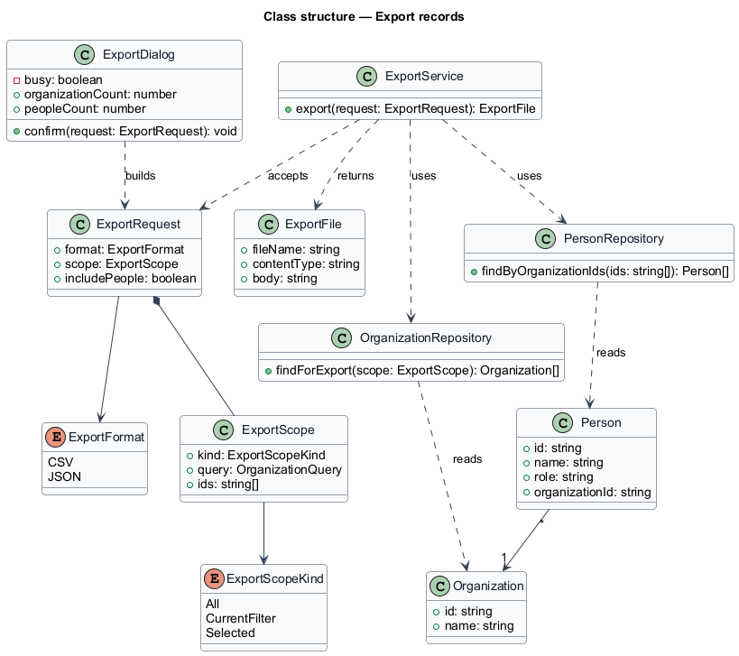
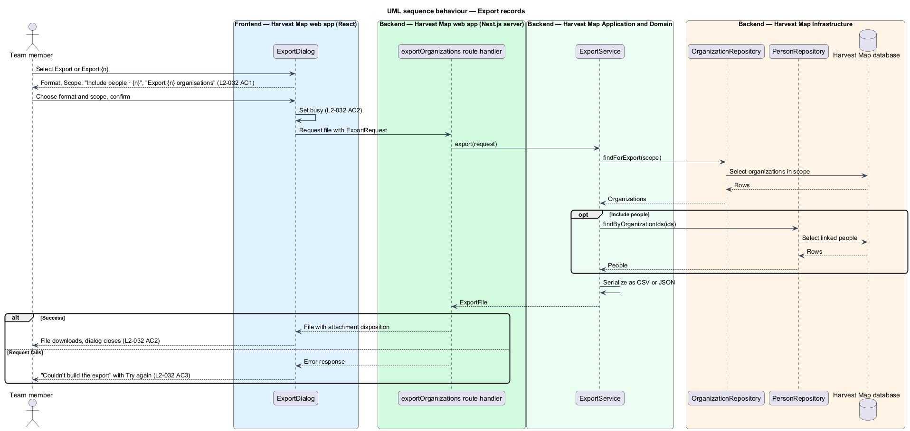

# Export records

## Overview

Harvest Map is a web application that maps organizations serving Christian youth. Team members share parts of the catalogue with people who do not use Harvest Map, or work on it in other tools. This feature covers the export dialog, which downloads organizations, and optionally their people, as a file.

**export** — download of a chosen set of organizations in a chosen file format

**scope** — set of organizations an export covers: all organizations, the current filter, or the selected rows

**format** — file type of the export: CSV or JSON

The dialog opens from "Export" on `/organizations`, or from "Export {n}" in the selection bar, in the organizations subsystem. The scope offered depends on where it opens: the page header offers "All {n} organisations" and "Current filter · {n}"; the selection bar offers the selected rows. The mocks in `docs/mocks/dialogs/export/` show the default, busy and failed states.

## Description

The slice runs from a React dialog in the Next.js web app to the PostgreSQL database and back as a file download.

- **`ExportDialog`** — client component. It offers Format (CSV, JSON), Scope ("All {n} organisations", "Current filter · {n}" or the selected rows), the checkbox "Include people · {n}" and the primary button "Export {n} organisations". On confirm it shows a busy state, requests the file from `exportOrganizations`, hands the response to the browser as a download, and closes. On failure it shows "Couldn't build the export" with "Try again."
- **`exportOrganizations`** — Next.js route handler. It reads an `ExportRequest` from the request, calls `ExportService.export`, and returns the file with a content type of `text/csv` or `application/json` and an attachment disposition. Its path is `<TO SUPPLY>`.
- **`ExportService`** — server module in the application layer. It resolves the scope to a set of organizations, reads them through `OrganizationRepository`, reads their people through `PersonRepository` when requested, and serializes the result in the chosen format.
- **`OrganizationRepository`** — data-access module over the `organizations` table. `findForExport(scope)` returns all organizations, those matching an `OrganizationQuery`, or those with the given ids.
- **`PersonRepository`** — data-access module of the people subsystem. `findByOrganizationIds(ids)` returns the people linked to the exported organizations.
- **`ExportRequest`** — typed request: `ExportFormat`, `ExportScope` and the include-people flag.
- **`ExportScope`** — one of all, the current filter (carrying the `OrganizationQuery` from browse-organizations) or the selected ids.

The CSV columns, the JSON shape, the file name, and whether archived organizations count towards "All {n} organisations" are `<TO SUPPLY>`.

## Requirements

| L2 ID | Refines (L1) | Requirement |
|-------|--------------|-------------|
| `L2-032` | `L1-003` | AC1. Given the dialog, when it opens, then it offers Format (CSV, JSON), Scope ("All {n} organisations", "Current filter · {n}" or the selected rows), and a checkbox "Include people · {n}", and a primary button "Export {n} organisations". |
| `L2-032` | `L1-003` | AC2. Given the user confirms, when processed, then the dialog is busy, a file in the chosen format with the chosen scope downloads, and the dialog closes. |
| `L2-032` | `L1-003` | AC3. Given the request fails, when it returns, then the failed state shows with retry. |

## Diagrams

### System context

A signed-in team member downloads an export file from Harvest Map over HTTPS. No external system takes part in the export.

### Containers

The Next.js web app reads organizations and people from the PostgreSQL database and streams the file back to the browser.

### Components

`ExportDialog` requests the file from the `exportOrganizations` route handler, which calls `ExportService`. The service reads `OrganizationRepository` and, when people are included, `PersonRepository`.

### Class structure

`ExportDialog` builds an `ExportRequest` made of an `ExportFormat`, an `ExportScope` and the include-people flag. `ExportService` returns an `ExportFile` built from `Organization` and `Person` rows.

### Behaviour — export records

The dialog offers format, scope and people (`L2-032` AC1). Confirm sets busy, downloads the file and closes the dialog (`L2-032` AC2). A failed request shows the failed state with retry (`L2-032` AC3).

