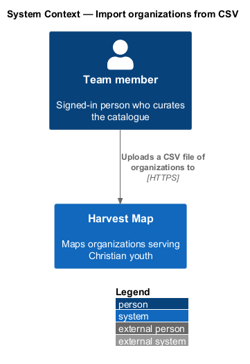
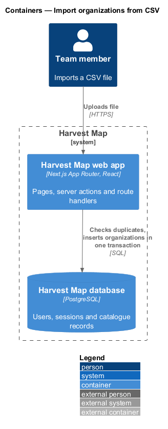
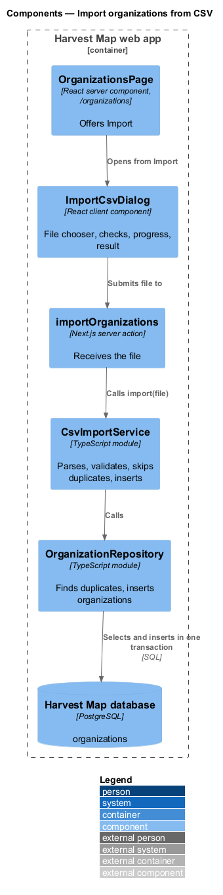
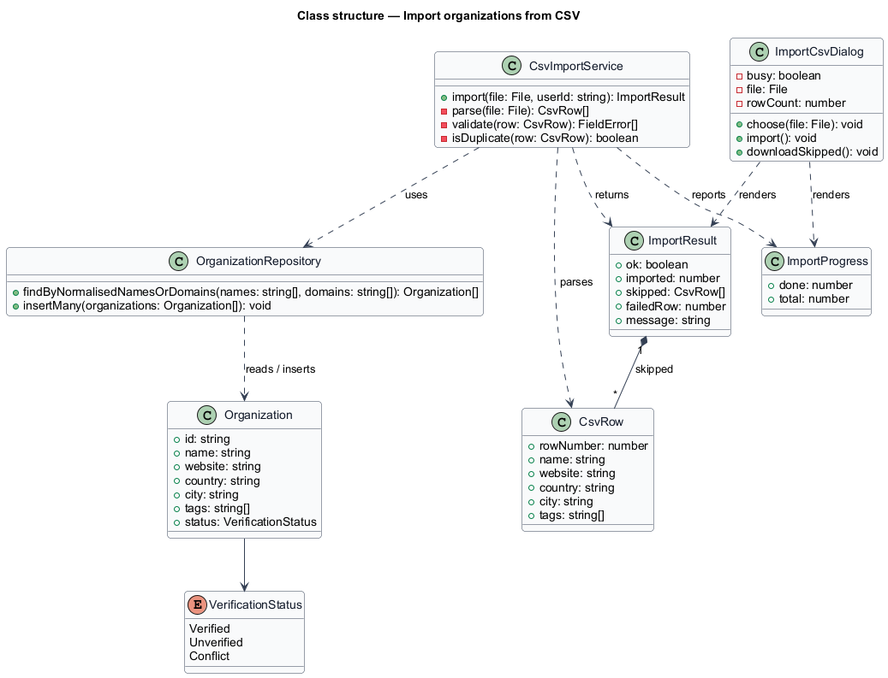
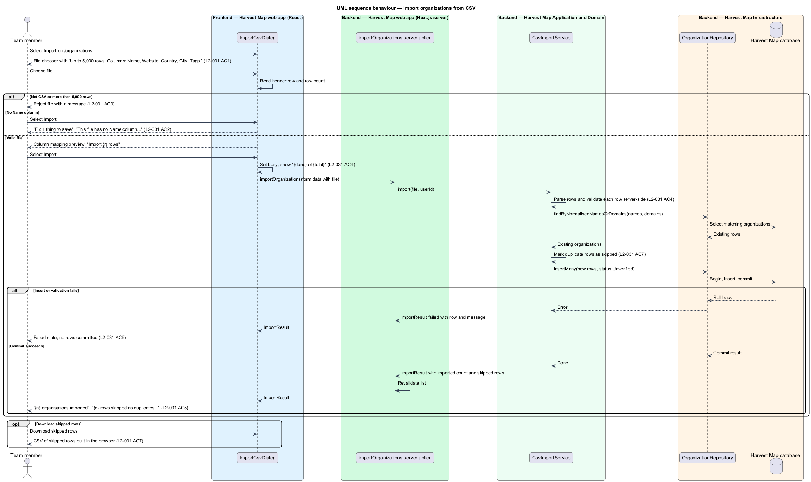

# Import organizations from CSV

## Overview

Harvest Map is a web application that maps organizations serving Christian youth. Team members often hold lists of organizations in spreadsheets. This feature lets them load such a list into the catalogue in one step instead of adding each organization by hand.

**CSV file** — comma-separated text file whose first row names the columns

**import** — operation that validates every row of a CSV file and creates one unverified organization per new row

**duplicate row** — row whose normalised name or website domain matches an organization already in the catalogue

**skipped row** — duplicate row that the import does not create and offers for download instead

The dialog opens from "Import" on `/organizations` in the organizations subsystem. It accepts up to 5,000 rows with the columns Name, Website, Country, City and Tags. Imported organizations start Unverified until research checks them. The import is all or nothing: a failure commits no rows. The mocks in `docs/mocks/dialogs/import-csv/` show the default, invalid, busy, failed and success states.

## Description

The slice runs from a React dialog in the Next.js web app to the PostgreSQL database.

- **`ImportCsvDialog`** — client component. It shows the file chooser with the hint "Up to 5,000 rows. Columns: Name, Website, Country, City, Tags." After a file is chosen it shows "{file} · {r} rows · columns matched automatically" and a column mapping preview (CSV column, Field, Sample), and the primary button reads "Import {r} rows". It reads the header row and the row count in the browser. A file that is not CSV or has more than 5,000 rows is rejected on selection. A file without a Name column shows "Fix 1 thing to save" with "Choose a .csv file with a Name column" and the field message "This file has no Name column. Expected: Name, Website, Country, City, Tags."
- **`importOrganizations`** — Next.js server action. It receives the file as form data, calls `CsvImportService.import` and returns an `ImportResult`.
- **`CsvImportService`** — server module in the application layer. It parses the file, maps columns, validates each row, and finds duplicate rows by normalised name or website domain. It inserts the remaining rows as Unverified organizations in one transaction and rolls back the whole import on any error.
- **`OrganizationRepository`** — data-access module. `findByNormalisedNamesOrDomains` looks up existing organizations; `insertMany` writes the new rows.
- **`ImportResult`** — typed result: the imported count, the skipped rows, and for a failure the row number and message.
- **`ImportProgress`** — rows processed and total, shown in the busy state as "Importing {file} · {done} of {total}".

On success the dialog shows "{n} organisations imported" and "{d} rows skipped as duplicates. New rows are unverified until research checks them." with "Download skipped rows" and "View organisations". The dialog builds the skipped-rows file in the browser from `ImportResult.skipped`. On failure the dialog shows the row and cause, for example "Import stopped at row 41 — “Website” isn't a URL: “faithtech”. Fix the file and import again; the first 40 rows were not saved.", with "Download error report".

The following details are `<TO SUPPLY>`: the channel that carries `ImportProgress` from the server to the dialog; how the import continues after the dialog closes, as the busy mock states "You can close this; the import continues and you'll get a notification."; the rejection message for a non-CSV or oversized file; the name and domain normalisation rules; whether duplicates within the same file count as duplicates; the CSV parser; and the content of the error report.

## Requirements

| L2 ID | Refines (L1) | Requirement |
|-------|--------------|-------------|
| `L2-031` | `L1-003` | AC1. Given the dialog, when it opens, then it shows a CSV file chooser with the hint "Up to 5,000 rows. Columns: Name, Website, Country, City, Tags." |
| `L2-031` | `L1-003` | AC2. Given a file without a Name column, when the user selects Import, then "Fix 1 thing to save" lists "Choose a .csv file with a Name column" and the field shows "This file has no Name column. Expected: Name, Website, Country, City, Tags." |
| `L2-031` | `L1-003` | AC3. Given a file that is not CSV, or larger than 5,000 rows, when selected, then it is rejected with a message. |
| `L2-031` | `L1-003` | AC4. Given a valid file, when the user selects Import, then the dialog is busy and shows progress, rows are validated server-side, and new records are created unverified. |
| `L2-031` | `L1-003` | AC5. Given the import succeeds, when it ends, then the dialog shows "{n} organisations imported" and "{d} rows skipped as duplicates. New rows are unverified until research checks them." with "Download skipped rows" and "View organisations". |
| `L2-031` | `L1-003` | AC6. Given the import fails, when it ends, then the failed state is shown, and no partial data is committed. |
| `L2-031` | `L1-003` | AC7. Given a row is a duplicate by normalised name or website domain, when imported, then it is skipped and included in the skipped download. |

## Diagrams

### System context

A signed-in team member uploads a CSV file to Harvest Map over HTTPS. No external system takes part in the import.

### Containers

The Next.js web app receives the file and writes the new organizations to the PostgreSQL database.

### Components

`ImportCsvDialog` submits the file to the `importOrganizations` server action, which calls `CsvImportService`. The service checks duplicates and inserts rows through `OrganizationRepository`.

### Class structure

`CsvImportService` turns each `CsvRow` into an `Organization` with status Unverified, or into a skipped row. It returns an `ImportResult` and reports `ImportProgress`.

### Behaviour — import organizations

The dialog rejects a wrong file type, an oversized file and a missing Name column before any upload (`L2-031` AC2, AC3). A valid file is validated on the server, duplicates are skipped, and new rows are inserted Unverified in one transaction (`L2-031` AC4, AC7). Success shows the counts and downloads (`L2-031` AC5); failure rolls back every row (`L2-031` AC6).

