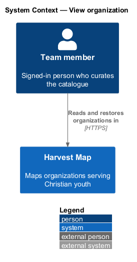
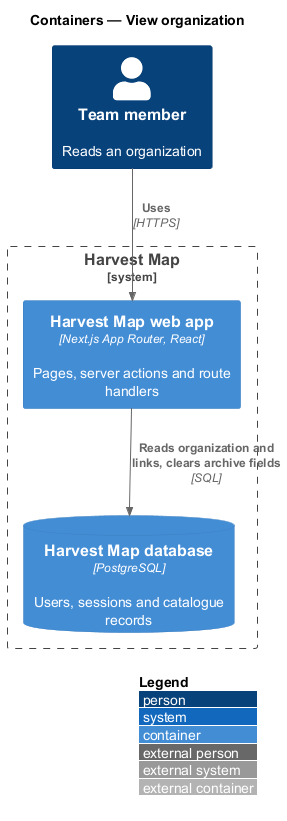
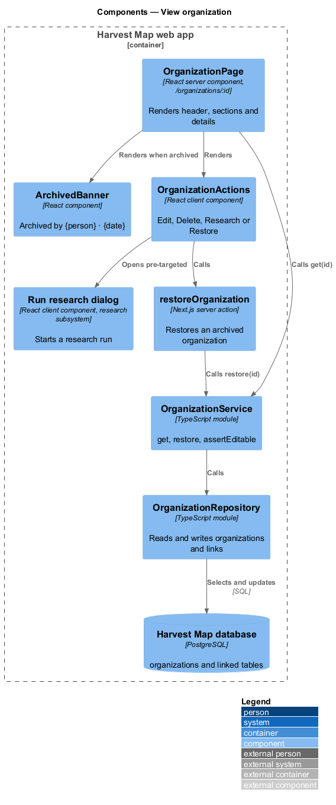
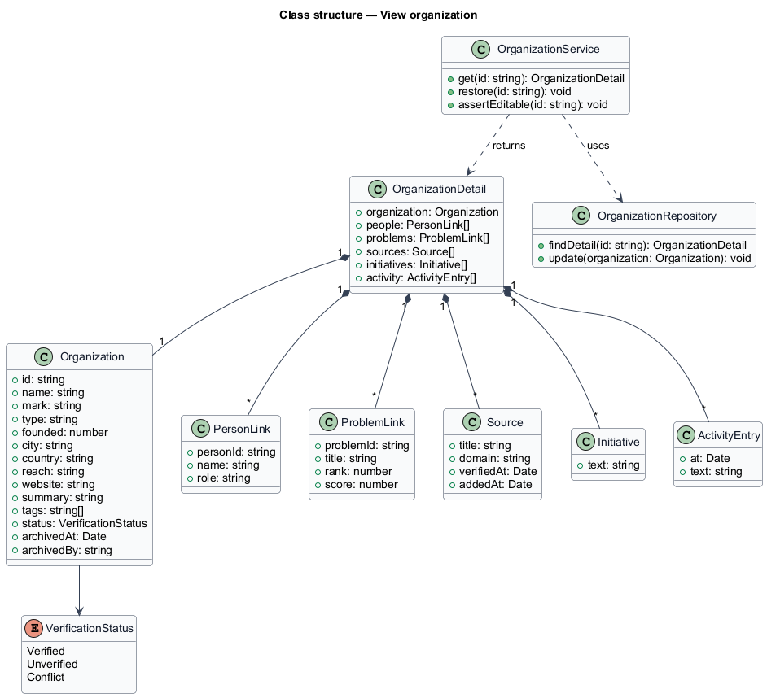
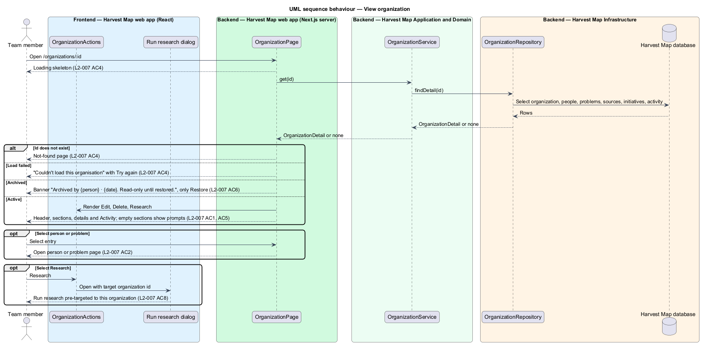
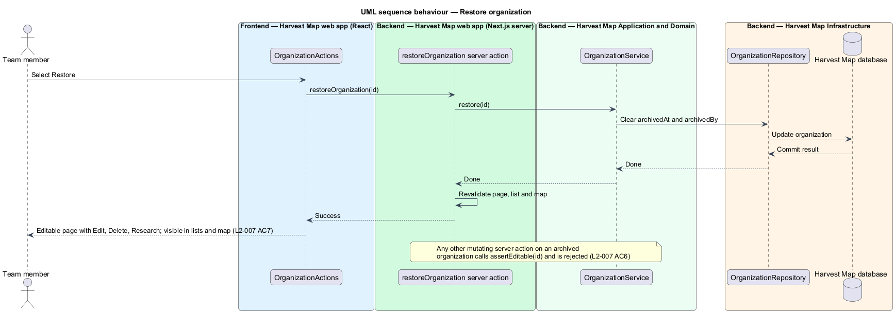

# View organization

## Overview

Harvest Map is a web application that maps organizations serving Christian youth. Each organization in the catalogue has a detail page that gathers everything known about it: what it is doing, its key people, the problems it targets, the sources behind its facts and its recent activity. This feature covers that page and the restore of an archived organization.

**initiative** — one line under "What they're doing" that records a piece of work the organization runs

**source** — web page that backs a fact about the organization, shown with its title, domain and the date it was verified or added

**activity** — dated entry that records a change to the organization, such as a research run or a verification

**archived organization** — organization hidden from lists and the map and held read-only until a team member restores it

The page lives at `/organizations/:id` in the organizations subsystem. It offers Edit, Delete and Research. Edit and Delete hand over to the edit-organization and delete-organization features; Research opens the Run research dialog of the research subsystem, pre-targeted to this organization. When the organization is archived, the page turns read-only and offers only Restore. The mocks in `docs/mocks/pages/organization/` show the default, loading, empty, error, read-only and edge states.

## Description

The slice runs from a React page in the Next.js web app to the PostgreSQL database.

- **`OrganizationPage`** — React server component at `/organizations/:id`. It calls `OrganizationService.get` and renders the name, mark, verification status, summary, tags, the sections "What they're doing", People (with "Add"), Problems (with "Link"), Sources, the details list (Type, Founded, Base, Reach, Website, Status) and Activity. Each person and problem links to its own page. When the id does not exist, it calls the Next.js `notFound` function, which shows the not-found page.
- **`OrganizationLoading`** and **`OrganizationError`** — Next.js `loading` and `error` boundaries for the route. The first shows a skeleton; the second shows "Couldn't load this organisation" with "Try again" and "Go back".
- **`OrganizationActions`** — client component. For an active organization it renders Edit, Delete and Research. For an archived organization it renders only Restore.
- **`ArchivedBanner`** — component shown above the header of an archived organization. It reads "Archived by {person} · {date}. Read-only until restored."
- **`restoreOrganization`** — Next.js route handler. It receives the organization id, calls `OrganizationService.restore` and revalidates the page, the list and the map.
- **`OrganizationService`** — server module in the application layer. `get(id)` returns an `OrganizationDetail` or nothing. `restore(id)` clears the archive fields. `assertEditable(id)` rejects any change to an archived organization; every mutating route handler of the organizations subsystem calls it first.
- **`OrganizationRepository`** — data-access module over the `organizations` table and its linked people, problems, sources, initiatives and activity.
- **`OrganizationDetail`** — typed view model: the `Organization` fields plus lists of `PersonLink`, `ProblemLink`, `Source`, `Initiative` and `ActivityEntry`.

Each empty section shows a prompt, as in the empty mock: "Nothing recorded yet" with "Add by hand", "No people yet" with "Add person", and "Not linked to a problem" with "Link problem". The prompt for an organization with no sources is `<TO SUPPLY>`; the empty mock omits the Sources section. The rule for who may restore an archived organization is `<TO SUPPLY>`.

## Requirements

| L2 ID | Refines (L1) | Requirement |
|-------|--------------|-------------|
| `L2-007` | `L1-003` | AC1. Given an organization, when the page loads, then it shows name, mark, status, summary, tags, actions Edit, Delete, Research, and sections "What they're doing", People (with "Add"), Problems (with "Link"), Sources (title, domain, "Verified {date}" or "Added {date}"), details (Type, Founded, Base, Reach, Website, Status) and Activity. |
| `L2-007` | `L1-003` | AC2. Given a person or problem in the sections, when the user selects it, then the person or problem page opens. |
| `L2-007` | `L1-003` | AC4. Given the page loads, then a loading skeleton is shown; given the id does not exist the not-found page is shown; given a load failure an error with "Retry" is shown. |
| `L2-007` | `L1-003` | AC5. Given an organization with no people, problems, sources or initiatives, when rendered, then each empty section shows a prompt to add or research. |
| `L2-007` | `L1-003` | AC6. Given an archived organization, when the page loads, then a banner "Archived by {person} · {date}. Read-only until restored." is shown, only "Restore" is offered, and all edit, add, link and delete actions are absent and rejected by the server. |
| `L2-007` | `L1-003` | AC7. Given the user selects "Restore", when it succeeds, then the organization becomes editable and visible in lists and on the map again. |
| `L2-007` | `L1-003` | AC8. Given the user selects Research, when the dialog opens, then Run research is pre-targeted to this organization. |

## Diagrams

### System context

A signed-in team member reads and restores organizations in Harvest Map over HTTPS. No external system takes part in this slice.

### Containers

The Next.js web app renders the page and runs the restore action. Both read and write the PostgreSQL database.

### Components

`OrganizationPage` renders `ArchivedBanner` and `OrganizationActions`. `OrganizationActions` calls the `restoreOrganization` route handler or opens the Run research dialog. The page and the action call `OrganizationService`, which uses `OrganizationRepository`.

### Class structure

`OrganizationService` returns an `OrganizationDetail` that composes the `Organization` with its people, problems, sources, initiatives and activity. `Organization` records who archived it and when.

### Behaviour — view an organization

The route shows a skeleton while loading, the not-found page for an unknown id, and an error with "Try again" on failure (`L2-007` AC4). An archived organization shows the banner and only Restore (`L2-007` AC6). Research opens the dialog pre-targeted (`L2-007` AC8).

### Behaviour — restore an organization

Restore clears the archive fields and revalidates the page, list and map, so the organization is editable and visible again (`L2-007` AC7). Any other change to an archived organization fails `assertEditable` on the server (`L2-007` AC6).

