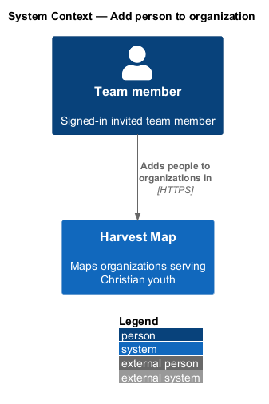
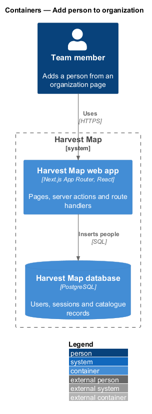
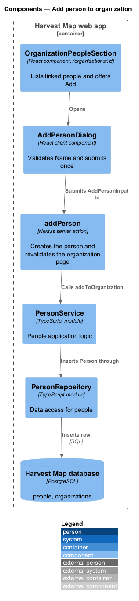
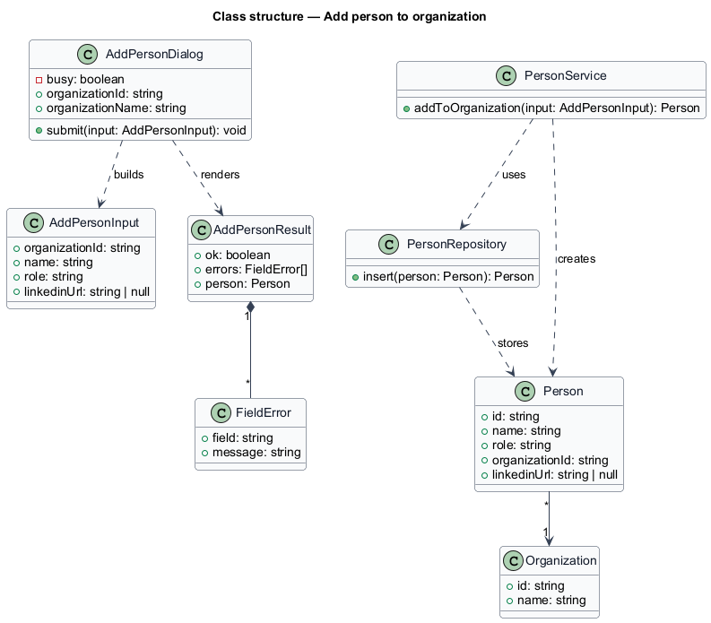
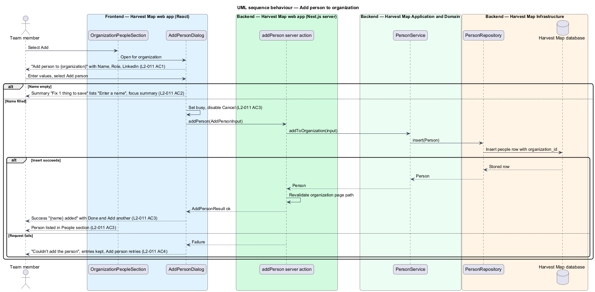

# Add person to organization

## Overview

Harvest Map is a web application that maps organizations serving Christian youth. Each organization record lists its key people. This feature covers the dialog that adds a person to one organization from that organization's page.

**organization page** — page at `/organizations/:id` that shows one organization with its People and Problems sections

**People section** — part of the organization page that lists the people linked to that organization and offers the "Add" action

**linked person** — person whose record names the organization as its organization

The dialog belongs to the people subsystem. It opens from the "Add" action in the People section, accepts a name, a role and an optional LinkedIn link, creates the person and links the person to the organization. The new person then appears in the People section. The mocks in `docs/mocks/dialogs/add-person/` show the default, invalid, busy, failed and success states.

## Description

The slice runs from a React dialog in the Next.js web app to the PostgreSQL database.

- **`OrganizationPeopleSection`** — React component on the organization page. It lists linked people and renders the "Add" action that opens `AddPersonDialog`. The rest of the organization page belongs to the organizations subsystem.
- **`AddPersonDialog`** — client component. It is titled "Add person to {organization}" and holds the fields Name (required), Role and LinkedIn (optional, placeholder `linkedin.com/in/`, hint "Leave blank to let research find it."). It offers "Cancel" and "Add person".
  - Invalid: an empty Name shows the summary "Fix 1 thing to save" listing "Enter a name", the inline message "Enter a name" under Name, and moves focus to the summary. No request is sent.
  - Busy: "Add person" shows a busy state and "Cancel" is disabled.
  - Failed: the alert "Couldn't add the person" with "Your input is kept. Try again." appears above the fields; the entries stay and "Add person" retries.
  - Success: the dialog shows "{name} added", "{role} · {organization}", a note that research will look for the LinkedIn profile, and the actions "Done" and "Add another".
- **`addPerson`** — Next.js server action. It receives an `AddPersonInput`, rejects an empty name with a `FieldError`, calls `PersonService.addToOrganization`, revalidates the organization page path so the People section shows the new person, and returns an `AddPersonResult`.
- **`PersonService`** — server module holding the people application logic. `addToOrganization` builds a `Person` with the given `organizationId` and inserts it through `PersonRepository`.
- **`PersonRepository`** — data-access module over the `people` table. `insert` writes one row and returns the stored `Person`.
- **`Person`** — row in the `people` table: `id`, `name`, `role`, `organizationId`, optional `linkedinUrl`. The `organizationId` column references the `organizations` table; that reference is the link.
- **`AddPersonInput`**, **`AddPersonResult`** and **`FieldError`** — typed input and result exchanged between the dialog and the server action.

L2-011 AC3 allows the success state or a toast. The mocks show the success state, so the dialog uses it. Validation of the LinkedIn field format in this dialog is `<TO SUPPLY>`; the add-person mocks show no LinkedIn error.

## Requirements

| L2 ID | Refines (L1) | Requirement |
|-------|--------------|-------------|
| `L2-011` | `L1-004` | AC1. Given the dialog, when it opens, then it is titled "Add person to {organization}" with Name (required), Role, and LinkedIn (optional, hint "Leave blank to let research find it."). |
| `L2-011` | `L1-004` | AC2. Given an empty Name, when the user submits, then "Fix 1 thing to save" lists "Enter a name" and focus moves to the summary. |
| `L2-011` | `L1-004` | AC3. Given valid input, when the user submits, then the dialog is busy, the person is created and linked, and the success state or a toast confirms, and the person appears in the People section. |
| `L2-011` | `L1-004` | AC4. Given the request fails, when it returns, then the failed state is shown with retry and entries are kept. |

## Diagrams

### System context

A team member adds people to organizations in Harvest Map over HTTPS. No external system takes part.

### Containers

The Next.js web app serves the dialog and runs the server action. The action inserts the person in the PostgreSQL database.

### Components

`OrganizationPeopleSection` opens `AddPersonDialog`, which submits to the `addPerson` server action. The action calls `PersonService`, which inserts through `PersonRepository`.

### Class structure

`AddPersonDialog` builds an `AddPersonInput` and renders an `AddPersonResult` made of `FieldError` entries. `PersonService` creates a `Person` through `PersonRepository`; each `Person` belongs to one `Organization`.

### Behaviour — add a person

The dialog rejects an empty Name before any request (`L2-011` AC2). A valid submit sets the busy state, inserts the linked person and shows the success state (`L2-011` AC3). A failed request shows the failed state and keeps the entries (`L2-011` AC4).

