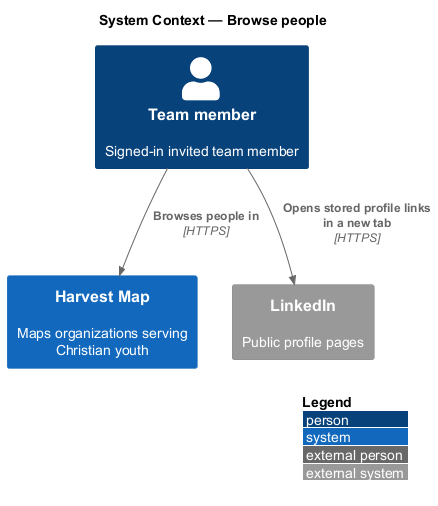
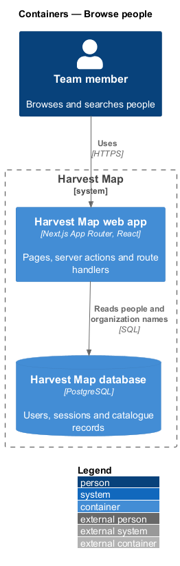
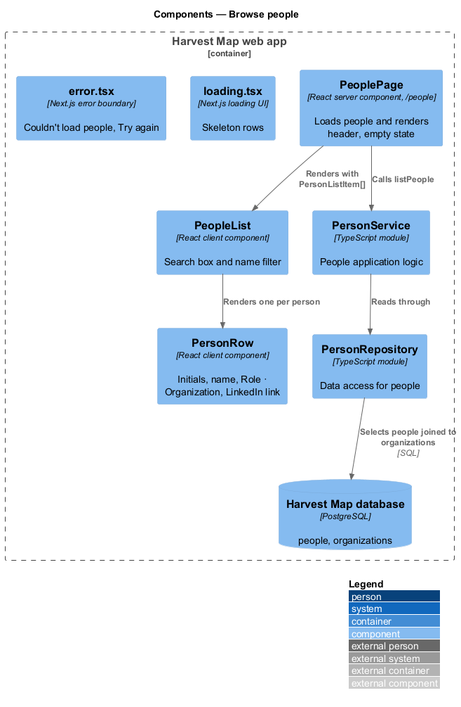
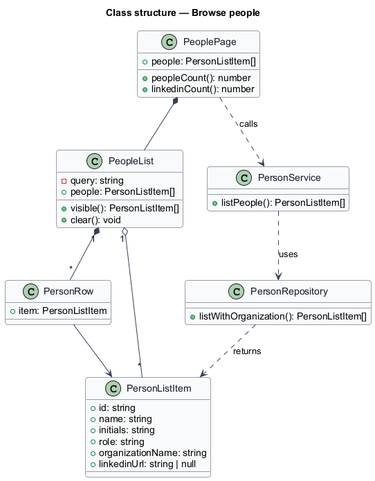
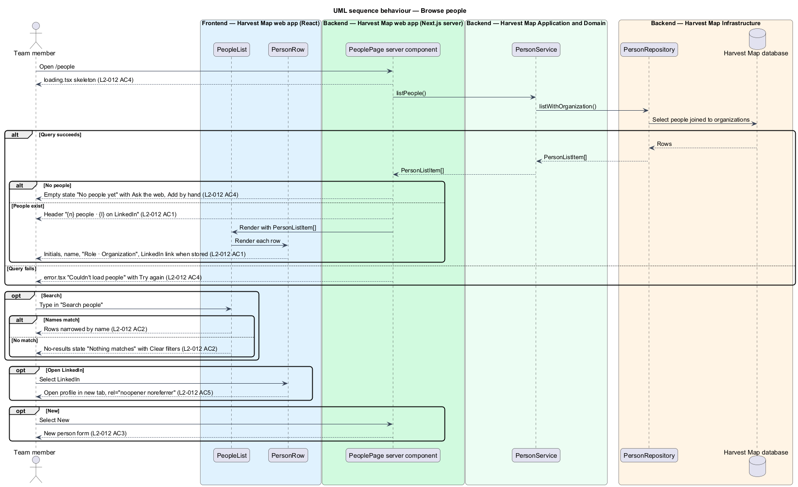

# Browse people

## Overview

Harvest Map is a web application that maps organizations serving Christian youth. Besides organizations, it records the key people who lead or work in them. This feature covers the People list page, the place where a team member sees every recorded person at once.

**person** — record of one key person, holding a name, a role, an organization and an optional LinkedIn link

**stored LinkedIn link** — LinkedIn profile URL saved on a person record; a person without one shows no LinkedIn link

The People list lives at `/people` in the people subsystem. It shows a count header, a search box that narrows the list by name, a "New" action that opens the new person form, and one row per person. The mocks in `docs/mocks/pages/people/` show the default, loading, empty, error, no-results and long states.

The default and no-results mocks also show a "to verify" count, the filter chips "Verified", "Unverified" and "No LinkedIn", and per-row verification badges. LinkedIn verification is out of scope, so this design omits those elements.

## Description

The slice runs from a React page in the Next.js web app to the PostgreSQL database.

- **`PeoplePage`** — React server component at `/people`, rendered on the Next.js server. It calls `PersonService.listPeople`, computes the header "{n} people · {l} on LinkedIn", where `n` counts all people and `l` counts people with a stored LinkedIn link, and renders `PeopleList`. When no person exists it renders the empty state: "No people yet", "People arrive with organisations. Add one or run research.", with the actions "Ask the web" and "Add by hand".
- **`PeopleList`** — client component. It renders the search box (label "Search people", placeholder "Search") and one `PersonRow` per person. Typing narrows the rows to people whose name matches the query. When no row matches, it shows the no-results state "Nothing matches" with a "Clear filters" action. The name-matching rule is `<TO SUPPLY>`.
- **`PersonRow`** — client component. It shows the person's initials, the name linking to `/people/:id`, the line "Role · Organization", and a "LinkedIn" link when a stored LinkedIn link exists. The link opens in a new tab with `target="_blank"` and `rel="noopener noreferrer"`. The rule that derives initials from the name is `<TO SUPPLY>`.
- **`loading.tsx`** — Next.js loading UI for `/people`. It shows the skeleton rows and a disabled search box.
- **`error.tsx`** — Next.js error boundary for `/people`. It shows "Couldn't load people" with "Try again" and "Go back". L2-012 AC4 names the action "Retry"; the mock labels it "Try again". The support reference shown in the mock ("HM-4F2A") has a source that is `<TO SUPPLY>`.
- **"New" action** — link to the new person form owned by the edit-person feature (`L2-014`). The route of that form is `<TO SUPPLY>`.
- **`PersonService`** — server module holding the people application logic. `listPeople` returns a `PersonListItem` per person.
- **`PersonRepository`** — data-access module over the `people` table. `listWithOrganization` selects every person joined to the organization name. The sort order is `<TO SUPPLY>`.
- **`PersonListItem`** — read model for one row: `id`, `name`, `initials`, `role`, `organizationName`, optional `linkedinUrl`.

The "Ask the web" action opens the run-research dialog owned by the research subsystem.

## Requirements

| L2 ID | Refines (L1) | Requirement |
|-------|--------------|-------------|
| `L2-012` | `L1-004` | AC1. Given people exist, when the page loads, then the header shows "{n} people · {l} on LinkedIn" and each row shows initials, name, "Role · Organization" and a LinkedIn link when one is stored. |
| `L2-012` | `L1-004` | AC2. Given the search box, when used, then the list narrows by name; no matches shows the no-results state. |
| `L2-012` | `L1-004` | AC3. Given the "New" action, when selected, then the new person form opens. |
| `L2-012` | `L1-004` | AC4. Given loading, empty or error conditions, when the page renders, then a skeleton, an empty prompt, or an error with "Retry" is shown. |
| `L2-012` | `L1-004` | AC5. Given a stored LinkedIn link, when selected, then it opens in a new tab with `rel="noopener noreferrer"`. |

## Diagrams

### System context

A team member browses people in Harvest Map over HTTPS. Selecting a stored LinkedIn link opens LinkedIn in a new browser tab; Harvest Map itself makes no call to LinkedIn.

### Containers

The Next.js web app renders the page on the server and reads people from the PostgreSQL database.

### Components

`PeoplePage` calls `PersonService`, which reads through `PersonRepository`. `PeoplePage` renders `PeopleList`, which renders a `PersonRow` per person and filters by name in the browser.

### Class structure

`PeoplePage` holds a list of `PersonListItem` values from `PersonService`. `PeopleList` filters that list and renders one `PersonRow` per item.

### Behaviour — browse and search people

The page loads every person and shows the count header and rows (`L2-012` AC1). The skeleton, the empty prompt and the error alert cover the other load outcomes (`L2-012` AC4). Typing in the search box narrows the rows by name or shows the no-results state (`L2-012` AC2). A LinkedIn link opens in a new tab (`L2-012` AC5).

