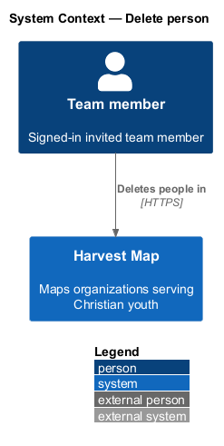
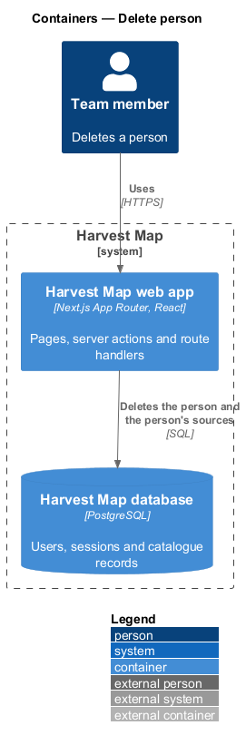
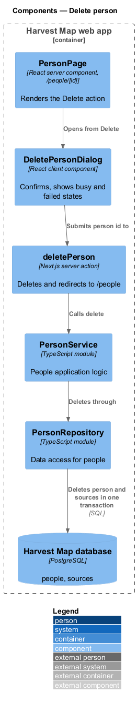
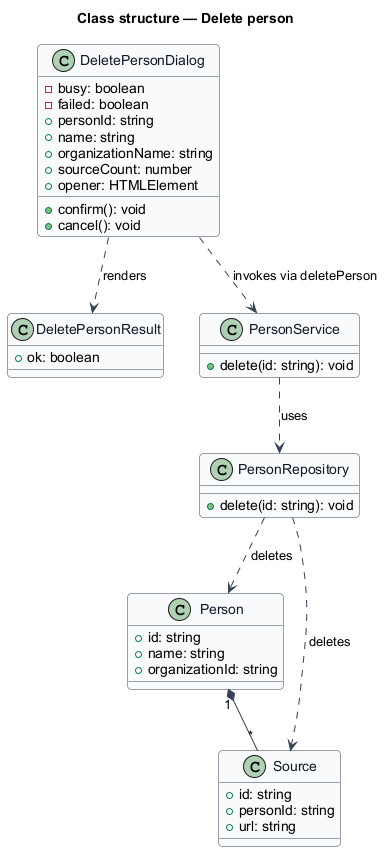
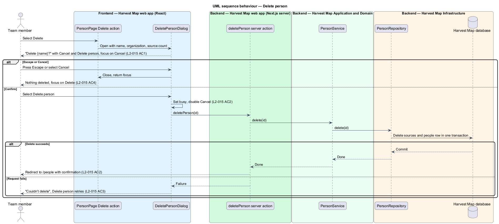

# Delete person

## Overview

Harvest Map is a web application that maps organizations serving Christian youth. It records the key people of those organizations. This feature covers the confirmation dialog that permanently removes one person.

**person** — record of one key person, holding a name, a role, an organization, an optional LinkedIn link and an optional bio

**source** — web page cited as evidence for a fact about a record

**opener** — control that opened the dialog, here the "Delete" action on the person detail page

The dialog opens from "Delete" on the person detail page (`/people/:id`). It names the person, states what the deletion removes and what stays, and asks for confirmation. Deleting removes the person and the person's sources; the person's organization stays. The mocks in `docs/mocks/dialogs/delete-person/` show the default, busy and failed states.

## Description

The slice runs from a React dialog in the Next.js web app to the PostgreSQL database.

- **`DeletePersonDialog`** — client component opened by the "Delete" action on `PersonPage`. It is titled "Delete {name}?" and reads "Removes the person and {n} sources. {organization} stays." It offers "Cancel" and the danger action "Delete person". Focus starts on "Cancel".
  - Busy: "Delete person" shows a busy state and "Cancel" is disabled.
  - Failed: the alert "Couldn't delete" with "The server didn't respond. Nothing was changed." appears; focus moves to "Cancel" and "Delete person" retries.
  - Escape, "Cancel" or the close button closes the dialog without a request and returns focus to the opener.
- **`deletePerson`** — Next.js server action. It receives the person id, calls `PersonService.delete`, and on success redirects to `/people` with a confirmation. The confirmation text and the way the redirect carries it to the People list are `<TO SUPPLY>`.
- **`PersonService`** — server module holding the people application logic. `delete` removes the person through `PersonRepository`.
- **`PersonRepository`** — data-access module. `delete` removes the `people` row and the person's sources in one transaction. The sources table belongs to the finding-review subsystem; its name is `<TO SUPPLY>`. What happens to the person's findings and activity entries is `<TO SUPPLY>`.
- **`DeletePersonResult`** — typed result: `ok`, or a failure the dialog renders as the failed state.

The source count `{n}` in the dialog body comes from the `PersonDetail` already loaded by the person detail page (`L2-013`).

## Requirements

| L2 ID | Refines (L1) | Requirement |
|-------|--------------|-------------|
| `L2-015` | `L1-004` | AC1. Given the user selects Delete on a person, when the dialog opens, then it asks to confirm the deletion with Cancel and a danger action, and focus starts on Cancel. |
| `L2-015` | `L1-004` | AC2. Given the user confirms, when processed, then the dialog is busy, the person is deleted, and the user returns to `/people` with a confirmation. |
| `L2-015` | `L1-004` | AC3. Given the request fails, when it returns, then the failed state is shown with retry. |
| `L2-015` | `L1-004` | AC4. Given Escape or Cancel, when used, then nothing is deleted and focus returns to the opener. |

## Diagrams

### System context

A team member deletes people in Harvest Map over HTTPS. No external system takes part.

### Containers

The Next.js web app serves the dialog and runs the server action, which deletes rows in the PostgreSQL database.

### Components

`PersonPage` opens `DeletePersonDialog`, which submits to the `deletePerson` server action. The action calls `PersonService`, which deletes through `PersonRepository`.

### Class structure

`DeletePersonDialog` holds the person id, name, organization name and source count, and renders a `DeletePersonResult`. `PersonService` deletes through `PersonRepository`.

### Behaviour — delete a person

The dialog opens with focus on "Cancel" (`L2-015` AC1). Confirming sets the busy state, deletes the person and returns to `/people` with a confirmation (`L2-015` AC2). A failed request shows the failed state with retry (`L2-015` AC3). Escape or "Cancel" closes the dialog without a request and returns focus to the opener (`L2-015` AC4).

