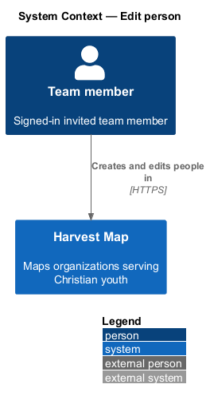
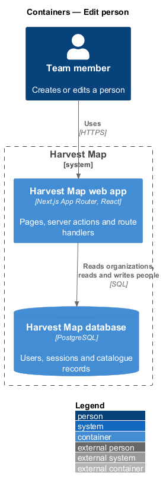
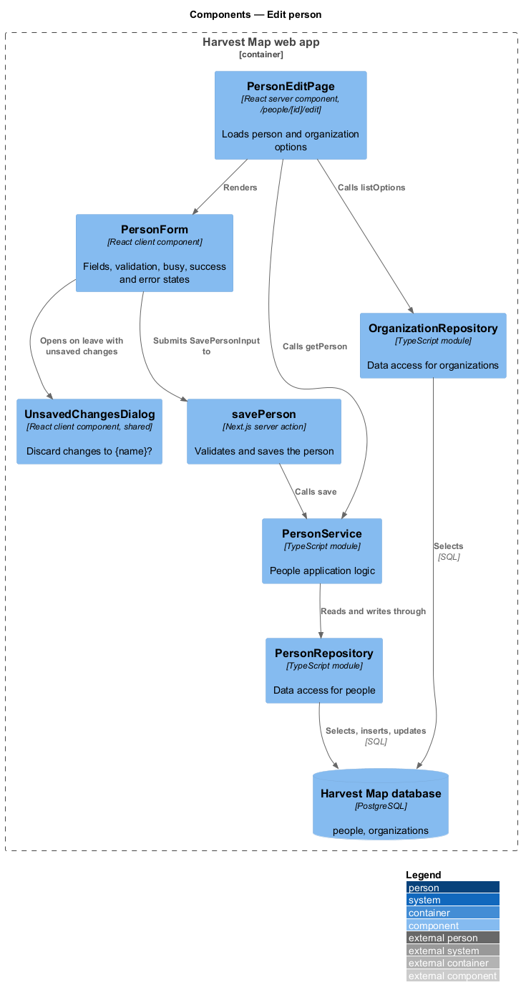
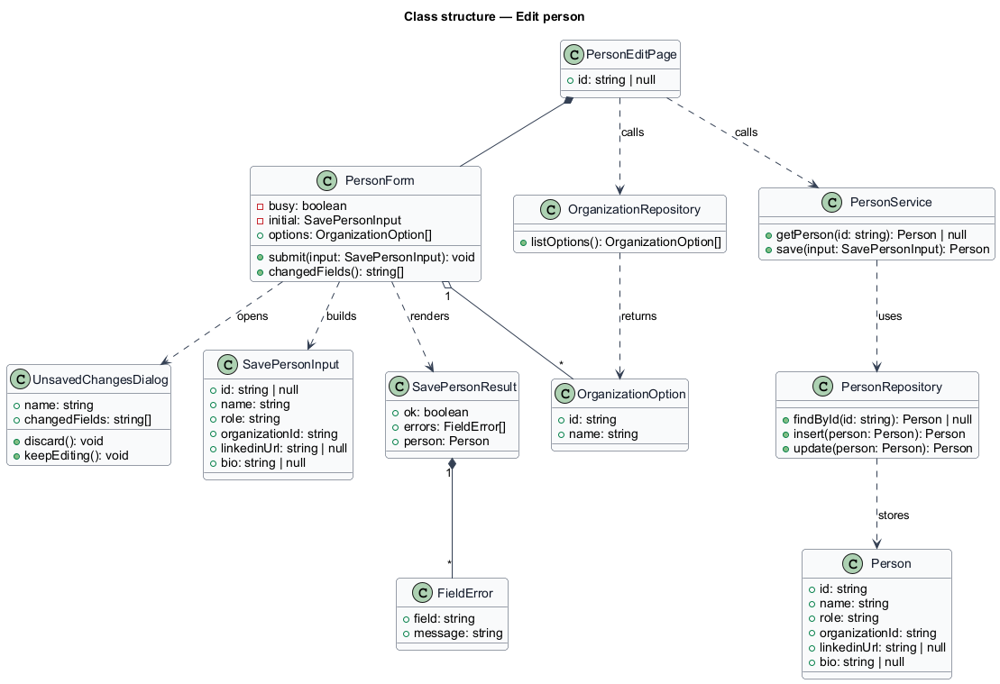
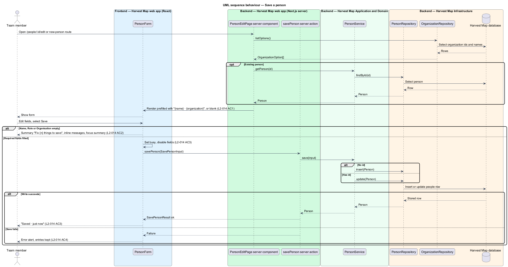
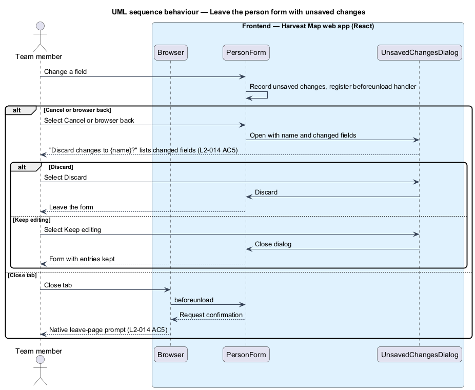

# Edit person

## Overview

Harvest Map is a web application that maps organizations serving Christian youth. It records the key people of those organizations. This feature covers the person form, which creates a new person or edits an existing one.

**person** — record of one key person, holding a name, a role, an organization, an optional LinkedIn link and an optional bio

**unsaved changes** — field values in the form that differ from the values last loaded or saved

**unsaved-changes dialog** — confirmation titled "Discard changes to {name}?" that lists the changed fields and offers "Discard" and "Keep editing"

The form lives at `/people/:id/edit` for an existing person and at a new-person route for a blank form; the new-person route is `<TO SUPPLY>`. The edit form opens from "Edit" on the person detail page; the blank form opens from "New" on the People list. The mocks in `docs/mocks/pages/person-edit/` show the default, loading, error, invalid, submitting and success states. The unsaved-changes dialog is shared with the organization form and uses `docs/mocks/dialogs/unsaved-changes/default.html`.

## Description

The slice runs from a React page in the Next.js web app to the PostgreSQL database.

- **`PersonEditPage`** — React server component at `/people/[id]/edit` and at the new-person route, rendered on the Next.js server. For an existing person it calls `PersonService.getPerson`. For both routes it calls `OrganizationRepository.listOptions` for the Organisation select. It renders the heading "Edit person" and `PersonForm`. A blank form's heading text is `<TO SUPPLY>`.
- **`PersonForm`** — client component. It shows "{name} · {organization}" under the heading for an existing person and holds these fields:
  - Name — text, required.
  - Role — text, required.
  - Organisation — select listing every organization, required.
  - LinkedIn — URL, optional, placeholder `linkedin.com/in/`, hint "Paste the profile URL. Leave blank to let research find it."
  - Bio — multi-line text, optional.
  - Actions "Cancel" (link back to the person page) and "Save".
- **Validation** — on Save, `PersonForm` checks that Name, Role and Organisation are filled. Each empty field adds an item to the summary "Fix {n} things to save" and shows an inline message under the field; focus then moves to the summary. The Name message is "Enter a name". The Role and Organisation messages are `<TO SUPPLY>`. The invalid mock also shows the LinkedIn message "Enter a LinkedIn profile URL like linkedin.com/in/name"; L2-014 lists no LinkedIn format check, so whether the form enforces it is `<TO SUPPLY>`.
- **Busy and result states** — while saving, "Save" shows a busy state and the fields are disabled. On success the form shows "Saved · just now". On failure the form shows an error alert and keeps the entries; the alert text is `<TO SUPPLY>`.
- **Leaving with unsaved changes** — when the form holds unsaved changes and the user selects Cancel or browser back, `PersonForm` opens `UnsavedChangesDialog`. "Discard" leaves the form; "Keep editing" closes the dialog. Closing the tab triggers the browser's native prompt through a `beforeunload` handler. `UnsavedChangesDialog` belongs to the organization form feature (`L2-008`) and is reused here.
- **`loading.tsx`** — Next.js loading UI for the form. It shows the skeleton.
- **`error.tsx`** — Next.js error boundary for the form. It shows "Couldn't load the form" with "Try again" and "Go back".
- **`savePerson`** — Next.js server action. It receives a `SavePersonInput`, repeats the required-field check, calls `PersonService.save` and returns a `SavePersonResult`.
- **`PersonService`** — server module holding the people application logic. `save` inserts a new `Person` when the input has no `id` and updates the existing row otherwise.
- **`PersonRepository`** — data-access module over the `people` table: `findById`, `insert` and `update`.
- **`OrganizationRepository`** — data-access module over the `organizations` table. `listOptions` returns the id and name of each organization.

L2-014 AC5 refers to "the unsaved-changes dialog from L2-008 criterion 5"; in `docs/specs/L2.md` that dialog is L2-008 criterion 5. The page shown after a new person is saved is `<TO SUPPLY>`.

## Requirements

| L2 ID | Refines (L1) | Requirement |
|-------|--------------|-------------|
| `L2-014` | `L1-004` | AC1. Given an existing person, when the page opens, then the form is prefilled and shows "{name} · {organization}"; the new form is blank. |
| `L2-014` | `L1-004` | AC2. Given an empty Name, Role or Organisation, when saved, then "Fix {n} things to save" lists each problem with an inline message and focus moves to the summary. |
| `L2-014` | `L1-004` | AC3. Given valid input, when saved, then busy state is shown, the record is saved, and a success confirmation appears. |
| `L2-014` | `L1-004` | AC4. Given a save failure, when it returns, then an error alert is shown and the entries are kept. |
| `L2-014` | `L1-004` | AC5. Given unsaved changes, when the user leaves, then the unsaved-changes dialog from L2-008 criterion 5 is shown. |

## Diagrams

### System context

A team member creates and edits people in Harvest Map over HTTPS. No external system takes part.

### Containers

The Next.js web app renders the form, runs the server action, and reads and writes people in the PostgreSQL database.

### Components

`PersonEditPage` loads the person and the organization options and renders `PersonForm`. `PersonForm` submits to `savePerson`, which calls `PersonService`. `PersonForm` opens `UnsavedChangesDialog` when the user leaves with unsaved changes.

### Class structure

`PersonForm` builds a `SavePersonInput` and renders a `SavePersonResult` made of `FieldError` entries. `PersonService` reads and writes `Person` through `PersonRepository`. `OrganizationRepository` supplies `OrganizationOption` values for the select.

### Behaviour — save a person

The page prefills an existing person or shows a blank form (`L2-014` AC1). Empty required fields stop the save and show the summary (`L2-014` AC2). A valid save shows the busy state, writes the record and confirms (`L2-014` AC3). A failed save shows the error alert and keeps the entries (`L2-014` AC4).

### Behaviour — leave with unsaved changes

Cancel or browser back with unsaved changes opens the unsaved-changes dialog; closing the tab uses the browser's native prompt (`L2-014` AC5).

