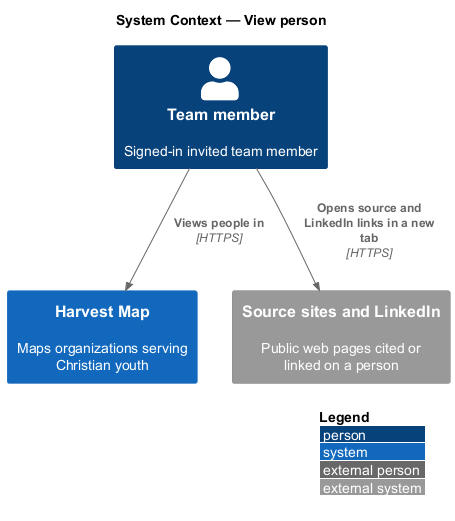
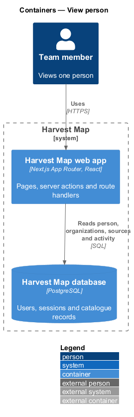
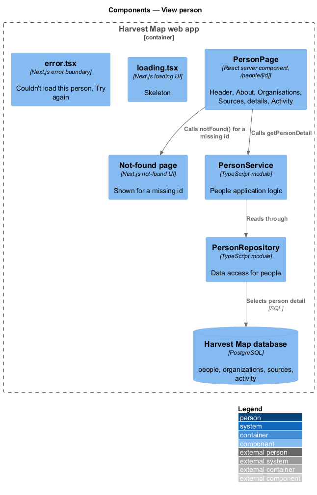
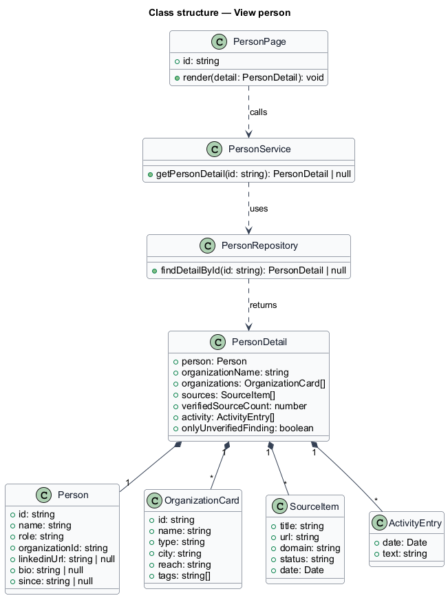
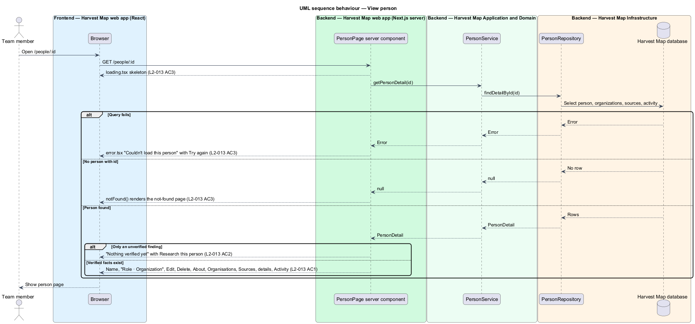

# View person

## Overview

Harvest Map is a web application that maps organizations serving Christian youth. It records the key people of those organizations so a team member can see who leads the work and how to reach them. This feature covers the person detail page, which shows everything Harvest Map holds about one person.

**person** — record of one key person, holding a name, a role, an organization, an optional LinkedIn link and an optional bio

**source** — web page cited as evidence for a fact about a record, shown with its title, domain and status

**finding** — research result about a record that a team member accepts, edits or rejects before it changes the record

**unverified finding** — finding that no team member has accepted yet

The person detail page lives at `/people/:id` in the people subsystem. It opens from a row on the People list, from an organization's People section, from search results and from the command palette. The mocks in `docs/mocks/pages/person/` show the default, loading, empty, error and edge states.

## Description

The slice runs from a React page in the Next.js web app to the PostgreSQL database.

- **`PersonPage`** — React server component at `/people/[id]`, rendered on the Next.js server. It calls `PersonService.getPersonDetail` with the route id. When no person has that id, it calls the Next.js `notFound()` function, which renders the not-found page. Otherwise it renders the header and sections below.
- **Header** — the initials, the name, the line "Role · Organization" with the organization name linking to `/organizations/:id`, and the actions "Edit" (link to `/people/:id/edit`) and "Delete" (opens the delete-person dialog, `L2-015`).
- **About** — the person's bio.
- **Organisations** — one `OrganizationCard` per organization the person belongs to: initials, name, "Type · City · Reach" and tags. A person record holds one `organizationId`; the edge mock shows four cards, so the way a person links to more than one organization is `<TO SUPPLY>`.
- **Sources** — one `SourceItem` per source: title linking to the page in a new tab, domain and status line, for example "christianpost.com · Verified Tue 14 Oct".
- **Details** — Organisation, Since, LinkedIn and Sources. Sources reads "{total} · {verified} verified". LinkedIn shows the stored LinkedIn link when one exists. The origin of the Since value is `<TO SUPPLY>`; no form in the mocks edits it.
- **Activity** — dated entries such as "Run #46 added role change". The events that write activity entries belong to the research and finding-review subsystems.
- **Empty state** — when the person has only an unverified finding, About shows "Nothing verified yet", a line naming the unverified finding, and the action "Research this person", which opens the run-research dialog owned by the research subsystem.
- **`loading.tsx`** — Next.js loading UI for `/people/[id]`. It shows the skeleton.
- **`error.tsx`** — Next.js error boundary for `/people/[id]`. It shows "Couldn't load this person" with "Try again" and "Go back" (to `/people`).
- **`PersonService`** — server module holding the people application logic. `getPersonDetail` returns a `PersonDetail` or nothing.
- **`PersonRepository`** — data-access module. `findDetailById` reads the person with its organizations, sources and activity. The tables that hold sources, findings and activity belong to the finding-review subsystem; their names are `<TO SUPPLY>`.
- **`PersonDetail`** — read model: the `Person`, `organizationName`, `organizations`, `sources`, `verifiedSourceCount`, `activity` and `onlyUnverifiedFinding`.

The default mock also shows a "Research" action and verification badges, and the empty mock shows "Find on LinkedIn". L2-013 AC1 lists only Edit and Delete as actions, and LinkedIn verification is out of scope, so this design omits those elements.

## Requirements

| L2 ID | Refines (L1) | Requirement |
|-------|--------------|-------------|
| `L2-013` | `L1-004` | AC1. Given a person, when the page loads, then it shows name, "Role · Organization", actions Edit and Delete, sections About, Organisations (card per organization), Sources, details (Organisation, Since, LinkedIn, Sources) and Activity. |
| `L2-013` | `L1-004` | AC2. Given a person with only an unverified finding, when the page loads, then the empty state "Nothing verified yet" offers "Research this person". |
| `L2-013` | `L1-004` | AC3. Given loading, error, or missing id, when requested, then skeleton, error with retry, or the not-found page is shown. |

## Diagrams

### System context

A team member views a person in Harvest Map over HTTPS. Source and LinkedIn links open the external pages in a new browser tab; Harvest Map makes no call to them.

### Containers

The Next.js web app renders the page on the server and reads the person, organizations, sources and activity from the PostgreSQL database.

### Components

`PersonPage` calls `PersonService`, which reads through `PersonRepository`. The Next.js loading UI, error boundary and not-found page cover the other outcomes.

### Class structure

`PersonDetail` composes the `Person` with `OrganizationCard`, `SourceItem` and `ActivityEntry` lists. `PersonService` returns it from `PersonRepository`.

### Behaviour — view a person

The page shows the skeleton, loads the detail and renders every section (`L2-013` AC1). A person with only an unverified finding shows the "Nothing verified yet" state (`L2-013` AC2). A missing id renders the not-found page and a failed load renders the error with "Try again" (`L2-013` AC3).

