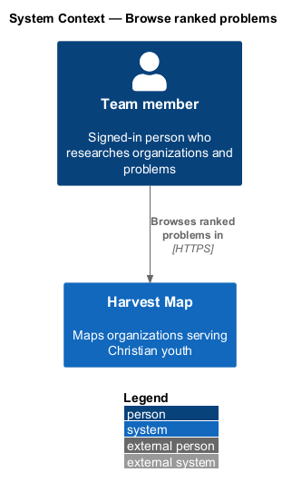
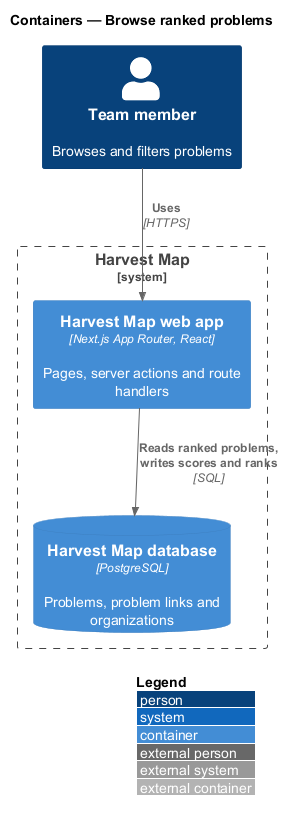
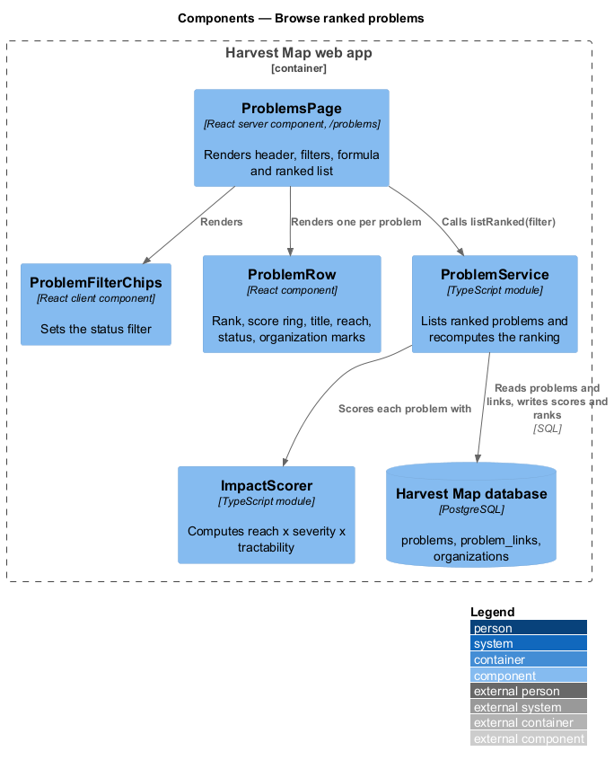
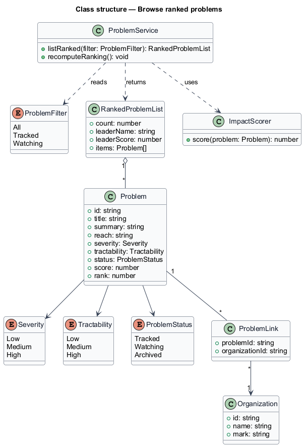
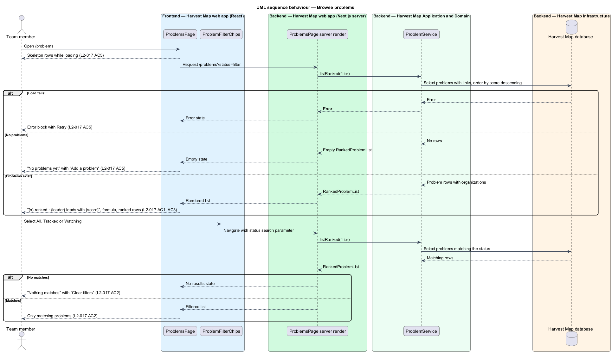
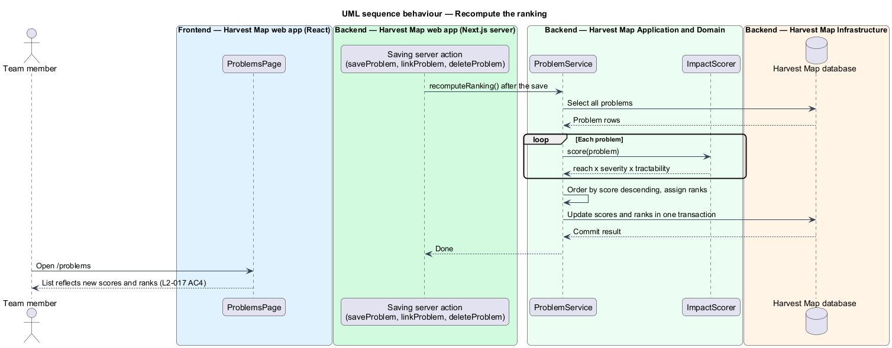

# Browse ranked problems

## Overview

Harvest Map is a web application that maps organizations serving Christian youth. One of its research questions asks which organization targets the most impactful problem. This feature covers the Problems page, which lists every recorded problem in order of impact.

**problem** — challenge that organizations target, recorded with a title, a reach, a severity, a tractability and a status

**impact score** — number computed as reach × severity × tractability that orders problems

**rank** — position of a problem when all problems are ordered by impact score, highest first

**organization mark** — two-letter initials that stand for a linked organization, for example "IL" for illumiNations

**problem link** — record that ties one organization to one problem it works on

The Problems page lives at `/problems` in the problems subsystem. It shows the header "{n} ranked · {leader} leads with {score}", the filters All, Tracked and Watching, the formula "Impact = reach × severity × tractability" and one row per problem. Each row leads to the problem detail page (`/problems/:id`). The mocks in `docs/mocks/pages/problems/` show the default, empty, loading, error and no-results states.

## Description

The slice runs from a React page in the Next.js web app to the PostgreSQL database.

- **`ProblemsPage`** — React server component at `/problems`. It renders the heading "Problems", the subtitle "{n} ranked · {leader} leads with {score}", the "New" action, the filter chips, the formula caption and the list of `ProblemRow` items.
- **`ProblemFilterChips`** — client component with the chips All, Tracked and Watching. It sets the `status` search parameter, and the page re-renders the filtered list.
- **`ProblemRow`** — component for one problem. It shows the rank, a `ScoreRing`, the title as a link to `/problems/:id`, the line "Reach · Status" and the marks of the linked organizations. The mock shows at most 4 marks per row.
- **`ScoreRing`** — component that draws the impact score as a ring. Rank 1 uses the warning hue as gold.
- **`ProblemService`** — server module. `listRanked(filter)` returns problems with their linked organizations, ordered by impact score descending. `recomputeRanking()` recalculates every score and rank; the edit, link and delete features call it after each save (`L2-017` AC4).
- **`ImpactScorer`** — server module that computes reach × severity × tractability for one `Problem`. The numeric values of Low, Medium and High are `<TO SUPPLY>`. The conversion of free-text reach (for example "3,800 languages") into a number is `<TO SUPPLY>`.
- **`Problem`**, **`ProblemLink`** and **`Organization`** — rows in the `problems`, `problem_links` and `organizations` tables of the Harvest Map database.
- **`RankedProblemList`** — typed result holding the count, the leader name, the leader score and the ordered `Problem` items.

The empty state shows "No problems yet", the text "Name the moonshots you care about; research links organisations to them." and "Add a problem". The no-results state shows "Nothing matches" and "Clear filters". The loading state shows skeleton rows, and the error state shows an error block with "Retry".

The following details are `<TO SUPPLY>`:

- which organization the header names as leader when the top problem has more than one link
- the order of problems that share a score
- whether the All filter includes problems with status Archived
- where a problem without a score appears in the ranking

## Requirements

| L2 ID | Refines (L1) | Requirement |
|-------|--------------|-------------|
| `L2-017` | `L1-006` | AC1. Given problems exist, when the page loads, then the header reads "{n} ranked · {leader} leads with {score}" and each item shows rank, score ring, title, "Reach · Status" and linked organization marks, ordered by score descending. |
| `L2-017` | `L1-006` | AC2. Given filters All, Tracked, Watching, when selected, then only matching problems show; no matches shows the no-results state. |
| `L2-017` | `L1-006` | AC3. Given the page, when it renders, then the formula "Impact = reach × severity × tractability" is shown. |
| `L2-017` | `L1-006` | AC4. Given a problem is created, edited or its linked organizations change, when saved, then the score and ranks recompute and the list reflects them. |
| `L2-017` | `L1-006` | AC5. Given no problems, loading, or load failure, when rendered, then empty prompt with "New", skeleton, or error with retry shows. |

## Diagrams

### System context

A team member browses the ranked problems in Harvest Map over HTTPS. No external system takes part in this feature.

### Containers

The Next.js web app renders the page and reads problems, links and organizations from the PostgreSQL database.

### Components

`ProblemsPage` renders `ProblemFilterChips` and one `ProblemRow` per problem. The page reads the list through `ProblemService`, which uses `ImpactScorer` when it recomputes the ranking.

### Class structure

`ProblemService` returns a `RankedProblemList` of `Problem` items. Each `Problem` holds a `Severity`, a `Tractability` and a `ProblemStatus`, and links to `Organization` through `ProblemLink`.

### Behaviour — browse problems

The page loads the ranked list and shows the formula (`L2-017` AC1, AC3). A filter chip narrows the list or shows the no-results state (`L2-017` AC2). An empty catalogue, a pending load and a failed load show the empty, skeleton and error states (`L2-017` AC5).

### Behaviour — recompute the ranking

After a save that creates or edits a problem or changes its links, the saving feature calls `recomputeRanking()`. The service scores each problem, writes the scores and ranks in one transaction, and the next page load reflects them (`L2-017` AC4).

