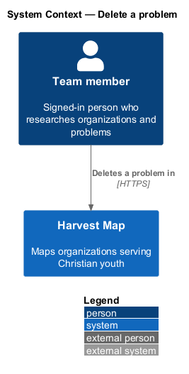
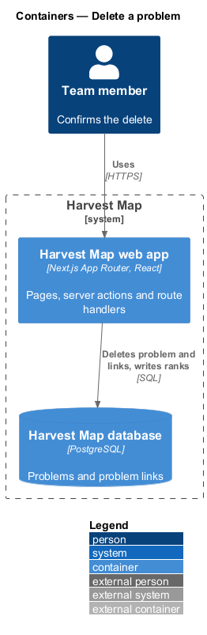
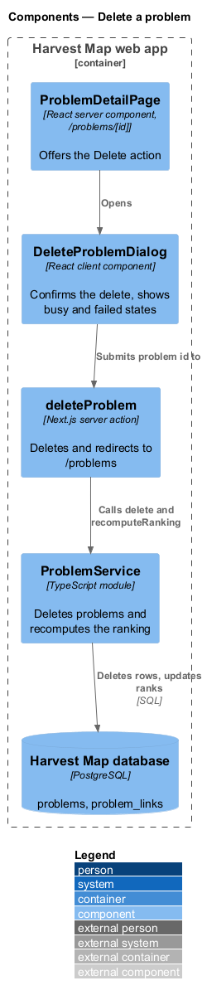
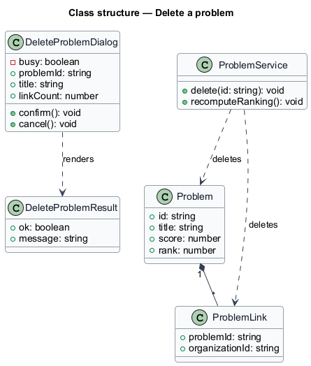
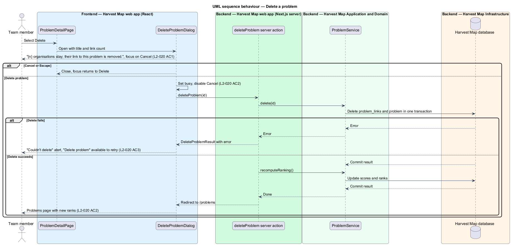

# Delete a problem

## Overview

Harvest Map is a web application that maps organizations serving Christian youth. A problem is a challenge that organizations target, ranked by its impact score. This feature covers deleting a problem from its detail page.

**problem link** — record that ties one organization to one problem it works on

**danger action** — button styled for a destructive, irreversible change

Deleting a problem removes the problem and its problem links. The linked organizations stay in the catalogue. Because the ranking orders every problem, the remaining problems receive new ranks after the delete. The person starts the delete with "Delete" on the problem detail page (`/problems/:id`) and confirms it in a dialog. The mocks in `docs/mocks/dialogs/delete-problem/` show the default, busy and failed states.

## Description

The slice runs from a React dialog in the Next.js web app to the PostgreSQL database.

- **`DeleteProblemDialog`** — client component opened by "Delete" on `ProblemDetailPage`. It is titled "Delete “{title}”?" and states "{n} organisations stay; their link to this problem is removed." It offers Cancel and the danger action "Delete problem", with focus on Cancel. While busy it disables Cancel and marks "Delete problem" busy. Escape and the close button cancel and return focus to "Delete".
- **`deleteProblem`** — Next.js server action. It receives the problem id, calls `ProblemService.delete`, then `ProblemService.recomputeRanking()`, and redirects to `/problems`.
- **`ProblemService`** — server module. `delete(id)` removes the `ProblemLink` rows and the `Problem` row in one transaction. `recomputeRanking()` is described in the browse-ranked-problems feature.
- **`DeleteProblemResult`** — typed result returned to the dialog when the delete fails.

The dialog reads the link count from the `ProblemDetail` that the detail page already holds. On failure the dialog shows the alert "Couldn't delete — The server didn't respond. Nothing was changed." and keeps "Delete problem" available as the retry.

The fate of milestones, sources and activity entries that belong to a deleted problem is `<TO SUPPLY>`.

## Requirements

| L2 ID | Refines (L1) | Requirement |
|-------|--------------|-------------|
| `L2-020` | `L1-006` | AC1. Given the user selects Delete, when the dialog opens, then it states how many organization links will be removed and offers Cancel and a danger action with focus on Cancel. |
| `L2-020` | `L1-006` | AC2. Given confirmation, when processed, then busy shows, the problem and its links are deleted, ranks recompute, and the user returns to `/problems`. |
| `L2-020` | `L1-006` | AC3. Given failure, when it returns, then the failed state is shown with retry. |

## Diagrams

### System context

A team member deletes a problem in Harvest Map over HTTPS. No external system takes part in this feature.

### Containers

The Next.js web app shows the dialog and runs the server action, which deletes rows and writes new ranks in the PostgreSQL database.

### Components

`ProblemDetailPage` opens `DeleteProblemDialog`, which calls the `deleteProblem` server action. The action calls `ProblemService` to delete and to recompute the ranking.

### Class structure

`DeleteProblemDialog` holds the problem title and link count and renders a `DeleteProblemResult` on failure. `ProblemService` deletes `Problem` and its `ProblemLink` rows.

### Behaviour — delete a problem

The dialog opens with the link count and focus on Cancel (`L2-020` AC1). Confirmation shows the busy state, deletes the problem and its links, recomputes the ranks and returns to `/problems` (`L2-020` AC2). A failure shows the failed alert with retry (`L2-020` AC3).

