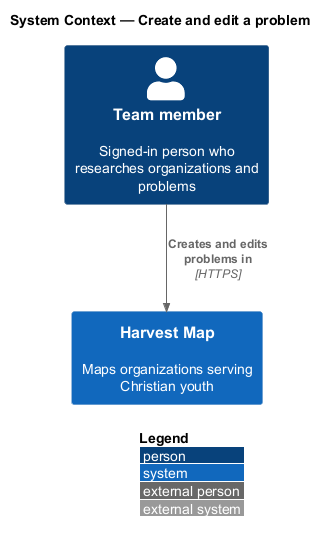
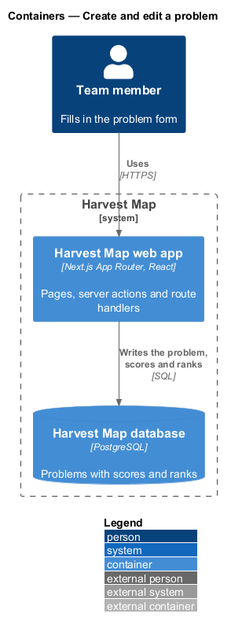
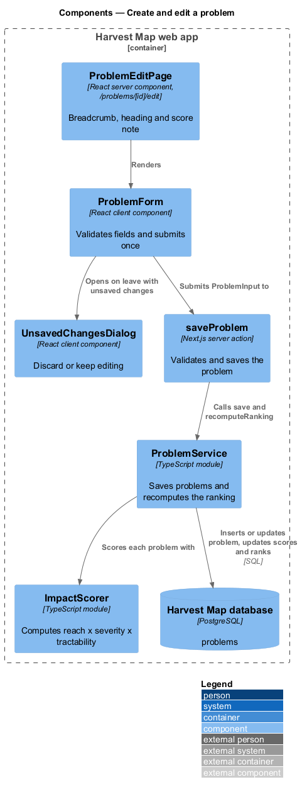
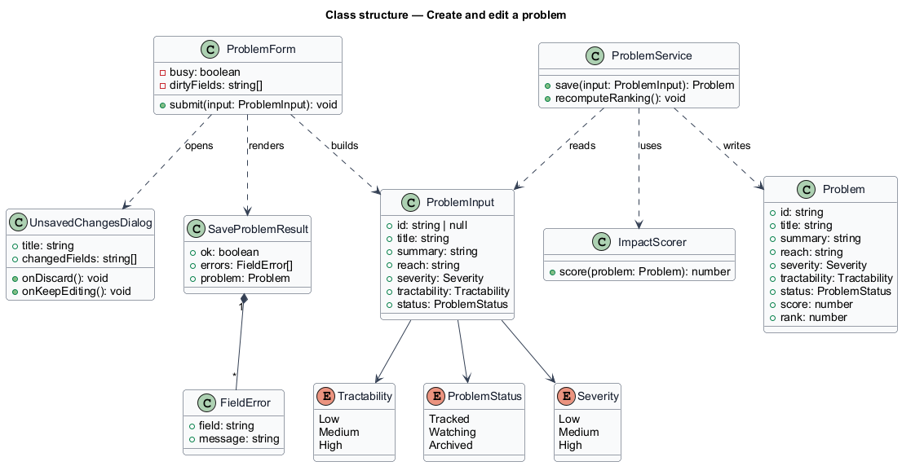
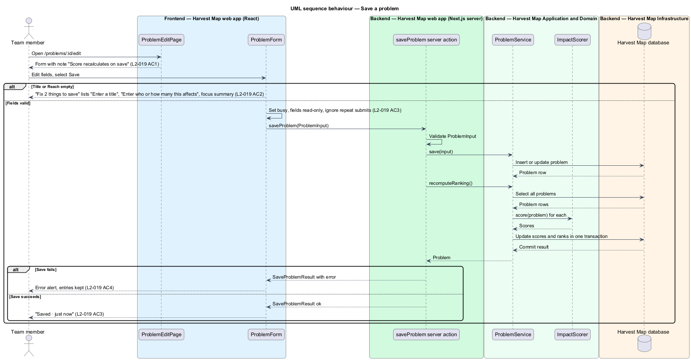
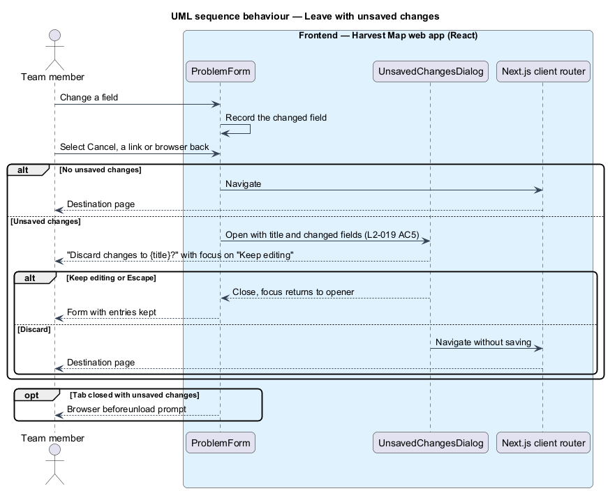

# Create and edit a problem

## Overview

Harvest Map is a web application that maps organizations serving Christian youth. A problem is a challenge that organizations target, ranked by its impact score. This feature covers the form that creates a new problem or edits an existing one.

**impact score** — number computed as reach × severity × tractability that orders problems

**reach** — free-text statement of who or how many people a problem affects, for example "3,800 languages"

**severity** — rating of how much harm a problem causes: Low, Medium or High

**tractability** — rating of how far a problem yields to effort: Low, Medium or High

**unsaved changes** — field values in an open form that differ from the last saved values

The edit form lives at `/problems/:id/edit` in the problems subsystem. A new problem uses the same page with blank fields. The form notes "Score recalculates on save": each save stores the problem and recomputes every score and rank. The mocks in `docs/mocks/pages/problem-edit/` show the default, loading, error, invalid, submitting and success states, and `docs/mocks/dialogs/unsaved-changes/` shows the leave confirmation.

## Description

The slice runs from a React page in the Next.js web app to the PostgreSQL database.

- **`ProblemEditPage`** — React server component at `/problems/[id]/edit`. It renders the breadcrumb "Problems / {title} / Edit", the heading "Edit problem", the subtitle "Score recalculates on save" and the `ProblemForm`. The route and heading for a new problem are `<TO SUPPLY>`.
- **`ProblemForm`** — client component with the fields Title, Summary, Reach, Severity (Low, Medium, High), Tractability (Low, Medium, High) and Status (Tracked, Watching, Archived), and the actions Cancel and Save. It checks that Title and Reach are filled before any request. It shows the error summary and inline messages and moves focus to the summary. While busy it marks Save busy, makes the fields read-only and ignores repeat submits.
- **`saveProblem`** — Next.js server action. It receives a `ProblemInput`, validates it again, calls `ProblemService.save`, then calls `ProblemService.recomputeRanking()`, and returns a `SaveProblemResult`.
- **`ProblemService`** — server module. `save(input)` inserts a new `Problem` or updates an existing one. `recomputeRanking()` is described in the browse-ranked-problems feature.
- **`UnsavedChangesDialog`** — shared dialog titled "Discard changes to {title}?" with the text "{n} fields changed: {fields}." and the actions "Discard" and "Keep editing". "Keep editing" holds focus. The form opens it when the person leaves with unsaved changes, including the browser back button; closing the tab triggers the browser `beforeunload` prompt.
- **`ProblemInput`**, **`SaveProblemResult`** and **`FieldError`** — typed request and result. `FieldError` names the field and its message.

The error summary for an empty Title and Reach reads "Fix 2 things to save" and lists "Enter a title" and "Enter who or how many this affects". On success the form shows "Saved · just now". On failure an error alert appears above the form and the entered values stay. The loading state shows skeleton fields, and the error state shows an error block with "Retry".

The following details are `<TO SUPPLY>`:

- the route and heading for a new problem
- the title and text of the save-failure alert
- the page the person lands on after saving a new problem

## Requirements

| L2 ID | Refines (L1) | Requirement |
|-------|--------------|-------------|
| `L2-019` | `L1-006` | AC1. Given the form, when it opens, then it notes "Score recalculates on save". |
| `L2-019` | `L1-006` | AC2. Given an empty Title or Reach, when saved, then "Fix 2 things to save" lists "Enter a title" and "Enter who or how many this affects" and focus moves to the summary. |
| `L2-019` | `L1-006` | AC3. Given valid input, when saved, then busy state shows, the problem and score are saved, and success is confirmed. |
| `L2-019` | `L1-006` | AC4. Given save failure, when it returns, then an error alert shows and entries are kept. |
| `L2-019` | `L1-006` | AC5. Given unsaved changes, when the user leaves, then the unsaved-changes dialog is shown. |

## Diagrams

### System context

A team member creates and edits problems in Harvest Map over HTTPS. No external system takes part in this feature.

### Containers

The Next.js web app serves the form and runs the server action. The action writes the problem and the recomputed scores and ranks to the PostgreSQL database.

### Components

`ProblemEditPage` renders `ProblemForm`, which submits to the `saveProblem` server action and opens `UnsavedChangesDialog` on leave. The action calls `ProblemService`, which uses `ImpactScorer` to recompute the ranking.

### Class structure

`ProblemForm` builds a `ProblemInput` and renders a `SaveProblemResult` made of `FieldError` entries. `ProblemService` writes `Problem` and uses `ImpactScorer`.

### Behaviour — save a problem

The form opens with the note "Score recalculates on save" (`L2-019` AC1). Empty Title or Reach fields stop the save at the error summary (`L2-019` AC2). A valid save shows the busy state, stores the problem, recomputes the ranking and confirms success (`L2-019` AC3). A failed save shows an error alert and keeps the entries (`L2-019` AC4).

### Behaviour — leave with unsaved changes

When the form holds unsaved changes and the person navigates away, the form shows the unsaved-changes dialog (`L2-019` AC5). "Keep editing" returns to the form, and "Discard" continues the navigation without saving.

