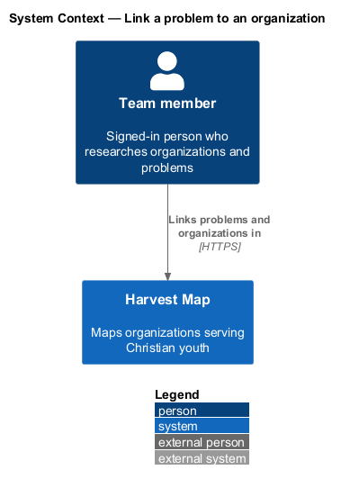
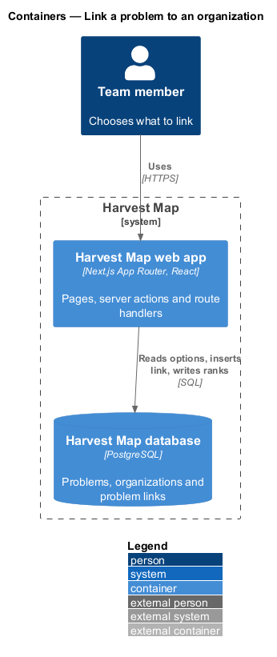
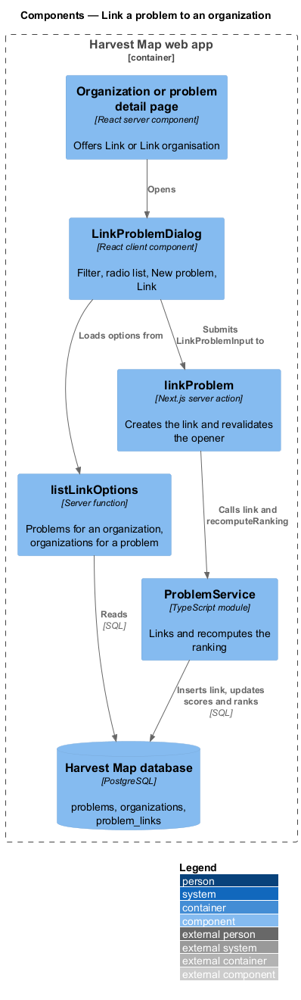
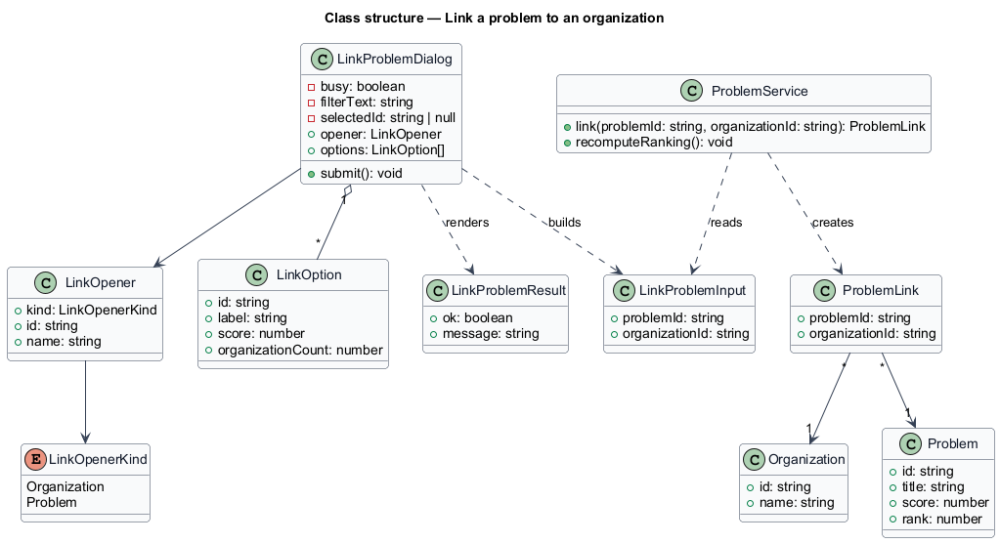
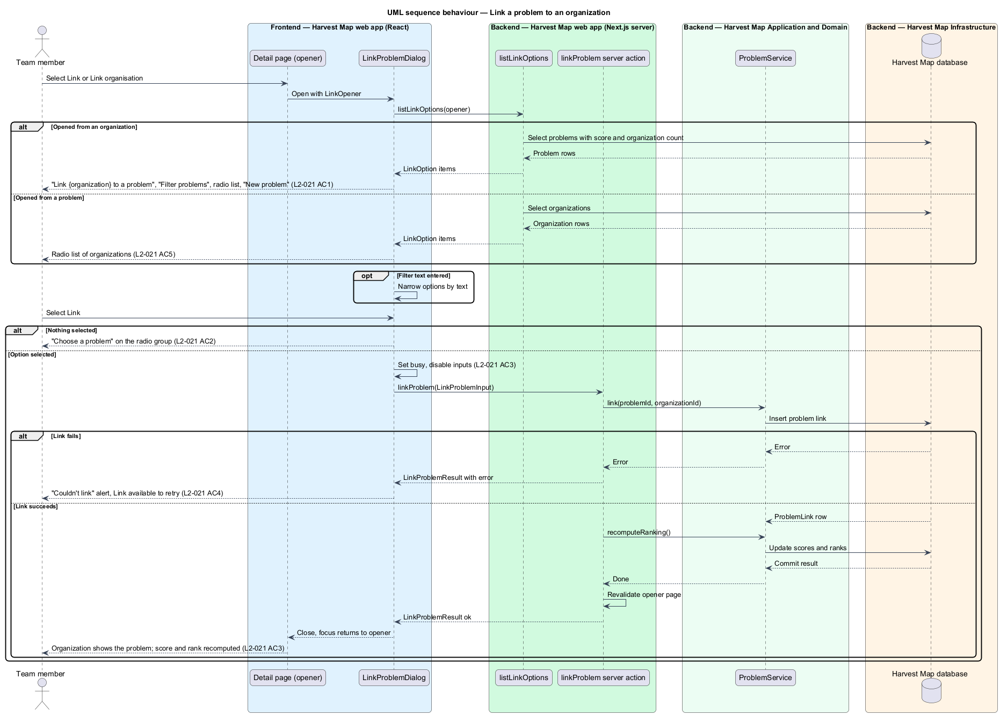

# Link a problem to an organization

## Overview

Harvest Map is a web application that maps organizations serving Christian youth. A problem is a challenge that organizations target, ranked by its impact score. This feature covers the dialog that records which organization works on which problem.

**problem link** — record that ties one organization to one problem it works on

**opener** — page and button from which the dialog was opened; it decides which side of the link the dialog lists

The dialog opens from two places. "Link" on an organization detail page lists problems, and "Link organisation" on a problem detail page lists organizations. A saved link appears on both detail pages, and the problem's score and rank recompute. The mocks in `docs/mocks/dialogs/link-problem/` show the default, invalid, busy and failed states for the organization opener.

## Description

The slice runs from a React dialog in the Next.js web app to the PostgreSQL database.

- **`LinkProblemDialog`** — client component. Opened from an organization, it is titled "Link {organization} to a problem" and shows a search input labelled "Filter problems", a radio group "Problem" and the link "New problem". Each radio shows the problem title and "Score {s} · {n} organisations". The footer offers Cancel and "Link". Opened from a problem, it lists organizations instead.
- **`LinkOptionFilter`** — logic inside the dialog that narrows the listed options by the text in the filter input.
- **`listLinkOptions`** — server function. Given an organization id, it returns `LinkOption` items for problems; given a problem id, it returns `LinkOption` items for organizations.
- **`linkProblem`** — Next.js server action. It receives a `LinkProblemInput`, calls `ProblemService.link`, then `ProblemService.recomputeRanking()`, revalidates the opener page and returns a `LinkProblemResult`.
- **`ProblemService`** — server module. `link(problemId, organizationId)` inserts a `ProblemLink` row. `recomputeRanking()` is described in the browse-ranked-problems feature.
- **`LinkOption`**, **`LinkProblemInput`** and **`LinkProblemResult`** — typed option, request and result.

With nothing selected, "Link" shows the inline message "Choose a problem" on the radio group and sends no request. While busy the dialog disables the inputs and marks "Link" busy. On failure the dialog shows the alert "Couldn't link — Try again." and keeps "Link" available as the retry. "New problem" opens the new-problem form.

The following details are `<TO SUPPLY>`:

- the title, filter label, option text and validation message when the dialog opens from a problem
- how the count of linked organizations enters the impact score; the formula reach × severity × tractability does not name it
- whether options already linked are hidden, disabled or shown
- whether "New problem" returns to the dialog after the problem is saved

## Requirements

| L2 ID | Refines (L1) | Requirement |
|-------|--------------|-------------|
| `L2-021` | `L1-006` | AC1. Given the dialog from an organization, when it opens, then it is titled "Link {organization} to a problem", has a "Filter problems" input and a radio list of problems showing title and "Score {s} · {n} organisations", and a "New problem" action. |
| `L2-021` | `L1-006` | AC2. Given nothing is selected, when "Link" is attempted, then it is rejected with "Choose a problem". |
| `L2-021` | `L1-006` | AC3. Given a selection, when the user selects "Link", then busy shows, the link is created, the dialog closes and the organization shows the problem; the problem's score and rank recompute. |
| `L2-021` | `L1-006` | AC4. Given failure, when it returns, then the failed state shows with retry. |
| `L2-021` | `L1-006` | AC5. Given the dialog opened from a problem, when it opens, then it lists organizations instead. |

## Diagrams

### System context

A team member links problems and organizations in Harvest Map over HTTPS. No external system takes part in this feature.

### Containers

The Next.js web app shows the dialog and runs the server action, which writes the link and the new ranking to the PostgreSQL database.

### Components

The organization or problem detail page opens `LinkProblemDialog`. The dialog loads options through `listLinkOptions` and submits to the `linkProblem` server action, which calls `ProblemService`.

### Class structure

`LinkProblemDialog` holds `LinkOption` items for one `LinkOpener` and builds a `LinkProblemInput`. `ProblemService` creates the `ProblemLink` between `Problem` and `Organization`.

### Behaviour — link a problem

The opener decides whether the dialog lists problems or organizations (`L2-021` AC1, AC5). An empty selection is rejected with "Choose a problem" (`L2-021` AC2). A valid selection shows the busy state, creates the link, recomputes the ranking and closes the dialog (`L2-021` AC3). A failure shows the failed alert with retry (`L2-021` AC4).

