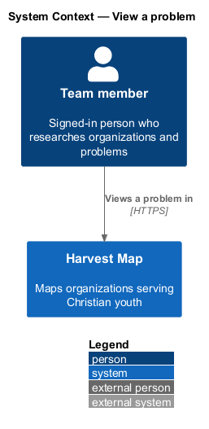
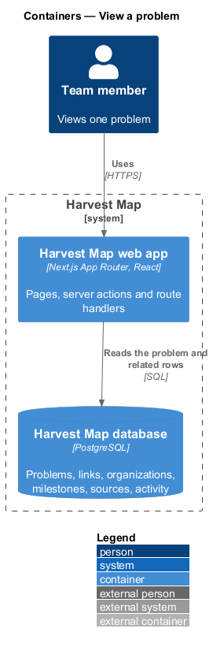
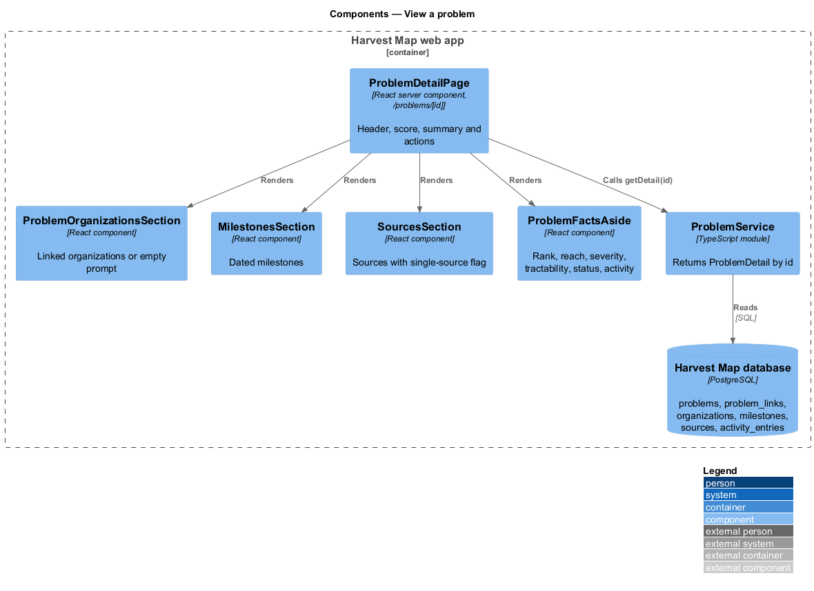
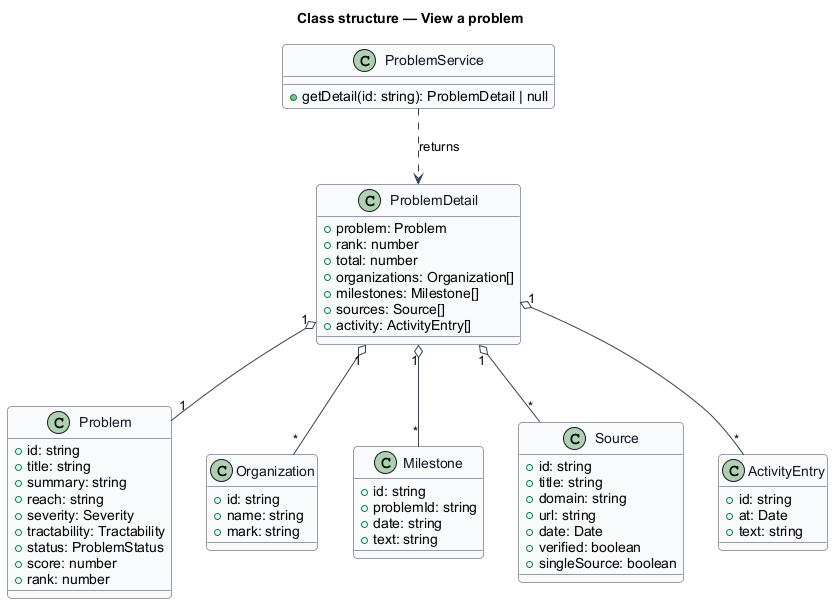
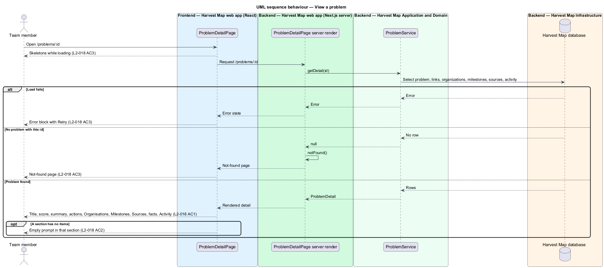

# View a problem

## Overview

Harvest Map is a web application that maps organizations serving Christian youth. A problem is a challenge that organizations target, such as "Scripture in every language by 2033". This feature covers the problem detail page, which shows everything Harvest Map holds about one problem and who works on it.

**impact score** — number computed as reach × severity × tractability that orders problems

**rank** — position of a problem when all problems are ordered by impact score, highest first

**milestone** — dated event in the history or plan of a problem, for example "2033 · All Access Goals deadline"

**source** — web page that supports a fact about the problem, shown with its domain and verification date

**single source** — flag on a source whose fact no second source confirms

**activity entry** — dated line that records a change to the problem, for example "Run #44 scored 94"

The page lives at `/problems/:id` in the problems subsystem. A team member reaches it from a row on the Problems page (`/problems`). It offers the actions Edit, Delete and "Link organisation". The mocks in `docs/mocks/pages/problem/` show the default, empty, loading and error states.

## Description

The slice runs from a React page in the Next.js web app to the PostgreSQL database.

- **`ProblemDetailPage`** — React server component at `/problems/[id]`. It renders the breadcrumb "Problems / {title}", the score ring, the title, the summary and the actions Edit, Delete and "Link organisation".
- **`ProblemOrganizationsSection`** — section "Organisations". It lists each linked organization as an organization card, or shows the empty prompt.
- **`MilestonesSection`** — section "Milestones". It shows a timeline of dated milestones, newest first.
- **`SourcesSection`** — section "Sources". It shows each source with its title, domain and date, and the text "single source" where the flag applies.
- **`ProblemFactsAside`** — aside with the facts Rank "{r} of {n}", Reach, Severity, Tractability and Status, followed by the "Activity" timeline.
- **`ProblemService`** — server module. `getDetail(id)` returns a `ProblemDetail`, or nothing when no problem has that id.
- **`ProblemDetail`** — typed result holding the `Problem`, its rank, the total count of ranked problems, and its `Organization`, `Milestone`, `Source` and `ActivityEntry` lists.
- **`Problem`**, **`ProblemLink`**, **`Organization`**, **`Milestone`**, **`Source`** and **`ActivityEntry`** — rows in the Harvest Map database.

The Edit action opens `/problems/:id/edit`. Delete opens the delete-problem dialog, and "Link organisation" opens the link-problem dialog; both dialogs belong to their own features.

The empty Organisations section shows "Nobody linked yet", the text "Link an organisation, or let research find who is working on this." and the actions "Link organisation" and "Ask the web". A problem without a score shows "—" in the score ring and the caption "The score appears once reach and tractability are set." A missing id calls the Next.js `notFound()` function, which shows the not-found page. The loading state shows skeletons, and the error state shows an error block with "Retry".

The following details are `<TO SUPPLY>`:

- the empty prompts for the Milestones and Sources sections; the mocks do not show them
- how milestones, sources and activity entries are created
- the rule that sets the "single source" flag

## Requirements

| L2 ID | Refines (L1) | Requirement |
|-------|--------------|-------------|
| `L2-018` | `L1-006` | AC1. Given a problem, when the page loads, then it shows title, score, summary, actions Edit, Delete and "Link organisation", an Organisations list, Milestones (dated), Sources (with "single source" flag where applicable), details (Rank "{r} of {n}", Reach, Severity, Tractability, Status) and Activity. |
| `L2-018` | `L1-006` | AC2. Given a problem with no linked organizations, milestones or sources, when rendered, then each empty section shows a prompt. |
| `L2-018` | `L1-006` | AC3. Given loading, error or missing id, when requested, then skeleton, error with retry, or not-found shows. |

## Diagrams

### System context

A team member views a problem in Harvest Map over HTTPS. No external system takes part in this feature.

### Containers

The Next.js web app renders the page and reads the problem and its related rows from the PostgreSQL database.

### Components

`ProblemDetailPage` reads a `ProblemDetail` through `ProblemService` and renders the organizations, milestones, sources and facts sections.

### Class structure

`ProblemDetail` aggregates one `Problem` with its linked `Organization` items and its `Milestone`, `Source` and `ActivityEntry` lists.

### Behaviour — view a problem

The page shows skeletons while loading and then the full detail (`L2-018` AC1). Each empty section shows its prompt (`L2-018` AC2). A failed load shows the error block with "Retry", and an unknown id shows the not-found page (`L2-018` AC3).

