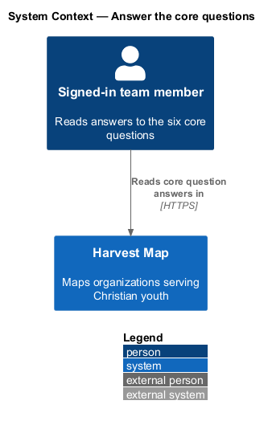
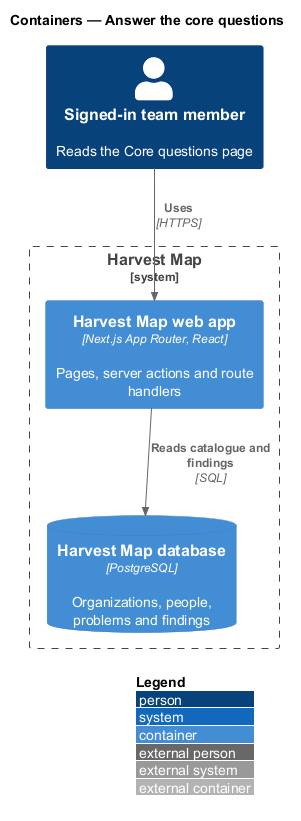
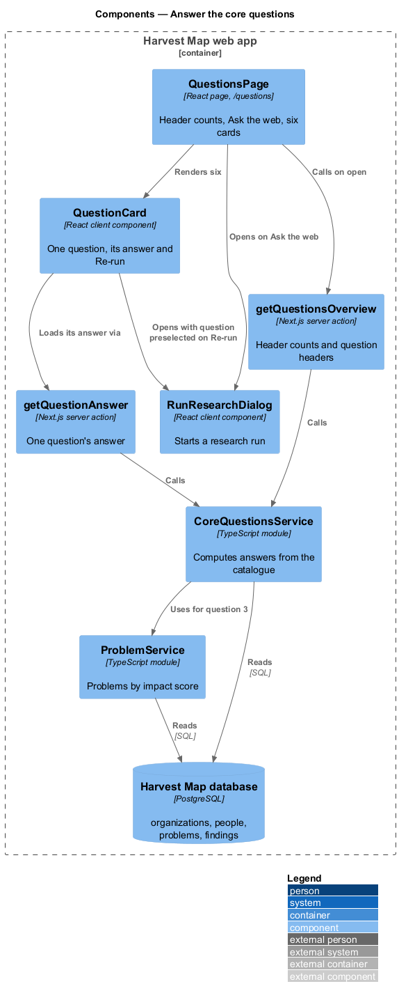
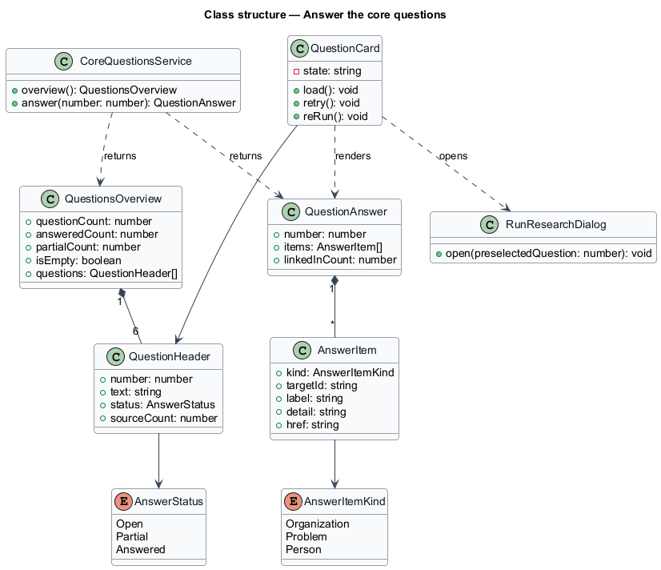
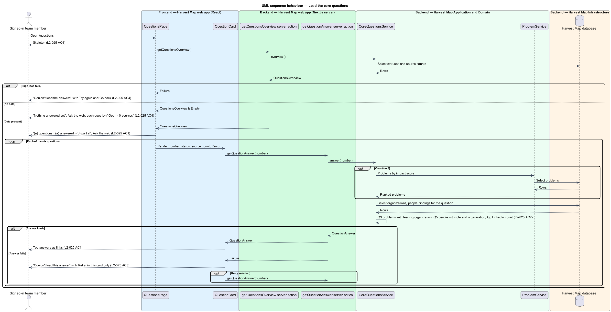
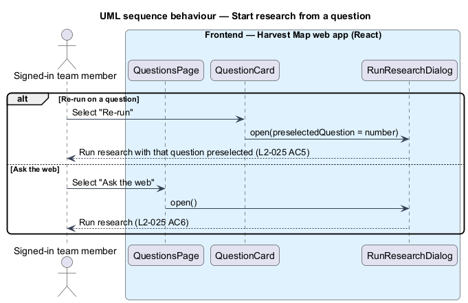

# Answer the core questions

## Overview

Harvest Map is a web application that maps organizations serving Christian youth. It exists to answer six fixed research questions from its catalogue. This feature covers the Core questions page, which shows the current answer to each question, its status and its sources, and lets a team member re-run research for any one question.

**core question** — one of the six fixed research questions: "Who is helping Christian youth, especially with AI?", "Who is targeting moonshot problems?", "Who is targeting the most impactful problem?", "What are they doing?", "Who are the key people?" and "Where are they on LinkedIn?"

**answer status** — completeness of a question's answer: Open, Partial or Answered

**source count** — number of web sources behind a question's answer

**research run** — numbered web search job that a team member starts and that returns findings

The page lives at `/questions` in the questions subsystem. The header counts the questions and how many are answered and partial. Each question shows its number, status, source count, a "Re-run" action and its top answers as links to the matching organization, problem or person. Each answer loads on its own, so one failed answer does not block the others. The Field home page (`field/view-field-home`) reads the same answers for its Questions section. The mocks in `docs/mocks/pages/questions/` show the default, loading, empty, error and partial states.

## Description

The slice runs from a React page in the Next.js web app to the PostgreSQL database. It reads the catalogue and does not change it.

- **`QuestionsPage`** — React page at `/questions`. It calls `getQuestionsOverview` on open and shows the header "{n} questions · {a} answered · {p} partial" with "Ask the web". While loading it shows a skeleton. On failure it shows "Couldn't load the answers — The request timed out. Try again, or share reference HM-4F2A with support." with "Try again" and "Go back". With no data it shows "Nothing answered yet", and each question reads "Open · 0 sources" with "Run research to answer this".
- **`QuestionCard`** — client component, one per question. It shows "{number} · {status} · {n} sources", "Re-run", the question text and the top answers as links. It calls `getQuestionAnswer` for its own question. On failure it shows "Couldn't load this answer — The findings service didn't answer in time." with "Retry". The number of top answers shown per question is `<TO SUPPLY>`.
- **`RunResearchDialog`** — dialog owned by the research feature. "Ask the web" opens it; "Re-run" opens it with that question preselected.
- **`getQuestionsOverview`** — Next.js server action. It returns a `QuestionsOverview` with the header counts and the six question headers.
- **`getQuestionAnswer`** — Next.js server action. It returns one `QuestionAnswer` by question number.
- **`CoreQuestionsService`** — server module. It computes each answer from the catalogue:
  - Question 3 lists problems by impact score, each with its leading organization. The rule that picks the leading organization is `<TO SUPPLY>`.
  - Question 5 lists key people with role and organization.
  - Question 6 reports how many people have a LinkedIn link. The mock lists people with a link and ends with the remainder, for example "8 more to verify".
  - The selection rules for questions 1, 2 and 4 are `<TO SUPPLY>`.
  - The rules that set answer status and source count are `<TO SUPPLY>`.
- **`ProblemService`** — server module designed in `problems/browse-ranked-problems`. `listRanked` returns problems ordered by impact score (reach × severity × tractability).
- **`Organization`**, **`Person`**, **`Problem`** and **`Finding`** — rows in the catalogue tables of the Harvest Map database.

## Requirements

| L2 ID | Refines (L1) | Requirement |
|-------|--------------|-------------|
| `L2-025` | `L1-009` | AC1. Given the catalogue, when the page loads, then the header shows "{n} questions · {a} answered · {p} partial" and each of the six questions (Who is helping Christian youth, especially with AI? / Who is targeting moonshot problems? / Who is targeting the most impactful problem? / What are they doing? / Who are the key people? / Where are they on LinkedIn?) shows its number, status, source count, a "Re-run" action and its top answers as links. |
| `L2-025` | `L1-009` | AC2. Given the answers, when computed, then question 3 lists problems by score with their leading organization, question 5 lists key people with role and organization, and question 6 reports how many people have a LinkedIn link. |
| `L2-025` | `L1-009` | AC3. Given a question's answer fails to load, when rendered, then only that question shows "Couldn't load this answer" with "Retry". |
| `L2-025` | `L1-009` | AC4. Given no data, loading, or load failure for the page, when rendered, then empty prompt with "Ask the web", skeleton, or error with retry shows. |
| `L2-025` | `L1-009` | AC5. Given "Re-run", when selected, then Run research opens with that question preselected. |
| `L2-025` | `L1-009` | AC6. Given "Ask the web", when selected, then Run research opens. |

## Diagrams

### System context

A signed-in team member reads the answers to the core questions in Harvest Map over HTTPS. No external system takes part in reading answers; research runs started from this page are designed in the research feature.

### Containers

The Next.js web app serves the page and runs the server actions. The actions read organizations, people, problems and findings from the PostgreSQL database.

### Components

`QuestionsPage` calls `getQuestionsOverview` and renders six `QuestionCard` components. Each card calls `getQuestionAnswer`. Both actions call `CoreQuestionsService`, which reads the database and uses `ProblemService` for question 3. "Re-run" and "Ask the web" open `RunResearchDialog`.

### Class structure

`QuestionsOverview` holds six `QuestionHeader` entries. Each `QuestionAnswer` holds `AnswerItem` links, and each item points at an organization, problem or person.

### Behaviour — load the core questions

The page shows a skeleton, then the header and six questions (`L2-025` AC1, AC4). Each card loads its own answer, computed per the rules in `L2-025` AC2. A failed answer shows "Couldn't load this answer" with "Retry" in that card alone (`L2-025` AC3). An empty catalogue shows the empty prompt, and a page failure shows the error with retry (`L2-025` AC4).

### Behaviour — start research from a question

"Re-run" opens Run research with that question preselected (`L2-025` AC5). "Ask the web" opens Run research with no preselection (`L2-025` AC6).

