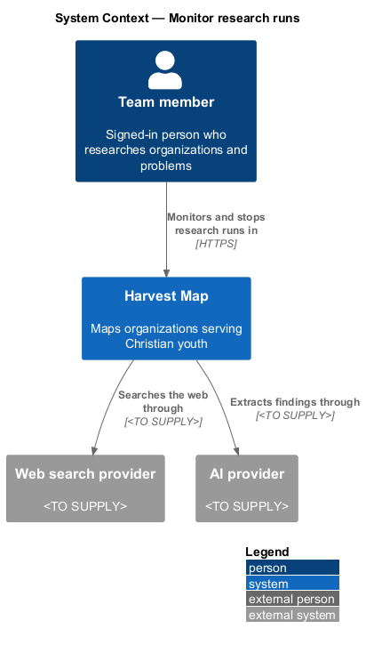
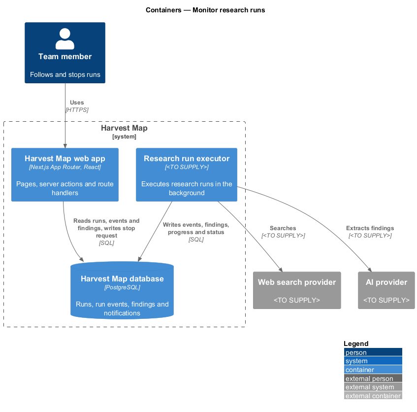
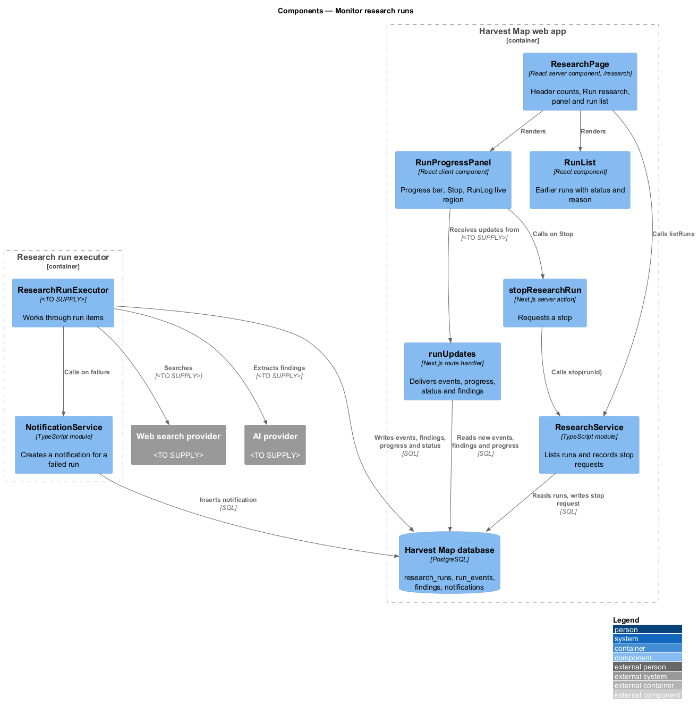
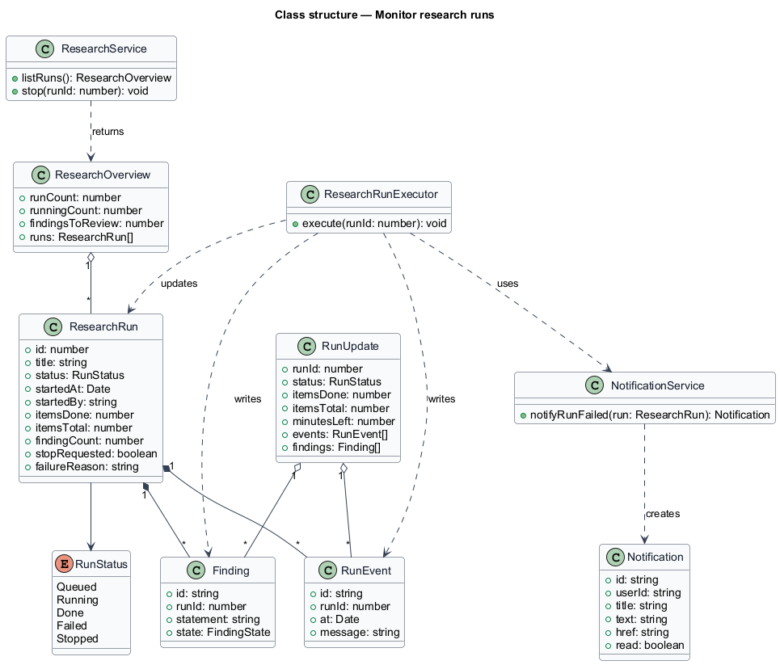
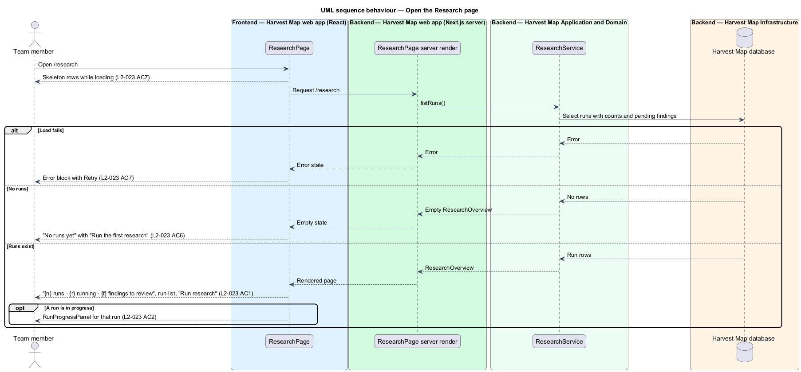
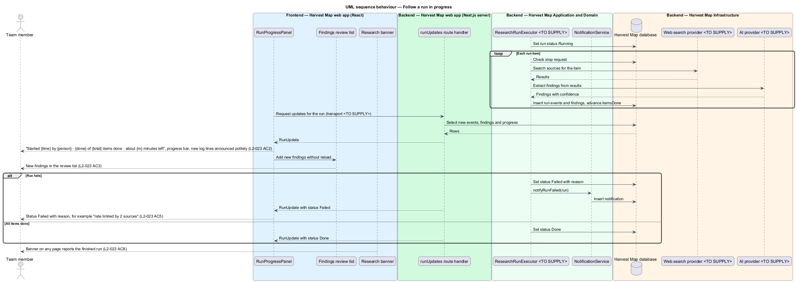
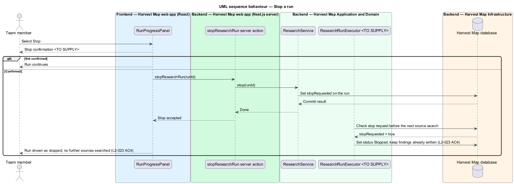

# Monitor research runs

## Overview

Harvest Map is a web application that maps organizations serving Christian youth. It searches the web through research runs and holds each result as a finding for review. This feature covers the Research page, where a team member follows runs while they execute, stops a run, and sees which runs finished or failed.

**research run** — numbered background job that searches the web for one question and produces findings

**run item** — one subject a run researches, such as one person whose LinkedIn profile the run seeks

**run event** — timestamped log line that a run writes as it works, for example "12:04:31 · 2 sources found for Mart Green"

**run status** — state of a run: Queued, Running, Done, Failed or Stopped

**finding** — single result of a research run, held for a person to accept, edit or reject before it changes a record

The Research page lives at `/research` in the research subsystem. Its header reads "{n} runs · {r} running · {f} findings to review" and offers "Run research". A run in progress shows a determinate progress bar, a "Stop" action and a streaming log. Findings appear in the review list as each run item completes. The mocks in `docs/mocks/pages/research/` show the default, running, empty, loading and error states, and `docs/mocks/notifications/research-banner/` shows the banner.

## Description

The slice runs from a React page in the Next.js web app, through the research run executor, to the PostgreSQL database and the external providers.

- **`ResearchPage`** — React server component at `/research`. It renders the heading "Research", the subtitle "{n} runs · {r} running · {f} findings to review", the "Run research" action, the `RunProgressPanel` for a run in progress, and the run list.
- **`RunProgressPanel`** — client component for one run in progress. It shows "#{id} · {title}", the status, the line "Started {time} by {person} · {done} of {total} items done · about {m} minutes left", the "Stop" action, a determinate progress bar and the `RunLog`.
- **`RunLog`** — list of run events, each with its time. It is a polite live region (`aria-live="polite"`) labelled "Run log", so assistive technology announces new lines.
- **`RunList`** — section "Earlier runs" with one `RunRow` per run. Each row shows "#{id} · {title}", "{start} · {person} · {n} findings" and the status Running, Done or Failed. A failed row shows its reason.
- **`runUpdates`** — Next.js route handler at `/api/research/runs/[id]/updates`. It delivers new run events, progress counts, status changes and new findings to `RunProgressPanel` and to the findings review list without a reload. The transport (polling or server-sent events) is `<TO SUPPLY>`.
- **`stopResearchRun`** — Next.js server action. It calls `ResearchService.stop(runId)`.
- **`ResearchService`** — server module. `listRuns()` returns a `ResearchOverview`. `stop(runId)` sets the stop request on the run.
- **`ResearchRunExecutor`** — background process that executes runs. For each run item it searches through the web search provider, extracts findings through the AI provider, writes `RunEvent` and `Finding` rows and advances `itemsDone`. It checks the stop request before each source search. Its mechanism is `<TO SUPPLY>`.
- **`NotificationService`** — server module. `notifyRunFailed(run)` creates a `Notification` for a failed run.
- **`ResearchRun`**, **`RunEvent`**, **`Finding`** and **`Notification`** — rows in the `research_runs`, `run_events`, `findings` and `notifications` tables.

A stopped run ends with status Stopped and keeps its findings, and the executor searches no further sources for it. A failed run ends with status Failed and stores its reason, for example "rate limited by 2 sources". When a run ends, the research banner on every signed-in page reports it, for example "Run #47 finished — 12 findings to review. Review" or "Run #45 failed — Rate limited by 2 sources after 30%. Retry". The banner belongs to the notifications subsystem.

The empty state shows the subtitle "No runs yet", the title "Ask the web", the text "Pick a question, choose sources and depth. Findings come back for you to accept or reject." and "Run the first research". The loading state shows skeleton rows, and the error state shows an error block with "Retry".

The following details are `<TO SUPPLY>`:

- the confirmation shown after "Stop"; no mock shows it
- the label and appearance of the Stopped status; the mocks show Queued, Running, Done and Failed only
- how "about {m} minutes left" is estimated
- the transport of `runUpdates`
- the web search and AI providers and the mechanism of `ResearchRunExecutor`
- the text of the failed-run notification

## Requirements

| L2 ID | Refines (L1) | Requirement |
|-------|--------------|-------------|
| `L2-023` | `L1-007` | AC1. Given runs exist, when the page loads, then the header shows "{n} runs · {r} running · {f} findings to review", an "Earlier runs" list shows number, title, start time, person, finding count and status (Running, Done, Failed), and "Run research" is available. |
| `L2-023` | `L1-007` | AC2. Given a run is in progress, when the page renders, then it shows the run title, "Started {time} by {person} · {done} of {total} items done · about {m} minutes left", a determinate progress bar, a "Stop" action and a streaming log of timestamped events announced politely to assistive technology. |
| `L2-023` | `L1-007` | AC3. Given findings are produced during a run, when an item completes, then its findings appear in the review list without reload. |
| `L2-023` | `L1-007` | AC4. Given the user selects "Stop" and confirms, when processed, then the run ends as stopped, findings already produced are kept, and no further sources are searched. |
| `L2-023` | `L1-007` | AC5. Given a run fails, when it ends, then its status is Failed, the reason (for example "rate limited by 2 sources") is shown, and a notification is created. |
| `L2-023` | `L1-007` | AC6. Given no runs exist, when the page loads, then the empty state "No runs yet" offers "Run the first research". |
| `L2-023` | `L1-007` | AC7. Given loading or load failure, when rendered, then skeleton or error with retry shows. |
| `L2-023` | `L1-007` | AC8. Given a run finishes, when the user is on any page, then the research banner reports it (L2-035). |

## Diagrams

### System context

A team member monitors research runs in Harvest Map over HTTPS. Harvest Map searches the web through an external web search provider and extracts findings through an external AI provider, both `<TO SUPPLY>`.

### Containers

The Next.js web app renders the page and streams run updates. The research run executor runs the work, calls the providers and writes events, findings and status to the PostgreSQL database.

### Components

`ResearchPage` renders `RunProgressPanel` and `RunList`. The panel receives updates from the `runUpdates` route handler and stops a run through the `stopResearchRun` server action. `ResearchRunExecutor` writes the rows that the route handler reads.

### Class structure

`ResearchService` returns a `ResearchOverview` of `ResearchRun` items. Each `ResearchRun` holds a `RunStatus` and owns `RunEvent` and `Finding` rows. `NotificationService` creates a `Notification` for a failed run.

### Behaviour — open the Research page

The page shows skeletons while loading, then the header counts, the run list and "Run research" (`L2-023` AC1, AC7). With no runs it shows "No runs yet" and "Run the first research" (`L2-023` AC6). A failed load shows the error block with "Retry" (`L2-023` AC7).

### Behaviour — follow a run in progress

The executor works through the run items and writes events, findings and progress. The panel receives them through `runUpdates`, updates the progress bar and log, and adds findings to the review list without a reload (`L2-023` AC2, AC3). A failed run ends with status Failed, its reason and a notification (`L2-023` AC5). The research banner reports a finished run on any page (`L2-023` AC8).

### Behaviour — stop a run

After "Stop" and its confirmation, the server action sets the stop request. The executor checks it before the next source search, ends the run as Stopped and keeps the findings already written (`L2-023` AC4).

