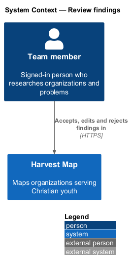
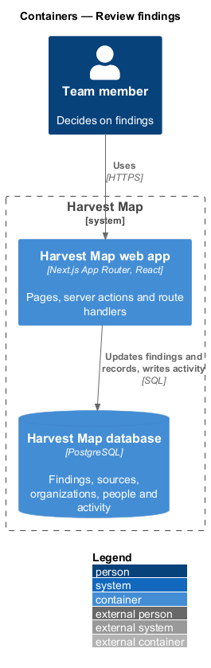
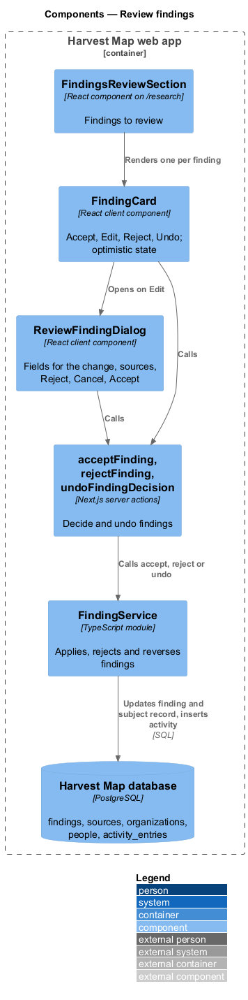
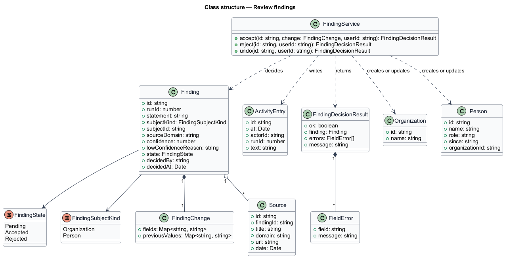
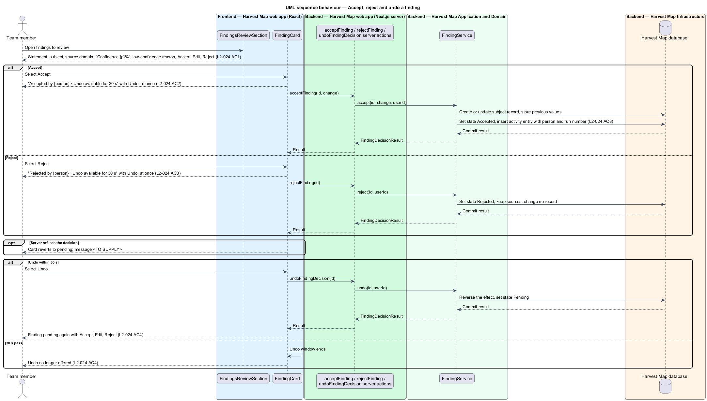
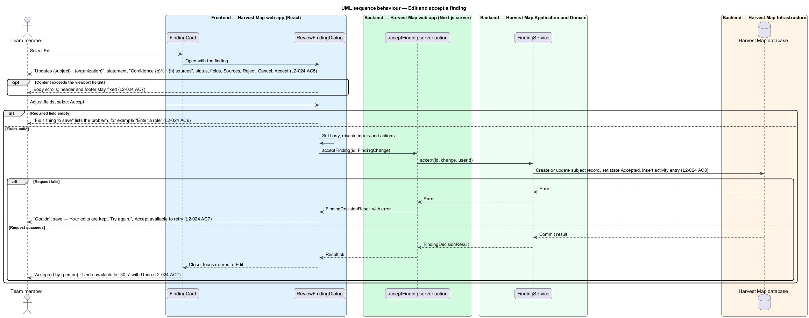

# Review findings

## Overview

Harvest Map is a web application that maps organizations serving Christian youth. Research runs search the web, but no result changes a record on its own: each result waits as a finding until a person decides on it. This feature covers that review.

**finding** — single result of a research run, held for a person to accept, edit or reject before it changes a record

**statement** — sentence a finding asserts, for example "Pat Gelsinger moved from chair to executive chair and head of technology at Gloo in April 2025."

**subject** — organization or person a finding is about

**confidence** — probability from 0 % to 100 % that a finding is correct, as estimated by the research run

**low-confidence finding** — finding whose confidence falls below the low-confidence threshold; it carries its reason inline, for example "Company claim; no independent source."

**undo window** — 30 s period after an Accept or Reject during which the decision can be reversed

**finding state** — review state of a finding: Pending, Accepted or Rejected

The review list is the section "Findings to review" on the Research page (`/research`). Accept applies the finding at once, Reject keeps the source without changing any record, and Edit opens the Review finding dialog for adjusting the values before accepting. The mocks are `docs/mocks/pages/research/review.html` and `docs/mocks/dialogs/review-finding/` with the default, invalid, busy, failed and scroll states.

## Description

The slice runs from React components on the Research page in the Next.js web app to the PostgreSQL database.

- **`FindingsReviewSection`** — section "Findings to review" with the caption "Accept creates or updates the record · Reject keeps the source". It lists one `FindingCard` per finding, and the monitor-research-runs feature adds new findings to it during a run.
- **`FindingCard`** — client component for one finding. It shows the statement, the subject, the source domain, "Confidence {p}%" and, for a low-confidence finding, the reason. A pending card offers Accept, Edit and Reject. A decided card shows "Accepted by {person} · Undo available for 30 s" or "Rejected by {person} · Undo available for 30 s" with "Undo". The card applies Accept and Reject optimistically with the React `useOptimistic` hook and hides Undo when the undo window ends.
- **`ReviewFindingDialog`** — client component titled "Review finding" with the description "Updates {subject} · {organization}". It shows the statement, "Confidence {p}% · {n} sources" with the status badge, the editable fields for the change, the "Sources" list, and the actions Reject, Cancel and Accept. Header and footer stay fixed, and the body scrolls when the content exceeds the viewport height.
- **`acceptFinding`**, **`rejectFinding`** and **`undoFindingDecision`** — Next.js server actions. Each calls `FindingService` and returns a `FindingDecisionResult`.
- **`FindingService`** — server module. `accept(id, change, userId)` applies the `FindingChange` to the subject record, creating or updating it. It stores the previous values for undo, sets the state Accepted and writes an `ActivityEntry` with the person and the run number. `reject(id, userId)` sets the state Rejected and keeps the `Source` rows. `undo(id, userId)` reverses the effect and returns the finding to Pending, and it refuses once the undo window has passed.
- **`Finding`**, **`FindingChange`**, **`Source`** and **`ActivityEntry`** — rows in the `findings`, `sources` and `activity_entries` tables; `FindingChange` is the set of field values a finding writes.

In the dialog an empty required field stops Accept at the error summary "Fix 1 thing to save", which lists the problem, for example "Enter a role". While busy the dialog disables its inputs and actions and marks Accept busy. On failure the dialog shows the alert "Couldn't save — Your edits are kept. Try again." and leaves Accept available as the retry.

The following details are `<TO SUPPLY>`:

- the low-confidence threshold
- the editable fields and the required fields for each kind of finding; the mock shows Role, Since and Organisation for a person
- the text of the activity entry for an applied finding
- the message shown when an optimistic Accept or Reject fails on the server
- how Undo reverses an Accept that created a new record

## Requirements

| L2 ID | Refines (L1) | Requirement |
|-------|--------------|-------------|
| `L2-024` | `L1-008` | AC1. Given findings to review, when the section renders, then each shows statement, subject, source domain, confidence percentage and, for low-confidence ones, the reason inline, with "Accept", "Edit" and "Reject". |
| `L2-024` | `L1-008` | AC2. Given the user selects "Accept", when processed, then the finding applies immediately (optimistic), the card shows "Accepted by {person} · Undo available for 30 s" with "Undo", and the record is created or updated. |
| `L2-024` | `L1-008` | AC3. Given the user selects "Reject", when processed, then the card shows "Rejected by {person} · Undo available for 30 s" and the source is kept without changing any record. |
| `L2-024` | `L1-008` | AC4. Given the user selects Undo within 30 s, when processed, then the effect is reversed and the finding returns to pending; after 30 s, Undo is no longer offered. |
| `L2-024` | `L1-008` | AC5. Given the user selects "Edit", when the dialog opens, then it shows the record it updates, the statement with confidence, source count and status, editable fields for the change (for example Role, Since, Organisation), the sources, and "Reject", "Cancel", "Accept". |
| `L2-024` | `L1-008` | AC6. Given a required field in the dialog is empty, when "Accept" is attempted, then "Fix 1 thing to save" lists the problem, for example "Enter a role". |
| `L2-024` | `L1-008` | AC7. Given the dialog request fails, when it returns, then the failed state shows with retry; the dialog scrolls inside when its content exceeds the viewport height. |
| `L2-024` | `L1-008` | AC8. Given a finding is applied, when it completes, then an activity entry records who accepted it and the run number. |

## Diagrams

### System context

A team member reviews findings in Harvest Map over HTTPS. No external system takes part in the review itself.

### Containers

The Next.js web app renders the review list and the dialog and runs the server actions. The actions update findings, subject records and activity in the PostgreSQL database.

### Components

`FindingsReviewSection` renders `FindingCard` items, and a card opens `ReviewFindingDialog`. Both call the `acceptFinding`, `rejectFinding` and `undoFindingDecision` server actions, which call `FindingService`.

### Class structure

`FindingService` decides a `Finding`, applies its `FindingChange` to an `Organization` or `Person`, keeps its `Source` rows and writes an `ActivityEntry`.

### Behaviour — accept, reject and undo

The card shows the finding with its confidence and any low-confidence reason (`L2-024` AC1). Accept updates the card at once and the server applies the change and writes the activity entry (`L2-024` AC2, AC8). Reject keeps the source and changes no record (`L2-024` AC3). Undo within 30 s reverses the decision; after 30 s the card no longer offers it (`L2-024` AC4).

### Behaviour — edit and accept a finding

Edit opens the dialog with the record, the statement, the fields and the sources (`L2-024` AC5). An empty required field stops Accept at the error summary (`L2-024` AC6). A failed request shows the failed alert with retry, and a long body scrolls inside the dialog (`L2-024` AC7).

