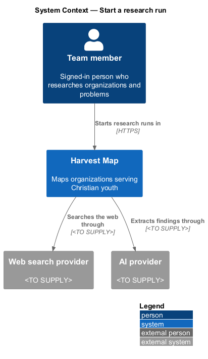
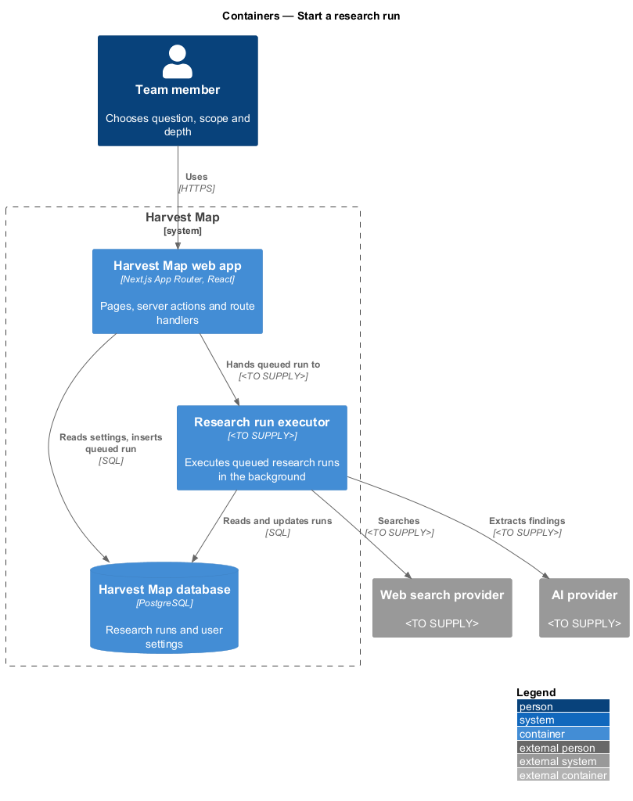
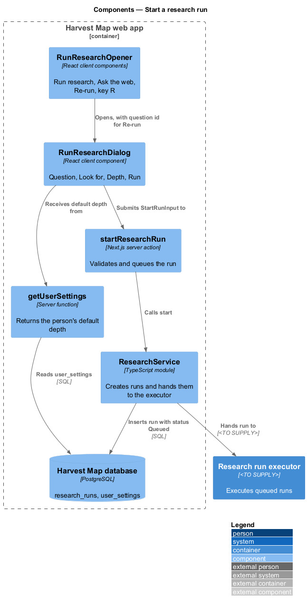
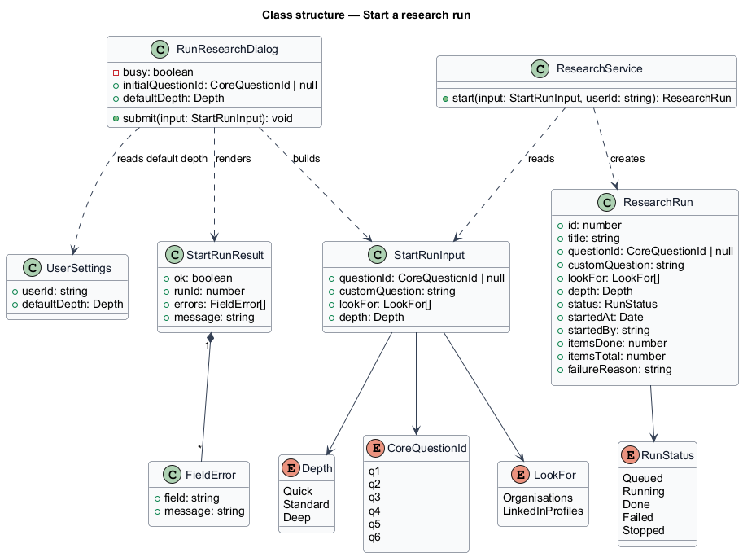
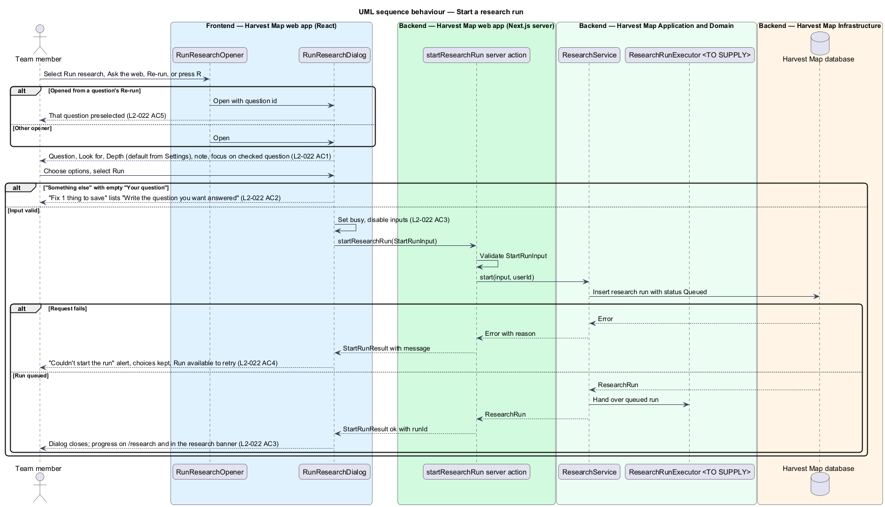

# Start a research run

## Overview

Harvest Map is a web application that maps organizations serving Christian youth. Besides records entered by hand, Harvest Map searches the web for organizations and their key people. This feature covers the dialog that starts such a search.

**research run** — numbered background job that searches the web for one question and produces findings

**core question** — one of the six research questions Harvest Map answers, for example "Who is helping Christian youth, especially with AI?"

**depth** — run setting that trades time for sources: Quick (about 1 minute), Standard (about 5 minutes) or Deep (about 20 minutes, more sources)

**finding** — single result of a research run, held for a person to accept, edit or reject before it changes a record

**verified finding** — finding backed by two sources, or by one trusted source

The dialog is titled "Ask the web". It opens from "Run research" on the Research page, from "Ask the web" on other pages, from Re-run on a question of the Questions page, and from the keyboard shortcut R. On Run, Harvest Map queues the run and closes the dialog; progress then appears on the Research page (`/research`) and in the research banner. The mocks in `docs/mocks/dialogs/run-research/` show the default, invalid, busy and failed states.

## Description

The slice runs from a React dialog in the Next.js web app to the PostgreSQL database and hands the run to background execution.

- **`RunResearchDialog`** — client component titled "Ask the web". It shows the radio group "Question" with the six core questions and "Something else", the text field "Your question" when "Something else" is checked, the checkbox group "Look for", the radio group "Depth", and the note "Findings need two sources, or one trusted source, before they count as verified." The footer offers Cancel and Run. Focus starts on the checked question.
- **`RunResearchOpener`** — the buttons and shortcut that open the dialog: "Run research", "Ask the web", a question's Re-run, and the key R. Re-run passes its question id, and the dialog preselects that question.
- **`startResearchRun`** — Next.js route handler at `POST /api/research/runs`. It receives a `StartRunInput`, validates it, calls `ResearchService.start` and returns a `StartRunResult`.
- **`ResearchService`** — server module. `start(input, userId)` inserts a `ResearchRun` with status Queued and hands it to the `ResearchRunExecutor`.
- **`ResearchRunExecutor`** — background process that executes queued runs. Its mechanism (worker, queue or scheduler) is `<TO SUPPLY>`. The monitor-research-runs feature describes its execution steps.
- **`getUserSettings`** — server function that returns the signed-in person's `UserSettings`. The dialog checks the default depth from it on open.
- **`UserSettings`** — row holding the person's default depth, set on the Settings page.
- **`StartRunInput`**, **`StartRunResult`** and **`FieldError`** — typed request and result.
- **`ResearchRun`** — row in the `research_runs` table of the Harvest Map database.

With "Something else" checked and "Your question" empty, Run shows the error summary "Fix 1 thing to save" listing "Write the question you want answered", and the field shows the same message. While busy the dialog disables every input and Cancel and marks Run busy. On failure the dialog shows the alert "Couldn't start the run" with the reason, for example "Two sources are rate-limiting us. Try again in 2 minutes, or run Quick.", keeps every choice and leaves Run available as the retry.

The following details are `<TO SUPPLY>`:

- the "Look for" options: `L2-022` names Organisations and LinkedIn profiles, and the mock also shows People
- whether at least one "Look for" option is required
- how the run title is formed, for example "Find LinkedIn profiles for 8 unverified people"
- the web search and AI providers the run uses
- the background execution mechanism of `ResearchRunExecutor`

## Requirements

| L2 ID | Refines (L1) | Requirement |
|-------|--------------|-------------|
| `L2-022` | `L1-007` | AC1. Given the dialog, when it opens, then it offers Question (the six core questions or "Something else"), "Look for" (Organisations, LinkedIn profiles), Depth (Quick about 1 minute, Standard about 5 minutes, Deep about 20 minutes · more sources, default from Settings), and the note "Findings need two sources, or one trusted source, before they count as verified.", with focus on the checked question. |
| `L2-022` | `L1-007` | AC2. Given "Something else" with an empty text, when the user selects Run, then "Fix 1 thing to save" lists "Write the question you want answered" and the "Your question" field shows the message. |
| `L2-022` | `L1-007` | AC3. Given valid input, when the user selects Run, then the dialog is busy, the run is queued, the dialog closes, and progress appears on `/research` and in the research banner. |
| `L2-022` | `L1-007` | AC4. Given the request fails, when it returns, then the failed state shows with retry and choices are kept. |
| `L2-022` | `L1-007` | AC5. Given the dialog opened from a question's Re-run, when it opens, then that question is preselected. |

## Diagrams

### System context

A team member starts research runs in Harvest Map over HTTPS. Harvest Map later searches the web through external web search and AI providers, both `<TO SUPPLY>`.

### Containers

The Next.js web app runs the dialog and the route handler, which writes the queued run to the PostgreSQL database. The research run executor picks the run up from there.

### Components

An opener shows `RunResearchDialog`, which receives the default depth from `getUserSettings` and submits to the `startResearchRun` route handler. The handler calls `ResearchService`, which inserts the run and hands it to `ResearchRunExecutor`.

### Class structure

`RunResearchDialog` builds a `StartRunInput` and renders a `StartRunResult` made of `FieldError` entries. `ResearchService` creates a `ResearchRun` with a `Depth`, a set of `LookFor` values and a `RunStatus`.

### Behaviour — start a research run

The dialog opens with the default depth from Settings and focus on the checked question, or on the preselected question for Re-run (`L2-022` AC1, AC5). An empty custom question stops at the error summary (`L2-022` AC2). A valid Run shows the busy state, queues the run and closes the dialog (`L2-022` AC3). A failure shows the failed alert and keeps the choices (`L2-022` AC4).

