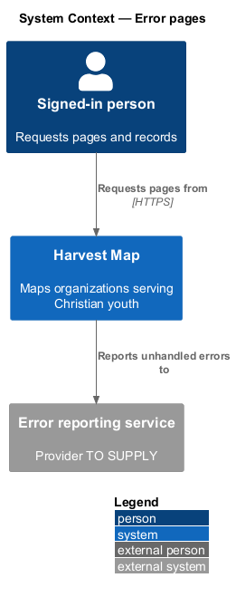
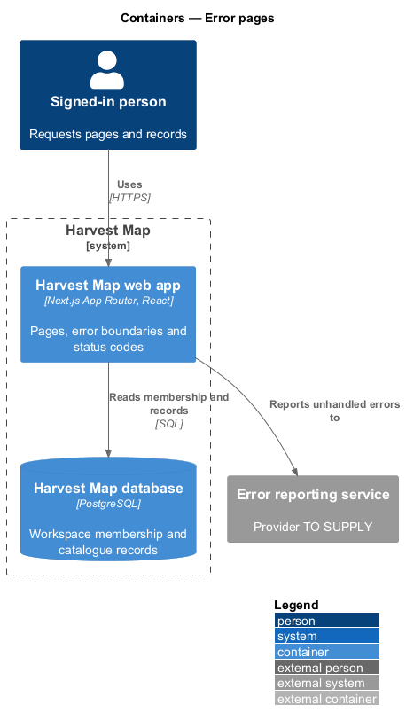
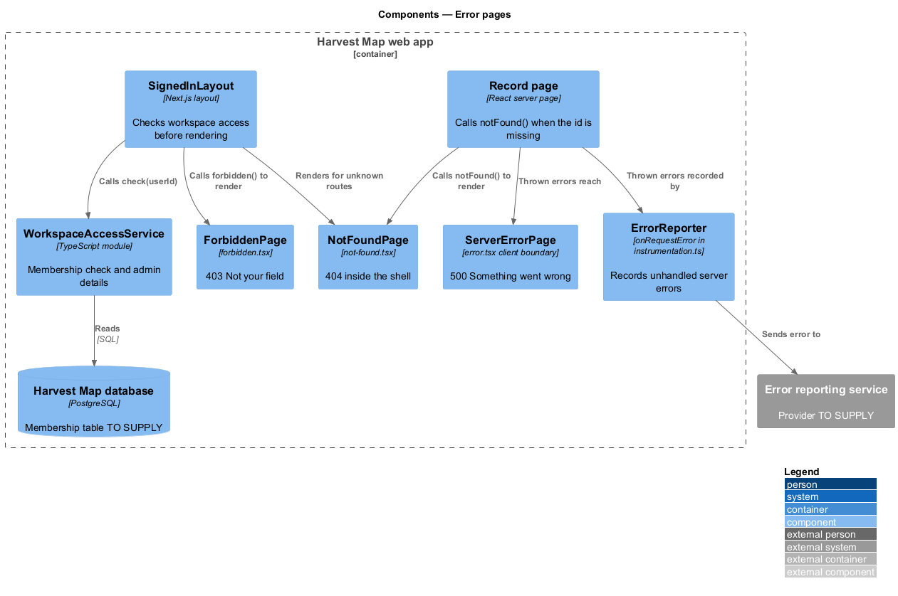
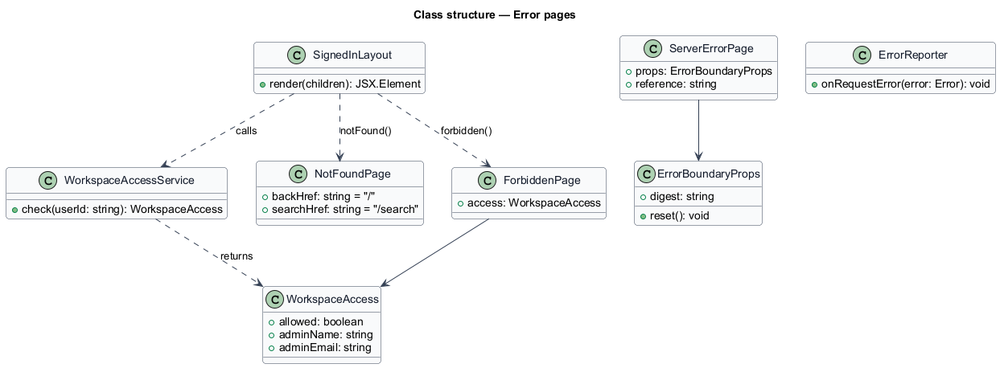
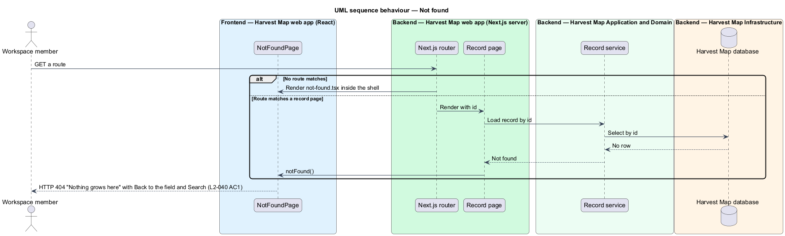
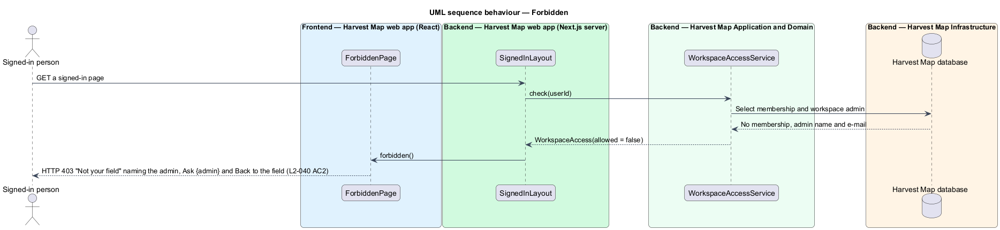
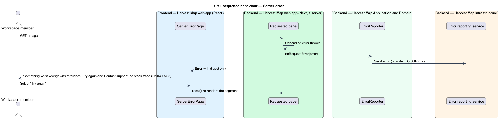

# Error pages

## Overview

Harvest Map is a web application that maps organizations serving Christian youth. Requests fail in three ways a team member can notice: the address names no page or record, the signed-in person has no access to the workspace, or the server fails while handling the request. This feature gives each case its own page with a way forward and the matching HTTP status.

**workspace** — the shared Harvest Map catalogue that one team works in, with one admin who invites members

**workspace member** — signed-in person with access to the workspace

**error reference** — short code, for example "HM-9C21", that a team member quotes to support so the failure can be found without exposing internal detail

The feature belongs to the resilience subsystem. The 404 page renders inside the navigation shell (`L2-030`), as do the 403 and 500 pages in the mocks. The mocks are `docs/mocks/pages/not-found/default.html`, `docs/mocks/pages/forbidden/default.html` and `docs/mocks/pages/server-error/default.html`.

## Description

The slice runs from Next.js special files in the web app to the PostgreSQL database for the access check.

- **`NotFoundPage`** — `not-found.tsx` in the signed-in route group, so it renders inside the shell. Next.js returns HTTP 404 with it for unknown routes and whenever a page calls `notFound()`. Record pages call `notFound()` when the id does not exist. It shows "404", "Nothing grows here", "The page you asked for doesn't exist, or was deleted.", "Back to the field" (`/`) and "Search" (`/search`).
- **`SignedInLayout`** — the shell layout (`L2-030`). Before rendering a page it asks `WorkspaceAccessService` whether the signed-in user is a workspace member, and calls `forbidden()` when not.
- **`ForbiddenPage`** — `forbidden.tsx`, rendered with HTTP 403. It shows "403", "Not your field", "You don't have access to this workspace. Ask {admin name}, the admin, to invite you.", "Ask {admin first name}" as a `mailto:` link to the admin's e-mail address, and "Back to the field".
- **`WorkspaceAccessService`** — server module. `check(userId)` returns `WorkspaceAccess` with `allowed`, `adminName` and `adminEmail`. The table that records membership and the admin is `<TO SUPPLY>`.
- **`ServerErrorPage`** — `error.tsx` client error boundary for the signed-in route group. It shows "500", "Something went wrong", "We've been notified. Try again, or share reference {reference} with support.", "Try again" (calls the boundary's `reset()`), and "Contact support" as `mailto:support@harvestmap.app?subject={reference}`. It receives only the error `digest` from Next.js and renders no message, stack trace or internal detail.
- **`ErrorReporter`** — `onRequestError` hook in `instrumentation.ts` that records each unhandled server error. The reporting service behind "We've been notified" is `<TO SUPPLY>`. The way the reference is derived from the error `digest` is `<TO SUPPLY>`.

## Requirements

| L2 ID | Refines (L1) | Requirement |
|-------|--------------|-------------|
| `L2-040` | `L1-014` | AC1. Given an unknown route or record id, when requested, then a 404 page with a way back to the Field is shown and HTTP status 404 is returned. |
| `L2-040` | `L1-014` | AC2. Given a signed-in user without access to the workspace, when requested, then the 403 page "Not your field — You don't have access to this workspace. Ask {admin name}, the admin, to invite you." is shown with "Ask {admin}" and "Back to the field". |
| `L2-040` | `L1-014` | AC3. Given an unhandled server error, when it occurs, then the 500 page "Something went wrong" is shown with a retry, and no stack trace or internal detail is shown. |

## Diagrams

### System context

A team member reaches the error pages through Harvest Map. Harvest Map reports unhandled errors to an error reporting service, which is `<TO SUPPLY>`.

### Containers

The Next.js web app renders the error pages and sets the status codes. The access check reads membership from the PostgreSQL database.

### Components

`SignedInLayout` calls `WorkspaceAccessService` and falls through to `ForbiddenPage`. Unknown routes and missing records reach `NotFoundPage`. Thrown errors reach `ServerErrorPage`, and `ErrorReporter` records them.

### Class structure

`WorkspaceAccessService` returns `WorkspaceAccess`, which `ForbiddenPage` uses for the admin's name and e-mail. `ServerErrorPage` receives an `ErrorBoundaryProps` holding only the digest and `reset`.

### Behaviour — not found

An unknown route or a missing record id renders the 404 page with HTTP 404 and a link back to the Field (`L2-040` AC1).

### Behaviour — forbidden

A signed-in user who is not a workspace member gets the 403 page naming the admin (`L2-040` AC2).

### Behaviour — server error

An unhandled error is reported and the 500 page shows a reference and "Try again" with no internal detail (`L2-040` AC3).

