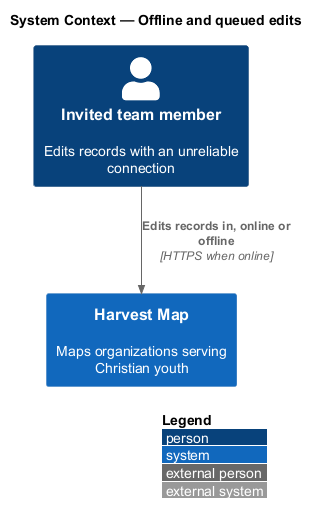
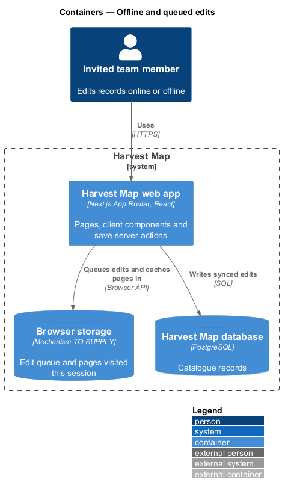
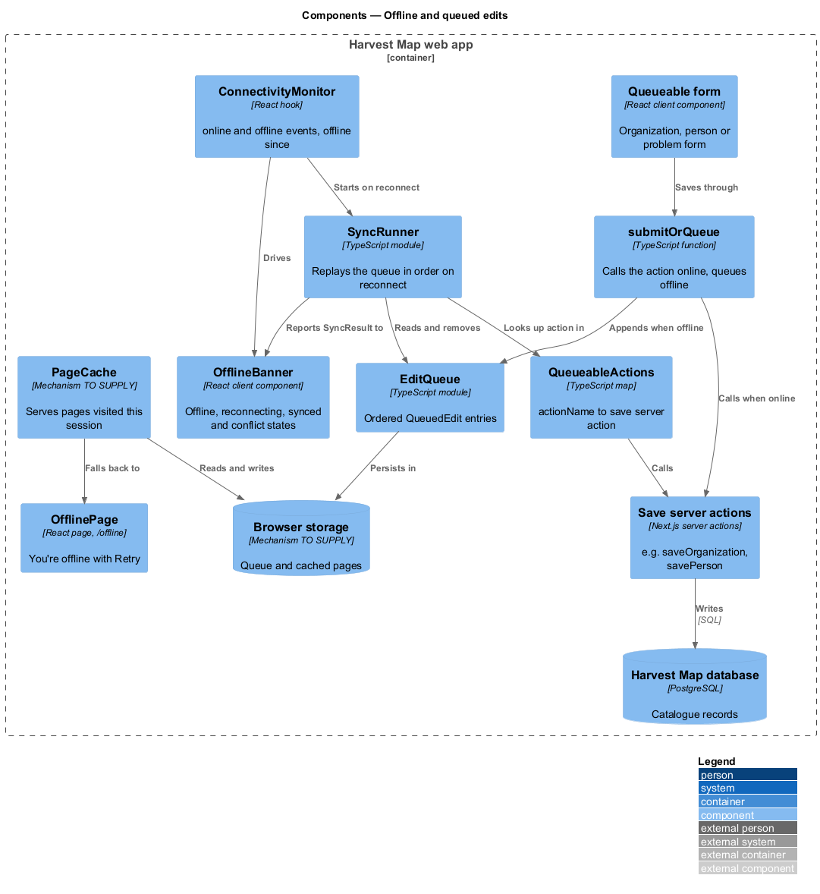
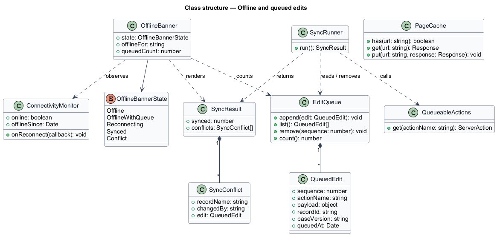
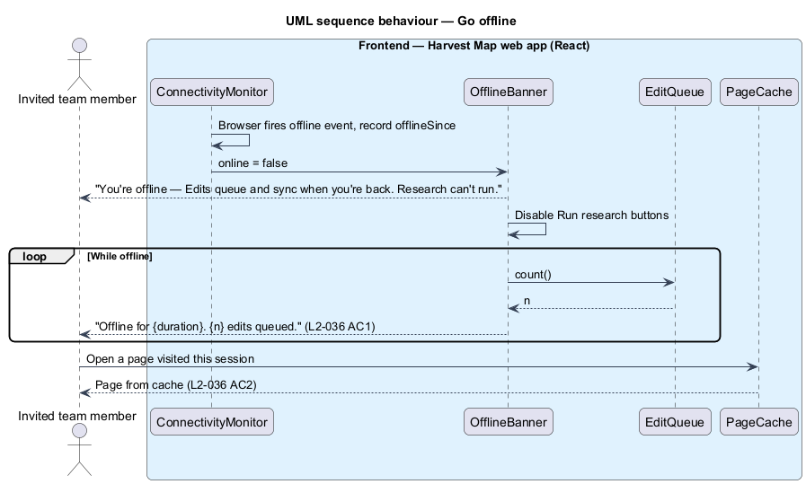
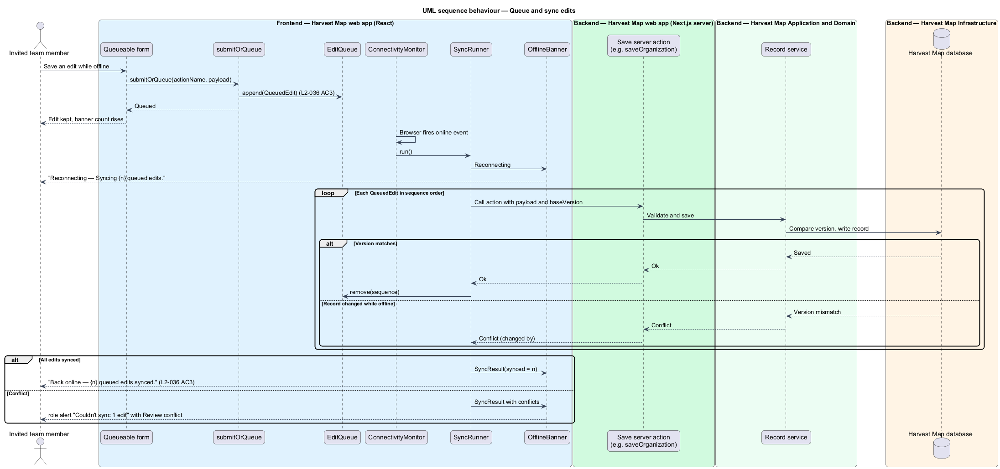
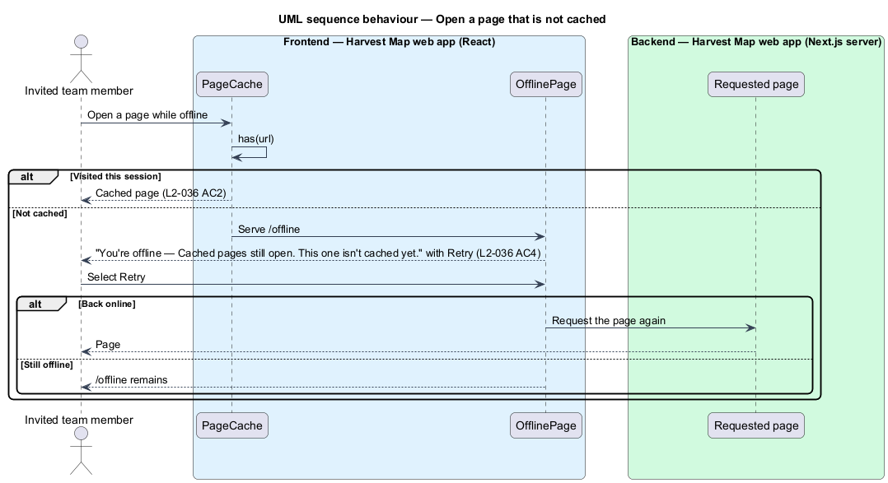

# Offline and queued edits

## Overview

Harvest Map is a web application that maps organizations serving Christian youth. Team members edit records on laptops and phones, and connections drop. This feature keeps Harvest Map usable without a connection and protects edits made while offline.

**offline** — state in which the browser reports no network connection

**queued edit** — save made while offline, held in the browser and sent to the server once the connection returns

**sync** — replay of queued edits to the server, in the order they were made

**cached page** — page visited earlier in the same browser session that opens again without a connection

The feature belongs to the resilience subsystem. An offline banner appears below the header on every page while offline and reports the outcome of the sync afterwards. A page that was not visited this session falls back to the `/offline` page. The mocks in `docs/mocks/notifications/offline-banner/` show the warning, persistent, info, success and danger states of the banner, and `docs/mocks/pages/offline/default.html` shows the fallback page.

## Description

The slice runs from client components in the browser, through the existing save server actions, to the PostgreSQL database.

- **`ConnectivityMonitor`** — client hook. It reads `navigator.onLine`, listens for the browser `online` and `offline` events, and records when the browser went offline.
- **`OfflineBanner`** — client component rendered by the layout below the header. It shows one state at a time:

  | State | Kind | Title | Message | Dismiss |
  |-------|------|-------|---------|---------|
  | Just offline | warning | You're offline | Edits queue and sync when you're back. Research can't run. | no |
  | Offline with queue | warning | Offline for {duration} | {n} edits queued. | no |
  | Reconnecting | info | Reconnecting | Syncing {n} queued edits. | no |
  | Synced | success | Back online | {n} queued edits synced. | yes |
  | Sync conflict | danger | Couldn't sync {n} edit | {record} was changed by {person} while you were offline. Link "Review conflict". | no |

  The mock notes that the offline banner is not dismissible because it is the only indicator that saves are queued, and that Run research buttons are disabled while it shows. The danger state uses `role="alert"`; the others use `role="status"`. The duration wording rule (for example "2 hours") is `<TO SUPPLY>`.
- **`submitOrQueue`** — client function that every queueable form calls instead of its server action. Online, it calls the server action. Offline, it appends a `QueuedEdit` to `EditQueue` and reports the save as queued.
- **`EditQueue`** — ordered store of `QueuedEdit` entries in browser storage. The storage mechanism is `<TO SUPPLY>`.
- **`QueuedEdit`** — `sequence`, `actionName`, `payload`, `recordId`, `baseVersion` and `queuedAt`.
- **`SyncRunner`** — client module. When the connection returns, it replays `EditQueue` in `sequence` order through `QueueableActions` and removes each edit the server accepts.
- **`QueueableActions`** — map from `actionName` to the existing save server actions, for example `saveOrganization` (`L2-008`) and `savePerson` (`L2-014`). The full list of queueable actions is `<TO SUPPLY>`.
- **Save server actions and their services** — unchanged server code that validates and persists the edit. A save whose `baseVersion` no longer matches the stored record returns a conflict instead of overwriting. The versioning field and the conflict-review flow behind "Review conflict" are `<TO SUPPLY>`.
- **`PageCache`** — keeps pages visited this session available offline. The caching mechanism is `<TO SUPPLY>`.
- **`OfflinePage`** — page at `/offline`. It shows "You're offline", "Cached pages still open. This one isn't cached yet." and "Retry".

## Requirements

| L2 ID | Refines (L1) | Requirement |
|-------|--------------|-------------|
| `L2-036` | `L1-014` | AC1. Given the browser goes offline, when the user is on any page, then a banner "Offline for {duration}. {n} edits queued." is shown. |
| `L2-036` | `L1-014` | AC2. Given pages visited this session, when offline, then they remain available from cache. |
| `L2-036` | `L1-014` | AC3. Given the user saves an edit while offline, when saved, then it is queued locally and synced automatically in order when the connection returns, and the banner changes to a success message. |
| `L2-036` | `L1-014` | AC4. Given a page that is not cached, when offline, then the `/offline` page shows "You're offline — Cached pages still open. This one isn't cached yet." with "Retry". |

## Diagrams

### System context

An invited team member uses Harvest Map with or without a connection. No external system takes part.

### Containers

The Harvest Map web app keeps the edit queue and cached pages in browser storage while offline. On reconnect it sends queued edits to its server actions, which write to the PostgreSQL database.

### Components

Forms call `submitOrQueue`, which either calls a save server action or appends to `EditQueue`. `ConnectivityMonitor` drives `OfflineBanner` and starts `SyncRunner`, which replays the queue through `QueueableActions`. `PageCache` serves visited pages and falls back to `OfflinePage`.

### Class structure

`EditQueue` holds ordered `QueuedEdit` entries. `SyncRunner` reads the queue and calls actions from `QueueableActions`, and reports a `SyncResult` that `OfflineBanner` renders as an `OfflineBannerState`.

### Behaviour — go offline

When the browser goes offline, the banner appears on the current page and then reports the offline duration and queued count (`L2-036` AC1). Visited pages keep opening from the cache (`L2-036` AC2).

### Behaviour — queue and sync edits

An offline save goes to the local queue. On reconnect the queue replays in order and the banner turns to "Back online" (`L2-036` AC3). A conflicting edit stops at the server and the banner shows the danger state.

### Behaviour — open a page that is not cached

A request for a page not visited this session falls back to `/offline` with "Retry" (`L2-036` AC4).

