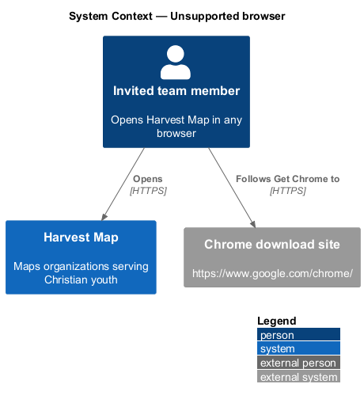
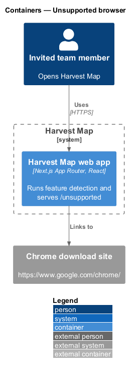
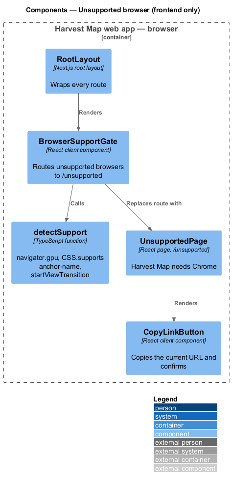
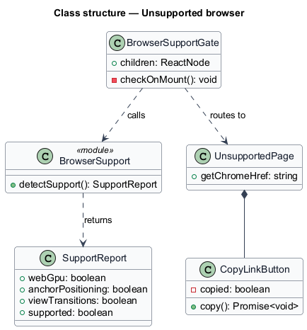
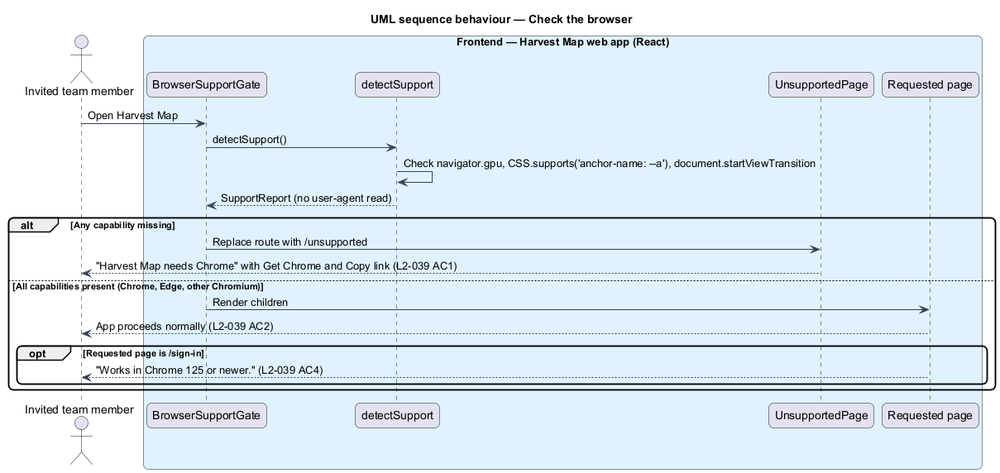
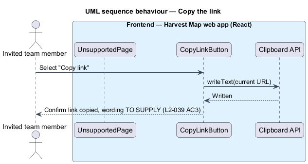

# Unsupported browser

## Overview

Harvest Map is a web application that maps organizations serving Christian youth. Its interface depends on three browser capabilities: WebGPU for the animated field, CSS anchor positioning for popovers, and view transitions between pages. A browser without them cannot run the app correctly. This feature detects that case and directs the team member to a supported browser.

**feature detection** — check, run in the browser, of whether a capability exists, as opposed to reading the browser's user-agent string

**supported browser** — browser that passes feature detection for WebGPU, CSS anchor positioning and view transitions; Chrome 125 or newer, and Edge or another Chromium browser that passes

The feature belongs to the resilience subsystem. A check runs when the app opens; a failing browser lands on `/unsupported`. The sign-in page states the browser requirement up front (`L2-001`). The mock `docs/mocks/pages/unsupported-browser/default.html` shows the page, which has no navigation header.

## Description

The slice is frontend-only: client code in the Next.js web app decides support and renders the page. No server action or database takes part.

- **`BrowserSupportGate`** — client component in the root layout. On first render it calls `detectSupport()` and, when any capability is missing, replaces the route with `/unsupported`. A supported browser proceeds with no visible step.
- **`detectSupport`** — function that returns a `SupportReport`. The mock names the checks `navigator.gpu` and `CSS.supports('anchor-name: --a')`; the view-transition check reads `document.startViewTransition`. It never reads the user-agent string.
- **`SupportReport`** — `webGpu`, `anchorPositioning`, `viewTransitions` and the derived `supported` flag.
- **`UnsupportedPage`** — page at `/unsupported`. It shows "Harvest Map needs Chrome", the text "It uses WebGPU, anchor positioning and view transitions that only Chrome 125 or newer supports. Open this link in Chrome to continue.", a "Get Chrome" link to `https://www.google.com/chrome/` and a "Copy link" button.
- **`CopyLinkButton`** — client component. It writes the current URL to the clipboard and tells the team member the link was copied. The wording and form of that confirmation are `<TO SUPPLY>`; the mock does not show it. Whether "current URL" means `/unsupported` or the address originally opened is `<TO SUPPLY>`.
- **`SignInPage` note** — the sign-in page renders "Works in Chrome 125 or newer." (`L2-001`); this design adds no other behaviour to that page.

## Requirements

| L2 ID | Refines (L1) | Requirement |
|-------|--------------|-------------|
| `L2-039` | `L1-014` | AC1. Given a browser lacking WebGPU, CSS anchor positioning or view transitions (feature detection, not user-agent sniffing), when the app opens, then `/unsupported` shows "Harvest Map needs Chrome" with "Get Chrome" and "Copy link". |
| `L2-039` | `L1-014` | AC2. Given a Chromium browser (including Edge) that passes feature detection, when the app opens, then it proceeds normally. |
| `L2-039` | `L1-014` | AC3. Given "Copy link", when selected, then the current URL is copied and the user is told. |
| `L2-039` | `L1-014` | AC4. Given the sign-in page, when rendered, then it states "Works in Chrome 125 or newer." |

## Diagrams

### System context

A team member opens Harvest Map in some browser. When the browser is unsupported, Harvest Map links to the Chrome download site.

### Containers

The Harvest Map web app runs the check in the browser and serves `/unsupported`. The database plays no part in this slice and is left out of the view.

### Components

The component view is frontend-only. `BrowserSupportGate` calls `detectSupport` and routes to `UnsupportedPage`, which holds `CopyLinkButton`.

### Class structure

`BrowserSupportGate` depends on `detectSupport`, which returns a `SupportReport`. `UnsupportedPage` composes `CopyLinkButton`.

### Behaviour — check the browser

The gate runs feature detection when the app opens. A missing capability routes to `/unsupported` (`L2-039` AC1); a passing browser proceeds (`L2-039` AC2). The sign-in page shows the Chrome note either way (`L2-039` AC4).

### Behaviour — copy the link

"Copy link" writes the current URL to the clipboard and confirms it (`L2-039` AC3).

