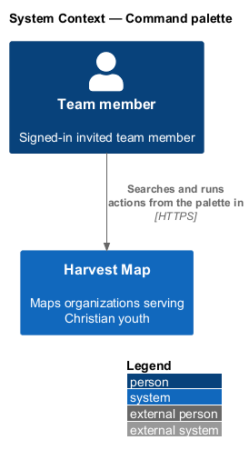
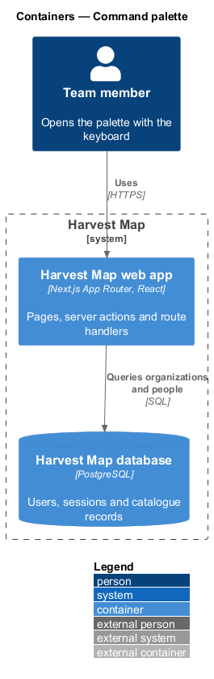
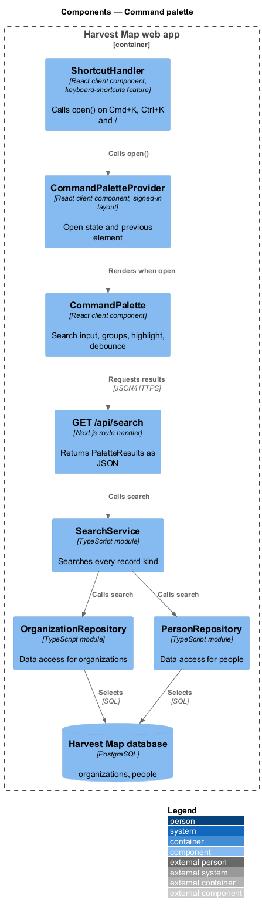
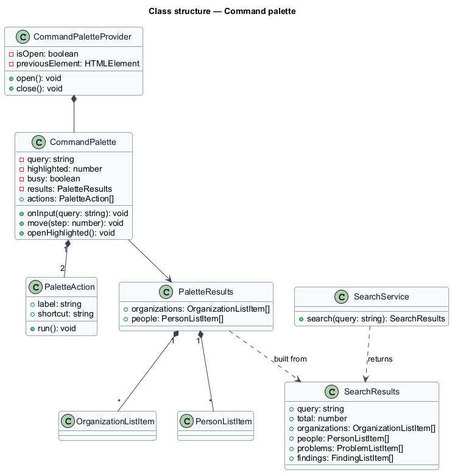
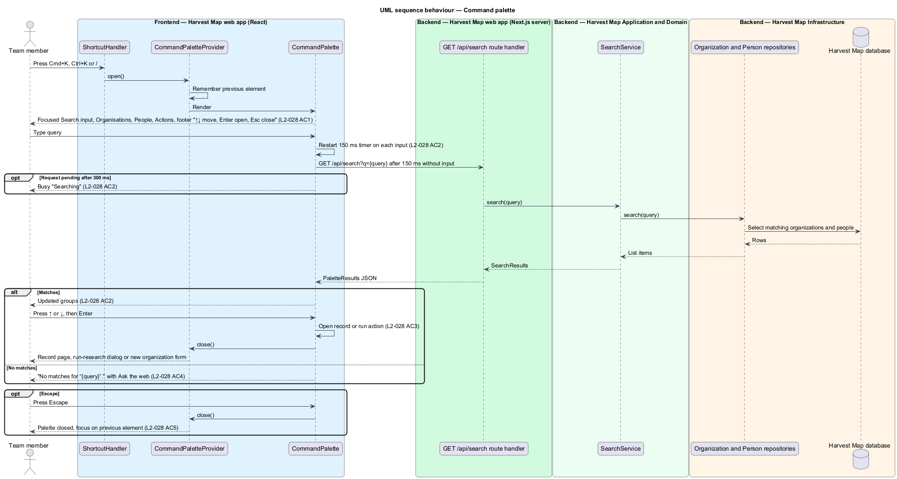

# Command palette

## Overview

Harvest Map is a web application that maps organizations serving Christian youth. Besides the Search page, it offers a keyboard-driven way to jump to a record or run a common action without leaving the current page. This feature covers that command palette.

**command palette** — dialog with one Search input that lists matching records and actions and opens the highlighted one with Enter

**highlighted result** — entry in the palette that ↑ and ↓ move between and Enter opens

**action** — palette entry that runs a command instead of opening a record, shown with its single-key shortcut

**previous element** — element that held focus before the palette opened

The palette belongs to the search subsystem and is available on every signed-in page. It opens with ⌘K (Ctrl+K on Windows and Linux) or `/`, and from the "⌘K" search button in the page header. The mocks in `docs/mocks/dialogs/command-palette/` show the default, busy and no-results states.

## Description

The slice runs from a React dialog in the Next.js web app to the PostgreSQL database.

- **`CommandPaletteProvider`** — client component in the signed-in layout. It holds the open state, remembers the previous element, and renders `CommandPalette` when open. It exposes `open()` to the header search button and to `ShortcutHandler`. `ShortcutHandler` belongs to the keyboard-shortcuts feature (`L2-029`) and calls `open()` on ⌘K, Ctrl+K and `/`. Whether `/` opens the palette while a text input has focus is `<TO SUPPLY>`.
- **`CommandPalette`** — client component rendered as a modal dialog.
  - It holds the Search input, focused on open, with an "Esc" hint.
  - It lists results in groups: "Organisations" (name and "City · Tag"), "People" (name and "Role · Organization") and "Actions" ("Run research" with the shortcut R, "New organisation" with the shortcut N). Whether the actions filter by the query is `<TO SUPPLY>`; the default mock shows both actions for the query "gl".
  - The footer reads "↑↓ move ↵ open Esc close".
  - Typing restarts a 150 ms timer; when it expires with no further input, the palette requests results for the query. When the request has not returned 300 ms after it started, the palette shows the busy state "Searching" with "Searching organisations, people and findings".
  - ↑ and ↓ move the highlighted result. Enter opens the highlighted record (`/organizations/:id` or `/people/:id`) or runs the highlighted action, then closes the palette. "Run research" opens the run-research dialog owned by the research subsystem. "New organisation" opens the new organization form (`L2-008`).
  - With no matching records, it shows "No matches for “{query}”." and the action "Ask the web", which opens the run-research dialog.
  - Escape closes the palette and returns focus to the previous element.
- **`GET /api/search`** — Next.js route handler. It reads the query from the `q` parameter, calls `SearchService.search` and returns `PaletteResults` as JSON. The number of results per group is `<TO SUPPLY>`.
- **`SearchService`** — server module shared with the Search page (`L2-027`). `search` returns `SearchResults` for all record kinds; the route handler keeps the organizations and people.
- **`OrganizationRepository`** and **`PersonRepository`** — data-access modules whose `search` methods return list-row read models.
- **`PaletteResults`** — JSON body: `organizations` and `people`.

The busy mock text names findings, but the default mock shows no findings group; whether the palette lists findings is `<TO SUPPLY>`. Behaviour when the request fails is `<TO SUPPLY>`; the mocks show no failed state.

## Requirements

| L2 ID | Refines (L1) | Requirement |
|-------|--------------|-------------|
| `L2-028` | `L1-011` | AC1. Given the palette opens, when shown, then it has a Search input with focus, grouped results ("Organisations", "People", "Actions" including "Run research R" and "New organisation N"), and a footer "↑↓ move ↵ open Esc close". |
| `L2-028` | `L1-011` | AC2. Given the user types, when 150 ms pass with no input, then results update; the spinner shows only after 300 ms. |
| `L2-028` | `L1-011` | AC3. Given results, when the user presses ↑/↓ and Enter, then the highlighted result opens or action runs and the palette closes. |
| `L2-028` | `L1-011` | AC4. Given no matches, when searched, then the no-results state is shown. |
| `L2-028` | `L1-011` | AC5. Given Escape, when pressed, then the palette closes and focus returns to the previous element. |

## Diagrams

### System context

A team member searches and runs actions from the palette in Harvest Map over HTTPS. No external system takes part.

### Containers

The palette runs in the browser part of the Next.js web app and calls a route handler on the server, which queries the PostgreSQL database.

### Components

`CommandPaletteProvider` opens `CommandPalette` from the header button or from `ShortcutHandler`. `CommandPalette` calls `GET /api/search`, which calls `SearchService` and the organization and person repositories.

### Class structure

`CommandPalette` holds the query, the highlighted index, the `PaletteResults` and the static `PaletteAction` list. `SearchService` returns `SearchResults`, from which the route handler builds `PaletteResults`.

### Behaviour — search and open from the palette

The palette opens with focus in the Search input (`L2-028` AC1). Results update after 150 ms without input and the busy state appears only after 300 ms (`L2-028` AC2). ↑, ↓ and Enter open the highlighted result or run the action (`L2-028` AC3). No matches show the no-results state (`L2-028` AC4). Escape closes the palette and restores focus (`L2-028` AC5).

