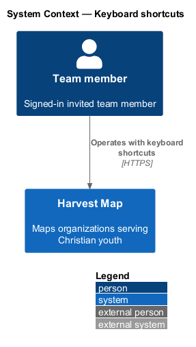
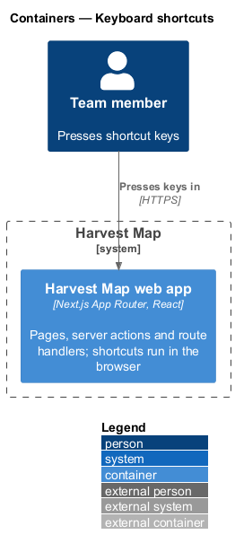
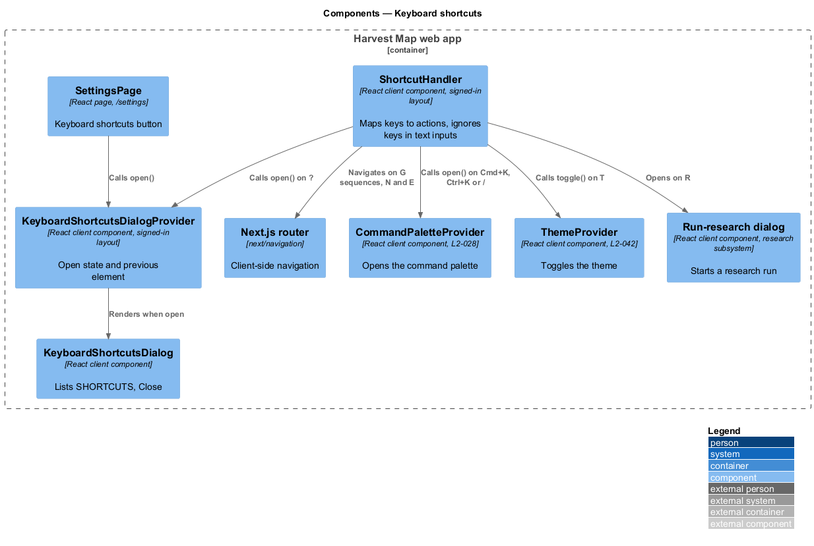
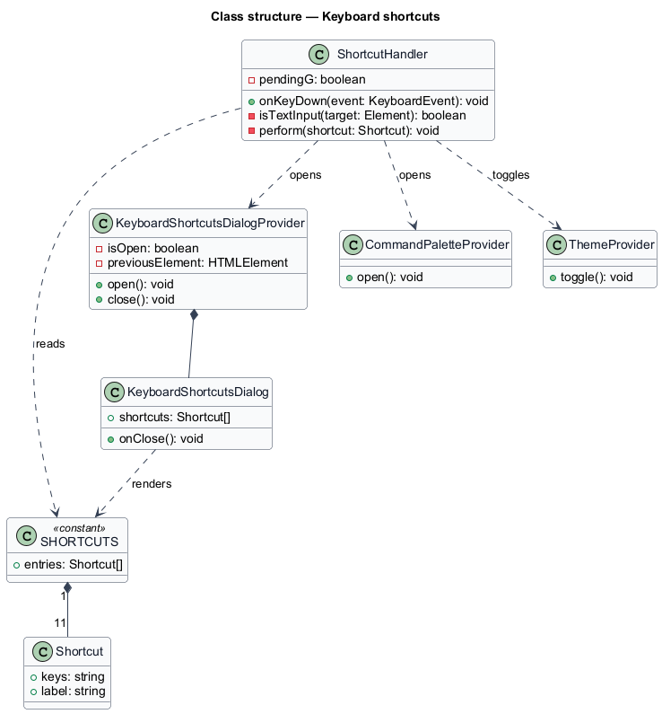
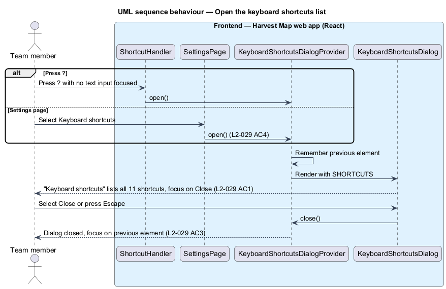
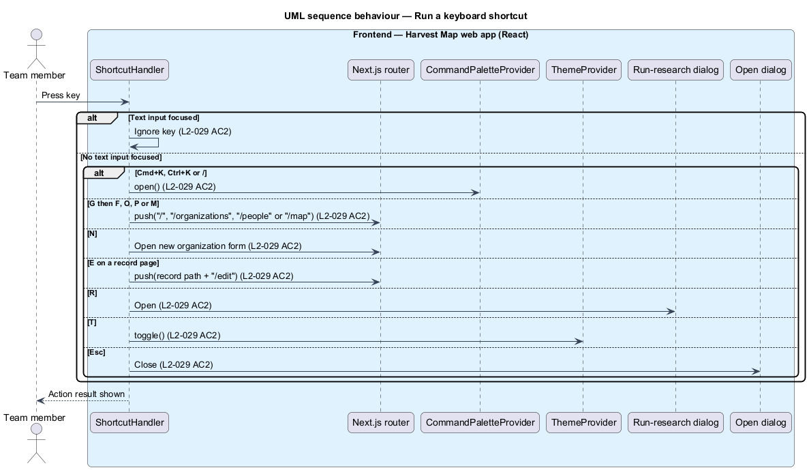

# Keyboard shortcuts

## Overview

Harvest Map is a web application that maps organizations serving Christian youth. It supports keyboard operation, and a set of single-key and two-key shortcuts moves between the main pages and runs common actions. This feature covers those shortcuts and the dialog that lists them.

**shortcut** — key or key sequence that performs one action when no text input has focus

**key sequence** — two keys pressed one after the other, written "G then F"

**text input** — focused element that accepts typed text: an `input` that takes text, a `textarea`, a `select` or an element with `contenteditable`

**record page** — detail page of one organization, person or problem

The shortcuts belong to the search subsystem and work on every signed-in page. Pressing `?` opens the Keyboard shortcuts dialog, which also opens from "Keyboard shortcuts" on the Settings page. The mock `docs/mocks/dialogs/keyboard-shortcuts/default.html` shows the dialog.

## Description

The slice runs entirely in the browser part of the Next.js web app. No server action, route handler or database read takes part.

- **`ShortcutHandler`** — client component in the signed-in layout. It listens for `keydown` on the document and ignores each key while a text input has focus. It maps keys to actions as follows.

  | Keys | Label | Action |
  |------|-------|--------|
  | ⌘K (Ctrl+K on Windows and Linux) | Search | `CommandPaletteProvider.open()` (`L2-028`) |
  | G then F | Field | Navigate to `/` |
  | G then O | Organisations | Navigate to `/organizations` |
  | G then P | People | Navigate to `/people` |
  | G then M | Map | Navigate to `/map` |
  | N | New organisation | Open the new organization form (`L2-008`) |
  | R | Run research | Open the run-research dialog owned by the research subsystem |
  | E | Edit this record | On a record page, navigate to its edit route (`/organizations/:id/edit`, `/people/:id/edit`, `/problems/:id/edit`) |
  | T | Toggle theme | Call `ThemeProvider.toggle()`, owned by the theming feature (`L2-042`) |
  | ? | This list | Open `KeyboardShortcutsDialog` |
  | Esc | Close | Close the open dialog |

  The key `/` also calls `CommandPaletteProvider.open()` (`L2-028`); the dialog does not list it. The time allowed between G and the second key is `<TO SUPPLY>`. The behaviour of E on a page that is not a record page is `<TO SUPPLY>`.
- **`SHORTCUTS`** — constant list of `Shortcut` entries (`keys`, `label`). `KeyboardShortcutsDialog` renders it, so the dialog and the handler list the same shortcuts.
- **`KeyboardShortcutsDialog`** — client component rendered as a modal dialog titled "Keyboard shortcuts". It lists each entry of `SHORTCUTS` and offers "Close", which has focus on open. "Close", the close button or Escape closes it and returns focus to the element that held focus before it opened.
- **`KeyboardShortcutsDialogProvider`** — client component in the signed-in layout. It holds the open state and the previous element, and exposes `open()` to `ShortcutHandler` and to the "Keyboard shortcuts" button on the Settings page.

## Requirements

| L2 ID | Refines (L1) | Requirement |
|-------|--------------|-------------|
| `L2-029` | `L1-011` | AC1. Given any page with no text input focused, when the user presses `?`, then the Keyboard shortcuts dialog lists: ⌘K Search, G then F Field, G then O Organisations, G then P People, G then M Map, N New organisation, R Run research, E Edit this record, T Toggle theme, ? This list, Esc Close. |
| `L2-029` | `L1-011` | AC2. Given each listed shortcut, when pressed with no text input focused, then it performs its action. |
| `L2-029` | `L1-011` | AC3. Given the dialog, when the user selects Close or presses Escape, then it closes and focus returns. |
| `L2-029` | `L1-011` | AC4. Given the Settings page, when the user selects "Keyboard shortcuts", then the dialog opens. |

## Diagrams

### System context

A team member operates Harvest Map with the keyboard over HTTPS. No external system takes part.

### Containers

The shortcuts run in the browser part of the Next.js web app. Navigation shortcuts load other pages from the same web app; no shortcut reads the database directly.

### Components

`ShortcutHandler` maps keys to the Next.js router, `CommandPaletteProvider`, `ThemeProvider`, the run-research dialog and `KeyboardShortcutsDialogProvider`. The Settings page also opens the dialog through `KeyboardShortcutsDialogProvider`.

### Class structure

`ShortcutHandler` and `KeyboardShortcutsDialog` both read the `SHORTCUTS` list of `Shortcut` entries. `KeyboardShortcutsDialogProvider` owns the dialog's open state.

### Behaviour — open the shortcuts list

Pressing `?` with no text input focused, or selecting "Keyboard shortcuts" on the Settings page, opens the dialog with the full list (`L2-029` AC1, AC4). "Close" or Escape closes it and returns focus (`L2-029` AC3).

### Behaviour — run a shortcut

`ShortcutHandler` ignores keys while a text input has focus. Otherwise it performs the action of the pressed shortcut or completed key sequence (`L2-029` AC2).

