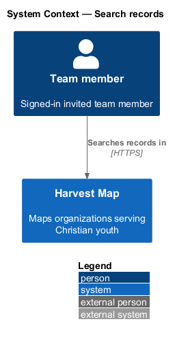
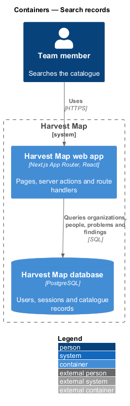
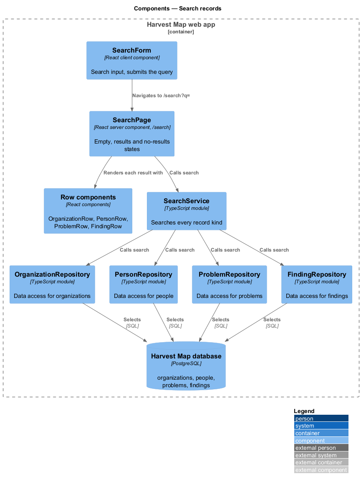
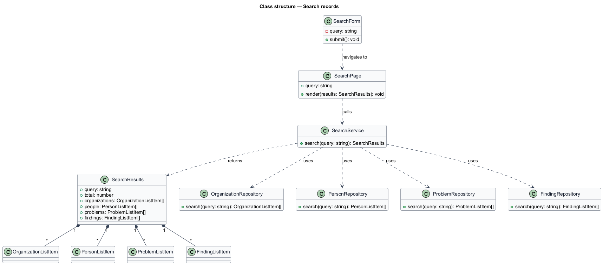
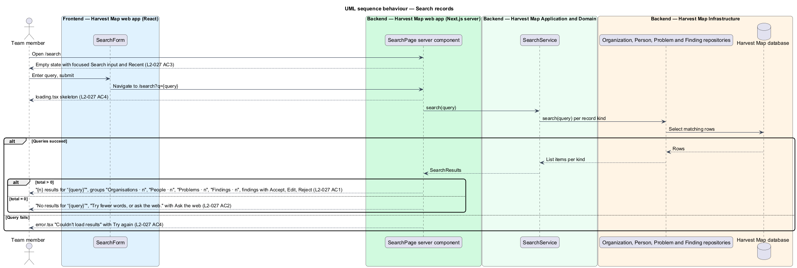

# Search records

## Overview

Harvest Map is a web application that maps organizations serving Christian youth. Its catalogue holds four kinds of record: organizations, people, problems and findings. This feature covers the Search page, which finds records of all four kinds from one query.

**query** — free text a team member enters to find records

**problem** — record of a large problem that organizations target, ranked by impact

**finding** — research result about a record that a team member accepts, edits or rejects before it changes the record

**result group** — set of matching records of one kind, headed by the kind and its count, for example "People · 2"

The Search page lives at `/search` in the search subsystem. A submitted query appears in the URL as `/search?q={query}`, so the server renders the results for the query in the URL. The mocks in `docs/mocks/pages/search/` show the default, loading, empty, error and no-results states.

## Description

The slice runs from a React page in the Next.js web app to the PostgreSQL database.

- **`SearchPage`** — React server component at `/search`, rendered on the Next.js server. It reads the query from the URL. With an empty query it renders the empty state; otherwise it calls `SearchService.search` and renders the results.
  - Results: the total line "{n} results for “{query}”" and up to four result groups, "Organisations · n", "People · n", "Problems · n" and "Findings · n". Each record renders like its list row: `OrganizationRow`, `PersonRow`, `ProblemRow` and `FindingRow`. Each finding row carries "Accept", "Edit" and "Reject". Whether a group with no matches is hidden is `<TO SUPPLY>`; the default mock shows only groups with matches.
  - No results: "No results for “{query}”", the suggestion "Try fewer words, or ask the web." and the action "Ask the web", which opens the run-research dialog owned by the research subsystem.
  - Empty: the Search input with focus and a "Recent" list of earlier queries. The source and length of the recent-query list are `<TO SUPPLY>`.
- **`SearchForm`** — client component. It renders the Search input (placeholder "Organisations, people, problems") and submits the query by navigating to `/search?q={query}`.
- **`loading.tsx`** — Next.js loading UI for `/search`. It shows the skeleton and a disabled Search input.
- **`error.tsx`** — Next.js error boundary for `/search`. It shows "Couldn't load results" with "Try again" and "Go back".
- **`SearchService`** — server module. `search` calls the four repositories with the query and returns `SearchResults`. The matching rule (fields searched, case handling, ranking) is `<TO SUPPLY>`.
- **`OrganizationRepository`**, **`PersonRepository`**, **`ProblemRepository`** and **`FindingRepository`** — data-access modules. Each `search` method returns the list-row read model of its kind.
- **`SearchResults`** — read model: `query`, `total`, `organizations`, `people`, `problems` and `findings`.
- **Row components** — `OrganizationRow`, `PersonRow`, `ProblemRow` and `FindingRow` belong to the list features of their subsystems. The finding actions "Accept", "Edit" and "Reject" belong to the finding-review subsystem.

## Requirements

| L2 ID | Refines (L1) | Requirement |
|-------|--------------|-------------|
| `L2-027` | `L1-011` | AC1. Given a query, when submitted, then results are grouped as "Organisations · n", "People · n", "Problems · n", "Findings · n" with the total "{n} results for “{query}”", each result rendered like its list row, and findings with Accept, Edit, Reject. |
| `L2-027` | `L1-011` | AC2. Given no matches, when searched, then the no-results state is shown with suggestions. |
| `L2-027` | `L1-011` | AC3. Given an empty query, when the page loads, then the empty state prompts for a query. |
| `L2-027` | `L1-011` | AC4. Given loading or failure, when rendered, then skeleton or error with retry shows. |

## Diagrams

### System context

A team member searches the Harvest Map catalogue over HTTPS. No external system takes part in the search itself.

### Containers

The Next.js web app renders the page on the server and queries the four record kinds in the PostgreSQL database.

### Components

`SearchForm` navigates to `/search?q={query}`. `SearchPage` calls `SearchService`, which queries the four repositories, and renders each result with the row component of its kind.

### Class structure

`SearchService` composes `SearchResults` from the four repositories. `SearchResults` holds one list per record kind.

### Behaviour — search records

An empty query shows the empty state (`L2-027` AC3). A submitted query shows the skeleton, then the grouped results (`L2-027` AC1), the no-results state (`L2-027` AC2) or the error with "Try again" (`L2-027` AC4).

