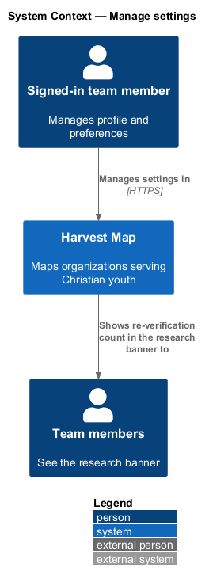
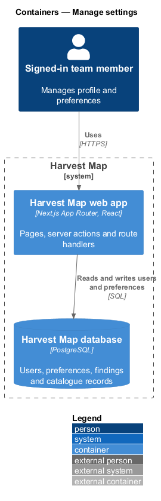
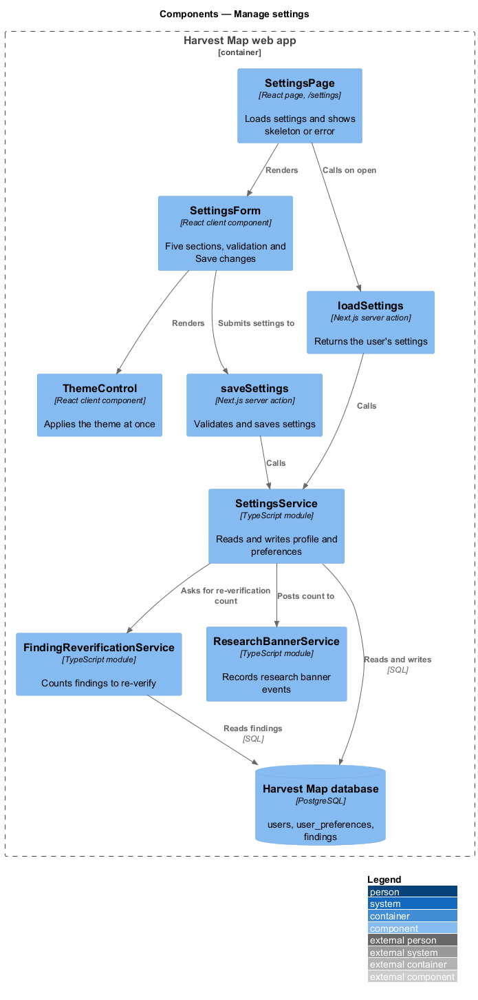
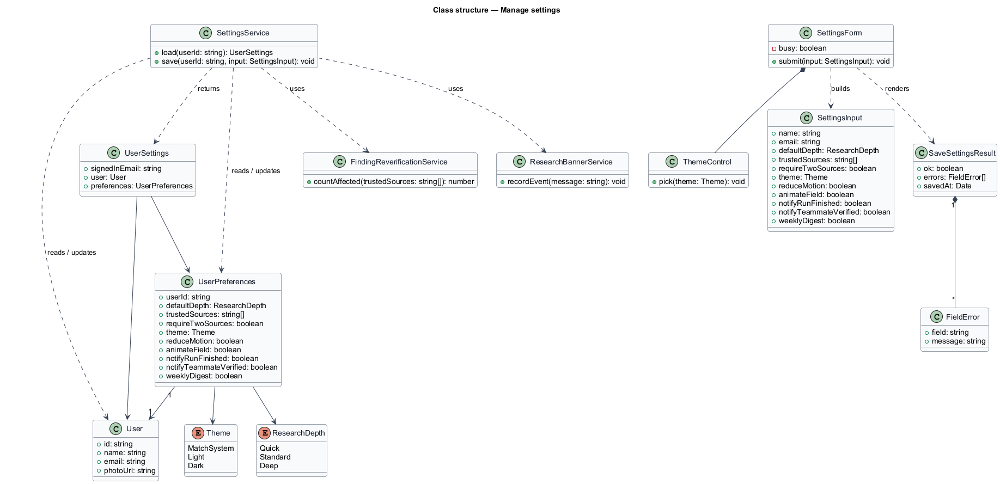
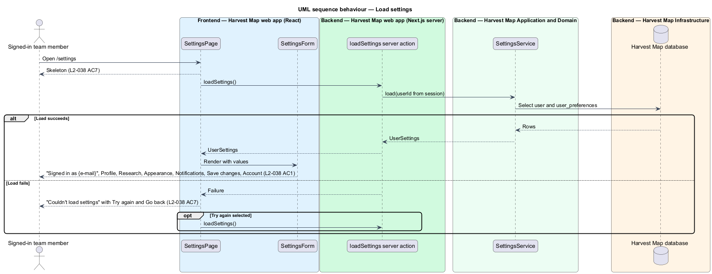
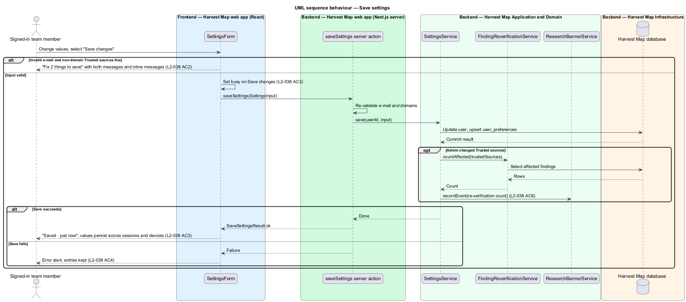
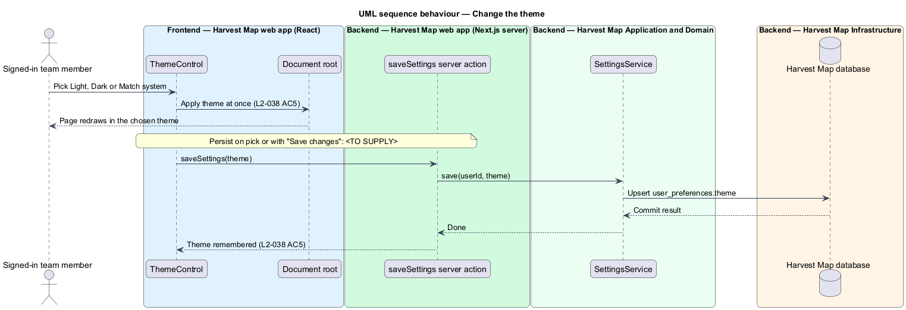

# Manage settings

## Overview

Harvest Map is a web application that maps organizations serving Christian youth. Each signed-in team member keeps a profile and a set of preferences that shape how research runs, how the app looks, and which notifications arrive. This feature covers the Settings page, where a team member reads and changes those values.

**default depth** — length of time a research run may search before it reports: Quick · 1 minute, Standard · 5 minutes or Deep · 20 minutes

**trusted source** — web domain whose findings need one source instead of two before they count as verified

**research banner** — persistent in-app message that tells team members about research-wide events

The page lives at `/settings` in the settings subsystem. It shows "Signed in as {e-mail}" and five sections: Profile, Research, Appearance, Notifications and Account. "Save changes" saves Profile, Research, Appearance and Notifications together. The Theme control applies at once. Account holds "Sign out", which opens the sign-out dialog (`identity/sign-out`), and "Keyboard shortcuts", which opens the keyboard-shortcuts dialog. The mocks in `docs/mocks/pages/settings/` show the default, loading, error, invalid, submitting and success states.

## Description

The slice runs from a React page in the Next.js web app to the PostgreSQL database.

- **`SettingsPage`** — React page at `/settings`. It calls `loadSettings` on open, shows a skeleton while loading, and on failure shows "Couldn't load settings — The request timed out. Try again, or share reference HM-4F2A with support." with "Try again" and "Go back".
- **`SettingsForm`** — client component holding the five sections:
  - Profile: photo with "Change photo", Name, E-mail. Photo upload and storage are `<TO SUPPLY>`.
  - Research: Default depth (Quick · 1 minute, Standard · 5 minutes, Deep · 20 minutes) with the hint "How long a run may search before it reports."; Trusted sources, one domain per line, with the hint "One domain per line. Findings from these need one source instead of two."; the checkbox "Require two sources before a finding is verified".
  - Appearance: Theme (Match system, Light, Dark), "Reduce motion", "Animate the field (WebGPU)".
  - Notifications: "When a run finishes", "When a teammate verifies a finding", "Weekly digest by e-mail".
  - Account: "Sign out" and "Keyboard shortcuts".

  Before any request the form checks the e-mail format and that each Trusted sources line is a domain. On failure it shows "Fix 2 things to save" listing "Enter an e-mail address like name@example.com" and "Enter one domain per line, like barna.com", with the same inline messages. While saving, "Save changes" shows a busy state. On success it shows "Saved · just now". On save failure it shows an error alert and keeps the entries; the alert copy is `<TO SUPPLY>`.
- **`ThemeControl`** — client component. Picking Light, Dark or Match system sets the theme on the document at once. Whether the choice persists on pick or with "Save changes" is `<TO SUPPLY>`.
- **`loadSettings`** — Next.js server action. It returns the signed-in user's `UserSettings`.
- **`saveSettings`** — Next.js server action. It re-validates a `SettingsInput`, calls `SettingsService` and returns a `SaveSettingsResult`.
- **`SettingsService`** — server module. It reads and writes the user's name and e-mail and the `UserPreferences` row, so preferences follow the user across sessions and devices. When an admin changes Trusted sources, it asks `FindingReverificationService` how many findings will be re-verified and posts that count to the research banner. Whether Trusted sources are per user or shared by the team is `<TO SUPPLY>`. How a user is identified as an admin is `<TO SUPPLY>`. The research banner copy is `<TO SUPPLY>`.
- **`FindingReverificationService`** — server module owned by the finding-review feature. It counts the findings affected by a Trusted sources change. No design names this module yet. Its counting rule is `<TO SUPPLY>`.
- **`ResearchBannerService`** — server module designed in `notifications/research-banner`. It records the trusted-source change event that the research banner shows to team members.
- **`User`** and **`UserPreferences`** — rows in the `users` and `user_preferences` tables of the Harvest Map database.

## Requirements

| L2 ID | Refines (L1) | Requirement |
|-------|--------------|-------------|
| `L2-038` | `L1-013` | AC1. Given the page, when it loads, then it shows "Signed in as {e-mail}" and sections Profile (photo with "Change photo", Name, E-mail), Research (Default depth: Quick · 1 minute, Standard · 5 minutes, Deep · 20 minutes; Trusted sources one domain per line; "Require two sources before a finding is verified"), Appearance (Theme: Match system, Light, Dark; "Reduce motion"; "Animate the field (WebGPU)"), Notifications ("When a run finishes", "When a teammate verifies a finding", "Weekly digest by e-mail"), "Save changes", and Account ("Sign out", "Keyboard shortcuts"). |
| `L2-038` | `L1-013` | AC2. Given an invalid E-mail and a Trusted sources line that is not a domain, when saved, then "Fix 2 things to save" lists "Enter an e-mail address like name@example.com" and "Enter one domain per line, like barna.com" with inline messages. |
| `L2-038` | `L1-013` | AC3. Given valid input, when saved, then busy shows, preferences persist across sessions and devices, and a success confirmation shows. |
| `L2-038` | `L1-013` | AC4. Given a save failure, when it returns, then an error alert shows and entries are kept. |
| `L2-038` | `L1-013` | AC5. Given the Theme control, when the user picks Light, Dark or Match system, then the app applies it immediately and remembers it. |
| `L2-038` | `L1-013` | AC6. Given a change to Trusted sources by an admin, when saved, then team members are told in the research banner how many findings will be re-verified. |
| `L2-038` | `L1-013` | AC7. Given loading or load failure, when the page renders, then skeleton or error with retry shows. |

## Diagrams

### System context

A signed-in team member manages settings in Harvest Map over HTTPS. Other team members see the research banner when an admin changes Trusted sources.

### Containers

The Next.js web app serves the page and runs the server actions. The actions read and write users and preferences in the PostgreSQL database.

### Components

`SettingsPage` loads through `loadSettings` and renders `SettingsForm` and `ThemeControl`. The form saves through `saveSettings`. Both actions call `SettingsService`, which reads and writes the database and, for an admin Trusted sources change, calls `FindingReverificationService` and `ResearchBannerService`.

### Class structure

`SettingsForm` builds a `SettingsInput` and renders a `SaveSettingsResult` made of `FieldError` entries. `UserSettings` combines `User` fields with `UserPreferences`, which holds `ResearchDepth` and `Theme` values.

### Behaviour — load settings

The page shows a skeleton while `loadSettings` runs, then the form with "Signed in as {e-mail}" and all five sections (`L2-038` AC1). A load failure shows the error with "Try again" (`L2-038` AC7).

### Behaviour — save settings

The form rejects an invalid e-mail and non-domain lines before any request (`L2-038` AC2). A valid save shows busy, persists the values and shows "Saved · just now" (`L2-038` AC3). An admin Trusted sources change posts the re-verification count to the research banner (`L2-038` AC6). A failed save shows an error alert and keeps the entries (`L2-038` AC4).

### Behaviour — change the theme

Picking a theme applies it to the document at once and records the choice (`L2-038` AC5).

