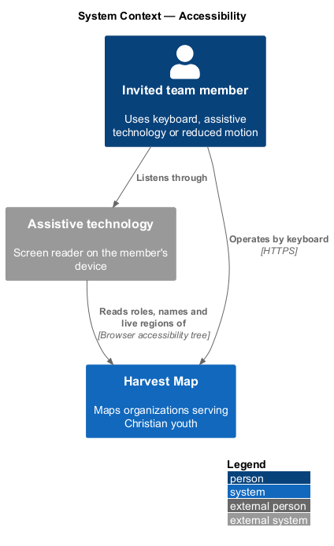
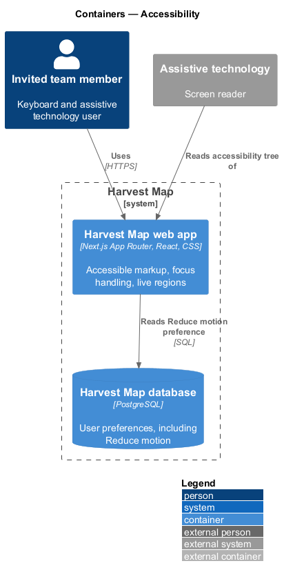
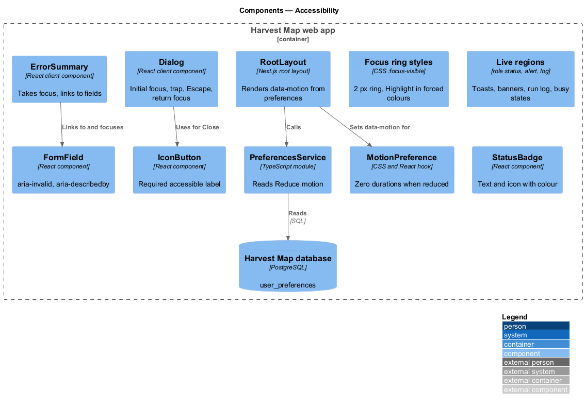
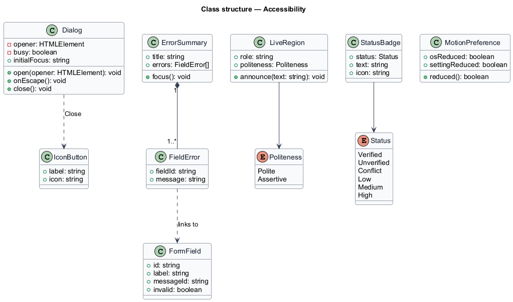
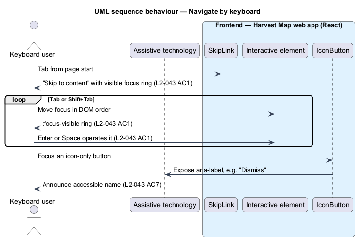
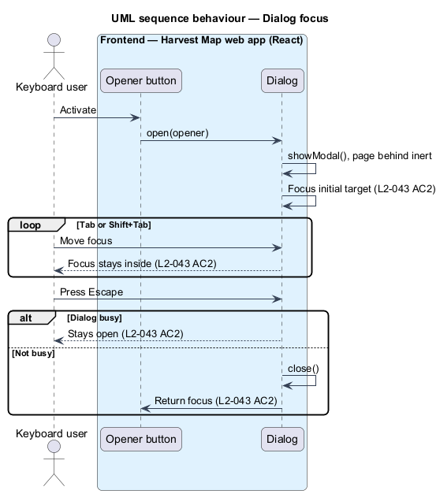
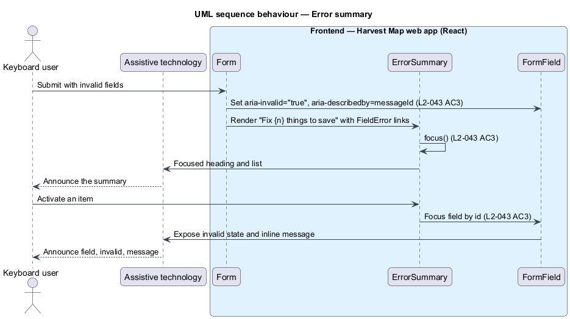
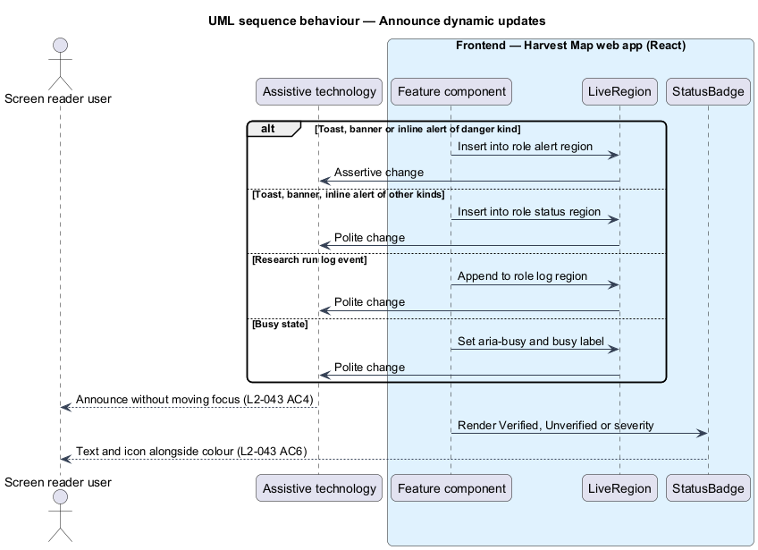
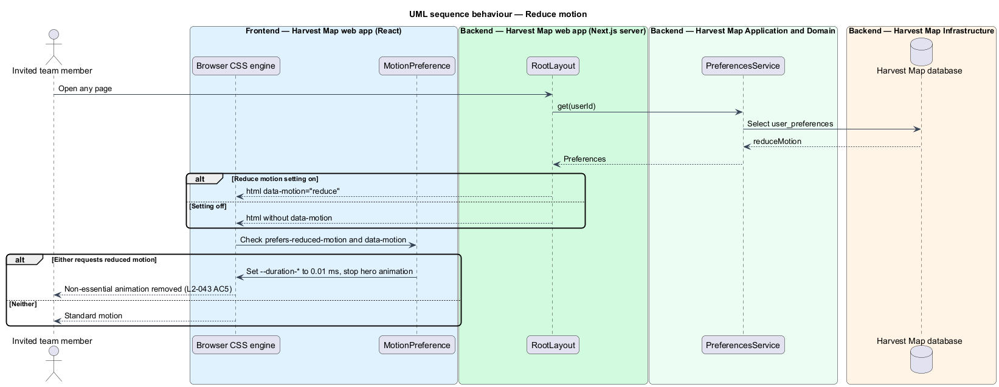

# Accessibility

## Overview

Harvest Map is a web application that maps organizations serving Christian youth. Some team members work by keyboard alone, use a screen reader, or are affected by motion. This feature sets the shared accessibility behaviour that every page, dialog and notification follows.

**assistive technology** — software such as a screen reader that presents the interface to a person in another form

**live region** — part of the page whose changes assistive technology announces without the person moving focus; polite announcements wait for a pause, assertive ones interrupt

**focus trap** — dialog behaviour that keeps keyboard focus inside the dialog while it is open

**error summary** — box at the top of a form, headed "Fix {n} things to save", that lists each problem as a link to its field

The feature belongs to the shell subsystem and is cross-cutting: the shared components below carry the behaviour, and each feature uses them. Related designs: the skip link in the navigation shell (`L2-030`), toasts (`L2-034`), banners (`L2-035`, `L2-036`), inline alerts (`L2-037`) and the Reduce motion setting (`L2-038`). Every mock is built to the same rules, and `docs/mocks/assets/ui.css` and `tokens.css` define the focus ring and motion tokens.

## Description

The slice is mostly frontend: shared React components and CSS in the Next.js web app. The only server part is reading the Reduce motion preference when the root layout renders.

- **Focus ring** — every interactive element shows an outline on `:focus-visible`, `--focus-ring-width` (2 px) wide in `--color-focus-ring`; under `forced-colors: active` the ring uses the system `Highlight` colour. Tab order follows the DOM order, and the "Skip to content" link comes first (`L2-030`).
- **`Dialog`** — shared dialog component, opened with the native `<dialog>` element's `showModal()`, so the page behind is inert. On open it moves focus to the dialog's initial target, for example the confirmation field in Delete organization (`L2-009`) or Cancel in Delete person (`L2-015`). Tab and Shift+Tab stay inside. Escape closes it unless it is busy. On close, focus returns to the element that opened it.
- **`ErrorSummary`** — rendered above a form on a failed submit. It takes focus, announces "Fix {n} things to save", and lists each message as a link that moves focus to its field.
- **`FormField`** — wraps a label, an input and its inline message. When invalid it sets `aria-invalid="true"` and `aria-describedby` to the message id.
- **Live regions** — toasts use polite and assertive regions (`L2-034`); banners and inline alerts use `role="status"`, or `role="alert"` for danger (`L2-035`, `L2-036`, `L2-037`); the research run log is a polite log (`L2-023`); busy buttons and loading areas set `aria-busy="true"` and expose a busy label.
- **`MotionPreference`** — reduced motion applies when the OS requests `prefers-reduced-motion: reduce` or the user's "Reduce motion" setting is on. The CSS sets every `--duration-*` token to 0.01 ms in that case. `RootLayout` reads the setting through `PreferencesService` and renders `<html data-motion="reduce">`, and the stylesheet treats that attribute like the media query. The hero field animation also stops (`L2-005`).
- **`StatusBadge`** — shows status as text with an icon, never by colour alone: "Verified", "Unverified", "Conflict", and the severity values. Score rings carry `role="img"` with a label such as "Impact score 94 of 100".
- **`IconButton`** — icon-only button that requires a `label` prop, rendered as `aria-label`, for example "Dismiss", "Close" or "Open navigation". Images carry `alt` text; decorative icons carry `aria-hidden="true"`.

The full list of animations classed as essential, if any, is `<TO SUPPLY>`.

## Requirements

| L2 ID | Refines (L1) | Requirement |
|-------|--------------|-------------|
| `L2-043` | `L1-015` | AC1. Given any page, when navigated by keyboard only, then every interactive element is reachable and operable in a logical order, with a visible focus indicator. |
| `L2-043` | `L1-015` | AC2. Given a dialog, when it opens, then focus moves inside, is trapped, Escape closes it (unless busy), and focus returns to the opener when it closes. |
| `L2-043` | `L1-015` | AC3. Given a form with errors, when submitted, then an error summary receives focus, each item links to its field, and fields use `aria-invalid` and `aria-describedby`. |
| `L2-043` | `L1-015` | AC4. Given dynamic updates (toasts, run log, banners, busy states), when they occur, then they are announced via live regions. |
| `L2-043` | `L1-015` | AC5. Given `prefers-reduced-motion` or the "Reduce motion" setting, when active, then non-essential animation is removed. |
| `L2-043` | `L1-015` | AC6. Given status shown by colour (Verified, Unverified, severity), when rendered, then text or icon also conveys it. |
| `L2-043` | `L1-015` | AC7. Given images and icon-only buttons, when rendered, then they have accessible names. |

## Diagrams

### System context

An invited team member uses Harvest Map by keyboard, with assistive technology, or with reduced motion. Assistive technology runs on the member's device and reads the page the browser exposes.

### Containers

The Harvest Map web app renders accessible markup and styles. The PostgreSQL database holds the Reduce motion preference.

### Components

The component view is frontend-only apart from `RootLayout` reading the motion preference. Pages compose `Dialog`, `ErrorSummary`, `FormField`, `StatusBadge`, `IconButton` and the live regions; `MotionPreference` and the focus ring apply globally.

### Class structure

`Dialog` tracks its opener and busy state. `ErrorSummary` holds `FieldError` entries that point at `FormField` ids. `LiveRegion` has a politeness. `StatusBadge` pairs a `Status` with text and an icon.

### Behaviour — navigate by keyboard

Tab moves through interactive elements in DOM order with a visible focus ring, starting with the skip link (`L2-043` AC1). Icon-only controls announce their label (`L2-043` AC7).

### Behaviour — dialog focus

Opening a dialog moves focus inside and traps it; Escape closes it unless busy, and focus returns to the opener (`L2-043` AC2).

### Behaviour — error summary

A failed submit focuses the summary; each item moves focus to its field, which carries `aria-invalid` and `aria-describedby` (`L2-043` AC3).

### Behaviour — announce dynamic updates

Toasts, banners, the run log and busy states change inside live regions, so assistive technology announces them (`L2-043` AC4). Status text and icons travel with colour (`L2-043` AC6).

### Behaviour — reduce motion

The OS preference or the Reduce motion setting collapses animation durations and stops the hero animation (`L2-043` AC5).

