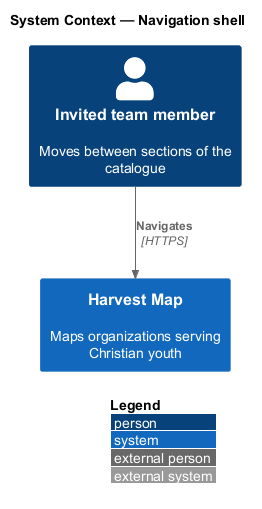
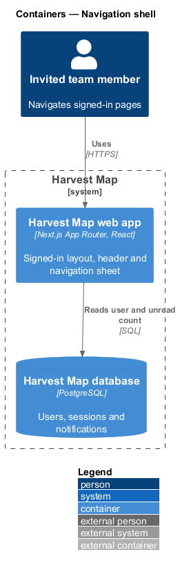
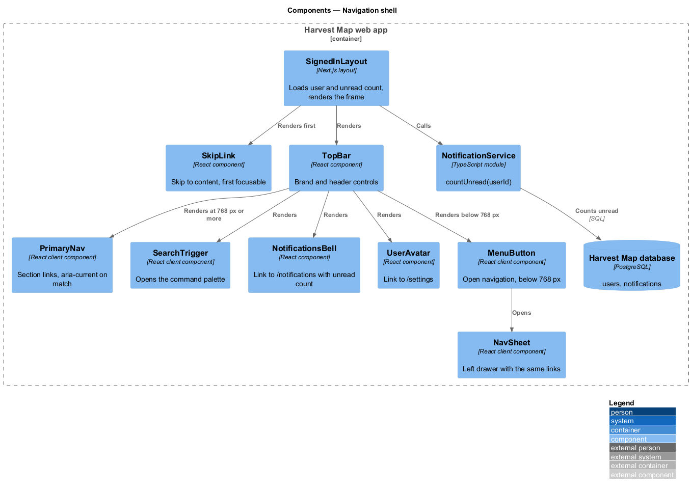
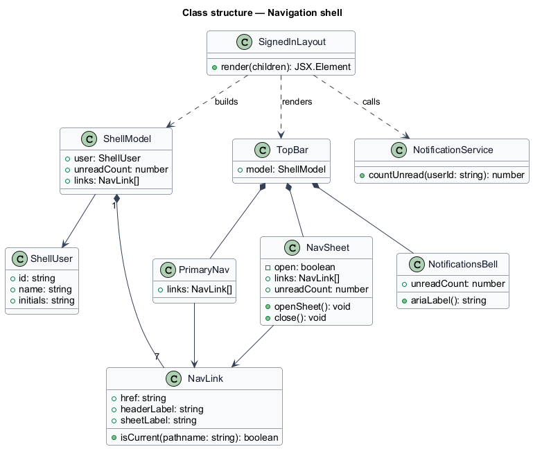
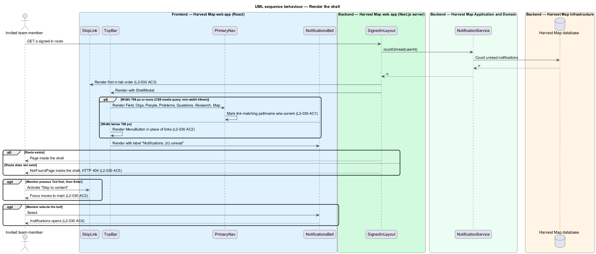
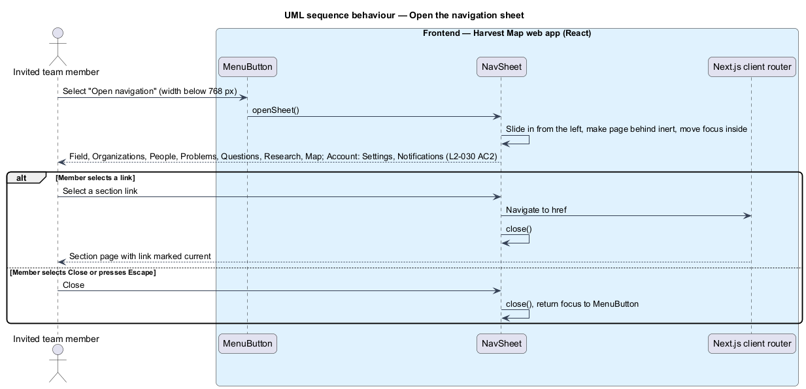

# Navigation shell

## Overview

Harvest Map is a web application that maps organizations serving Christian youth. Every signed-in page shares one frame: a header with the brand, links to the main sections, search, notifications and the account. This feature defines that frame and how it adapts to narrow screens.

**navigation shell** — shared frame around every signed-in page: skip link, header, optional banners and the main content area

**navigation sheet** — panel that slides in from the left on narrow screens and holds the same section links as the header

**current page link** — section link that matches the page on screen, marked with `aria-current="page"`

The shell belongs to the shell subsystem and wraps every route in the signed-in route group. It hosts the research banner (`L2-035`), the offline banner (`L2-036`) and the toast region (`L2-034`), and renders the 404 page for unknown routes (`L2-040`). The mocks show the header on every page and the sheet in `docs/mocks/dialogs/nav-sheet/default.html`.

## Description

The slice runs from React components in the Next.js web app to the PostgreSQL database for the user and the unread count.

- **`SignedInLayout`** — Next.js layout for the signed-in route group. It loads the signed-in user and the unread notification count, then renders `SkipLink`, `TopBar`, the banners, `<main id="main">` and the toast region.
- **`SkipLink`** — "Skip to content" link, first in tab order, that moves focus to `<main id="main">`. It shows only when focused.
- **`TopBar`** — header. It shows the "Harvest Map" brand linking to `/`, `PrimaryNav`, `SearchTrigger`, `NotificationsBell` and `UserAvatar`. A CSS media query at `48rem` (768 px) shows `PrimaryNav` at that width or more and `MenuButton` below it.
- **`PrimaryNav`** — links Field, Orgs, People, Problems, Questions, Research and Map. It reads the path with `usePathname` and marks the matching link `aria-current="page"`.
- **`SearchTrigger`** — "⌘K" button labelled "Search, Control K" that opens the command palette (`L2-028`).
- **`NotificationsBell`** — link to `/notifications` with the unread count. The mock labels it "Notifications, 3 unread", or "Notifications" when the count is zero, and repeats the label in a tooltip. `L2-030` writes the label as "{n} Notifications, {n} unread"; the final wording is `<TO SUPPLY>`.
- **`UserAvatar`** — initials linking to `/settings`, labelled "Account settings for {name}".
- **`MenuButton`** — icon button labelled "Open navigation" that opens `NavSheet`.
- **`NavSheet`** — dialog titled "Harvest Map" with a "Close" button. It lists Field, Organizations, People, Problems, Questions, Research and Map, then an "Account" group with Settings and Notifications (with the unread badge), then the user's name. The mock states that the sheet slides in from the left over 320 ms and that the page behind is inert. The header says "Orgs" where the sheet says "Organizations".
- **`NotificationService.countUnread`** — server call shared with the notifications page (`L2-033`).

## Requirements

| L2 ID | Refines (L1) | Requirement |
|-------|--------------|-------------|
| `L2-030` | `L1-015` | AC1. Given viewport width of 768 px or more, when a signed-in page renders, then the header shows the "Harvest Map" brand, links Field, Orgs, People, Problems, Questions, Research, Map, the ⌘K search trigger, the notifications bell with unread count ("{n} Notifications, {n} unread" to assistive technology) and the user avatar; the current page link is marked current. |
| `L2-030` | `L1-015` | AC2. Given viewport width below 768 px, when the page renders, then the navigation links collapse into a Navigation sheet opened from a menu button, with the same links. |
| `L2-030` | `L1-015` | AC3. Given any page, when it loads, then a "Skip to content" link is the first focusable element and moves focus to the main content. |
| `L2-030` | `L1-015` | AC4. Given the user selects the notifications bell, when selected, then `/notifications` opens. |
| `L2-030` | `L1-015` | AC5. Given a route that does not exist, when requested, then the not-found page (L2-040) is shown inside the shell. |

## Diagrams

### System context

An invited team member moves between sections of Harvest Map through the shell. No external system takes part.

### Containers

The Next.js web app renders the shell on the server and hydrates its interactive parts in the browser. It reads the user and unread count from the PostgreSQL database.

### Components

`SignedInLayout` renders `SkipLink`, `TopBar` and the page. `TopBar` composes `PrimaryNav`, `SearchTrigger`, `NotificationsBell`, `UserAvatar` and `MenuButton`, which opens `NavSheet`. The layout reads the unread count from `NotificationService`.

### Class structure

`SignedInLayout` builds a `ShellModel` holding the `ShellUser`, the unread count and the `NavLink` list. `PrimaryNav` and `NavSheet` render the same `NavLink` entries.

### Behaviour — render the shell

The layout loads the user and the unread count, then renders the skip link first (`L2-030` AC3) and the header with the current link marked (`L2-030` AC1). Below 768 px the menu button replaces the links (`L2-030` AC2). The bell opens `/notifications` (`L2-030` AC4), and an unknown route renders the 404 page inside the shell (`L2-030` AC5).

### Behaviour — open the navigation sheet

On a narrow screen the menu button opens the sheet with the same section links; selecting a link or "Close" closes it (`L2-030` AC2).

