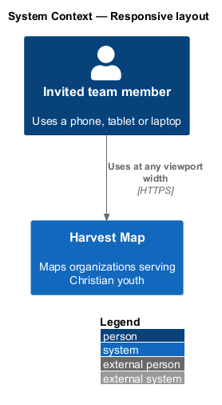
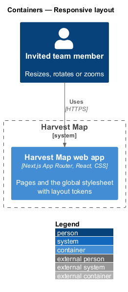
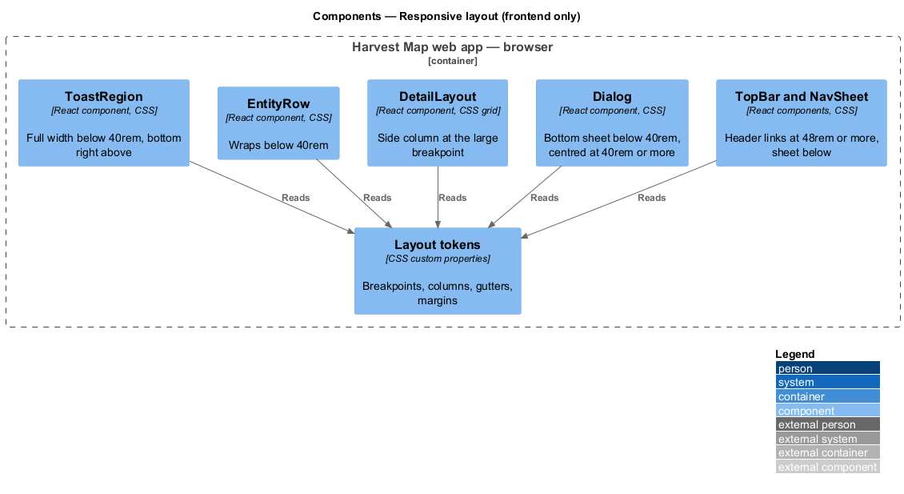
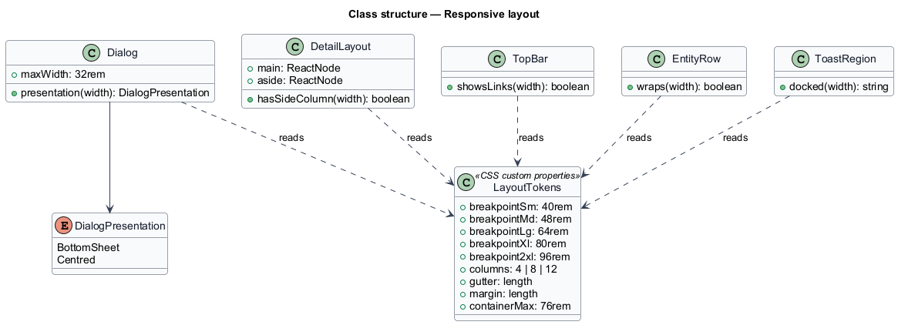
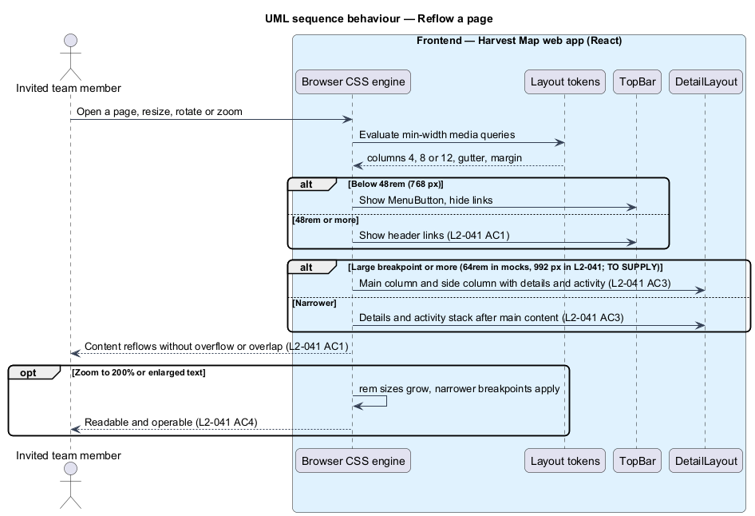
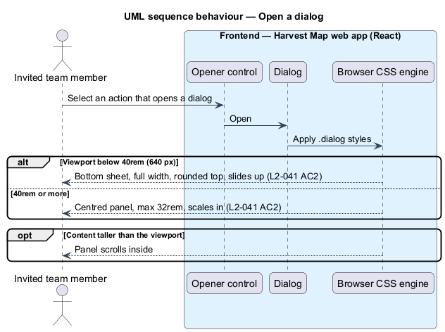

# Responsive layout

## Overview

Harvest Map is a web application that maps organizations serving Christian youth. Team members use it on phones, tablets and laptops. This feature makes every page and dialog reflow to the viewport width and stay usable when zoomed or with enlarged text.

**breakpoint** — viewport width at which the layout changes

**bottom sheet** — dialog presentation anchored to the bottom edge of a narrow screen, full width, with rounded top corners

**side column** — right-hand column on detail pages that holds the details and activity next to the main content

The feature belongs to the shell subsystem and applies to every page, dialog and notification. The mocks are captured at 360×800, 768×1024 and 1280×800 in light and dark, and their stylesheets in `docs/mocks/assets/` (`tokens.css`, `ui.css`, `harvest.css`) define the breakpoints the design follows.

## Description

The slice is frontend-only: CSS custom properties, media queries and the layout components that use them. No server action or database takes part, and no JavaScript measures the viewport.

- **Layout tokens** — custom properties in the global stylesheet, taken from `docs/mocks/assets/tokens.css`. Breakpoints: `--layout-breakpoint-sm` 40rem (640 px), `--layout-breakpoint-md` 48rem (768 px), `--layout-breakpoint-lg` 64rem (1024 px), `--layout-breakpoint-xl` 80rem (1280 px), `--layout-breakpoint-2xl` 96rem (1536 px). Grid: 4 columns by default, 8 columns at 48rem, 12 columns at 64rem, with gutter and page margin growing at each step. Content width caps at `--layout-container-max` 76rem.
- **Breakpoint conflict** — `L2-041` names S 576 px, M 768 px, L 992 px and XL 1200 px, while the mock stylesheets use 640, 768, 1024, 1280 and 1536 px; the side column switches at 64rem (1024 px) in the mocks and at 992 px in `L2-041`. Only the 768 px navigation switch agrees. The values to build against are `<TO SUPPLY>`; `L1.md` states that the mocks win where they disagree with the specs.
- **`TopBar` and `NavSheet`** — header links show at 48rem (768 px) or more; below that the menu button opens the navigation sheet (`L2-030`).
- **`Dialog`** — shared dialog component. Below 40rem (640 px) it sits at the bottom of the viewport, full width with rounded top corners and a slide-up entrance; at 40rem or more it is centred with a 32rem maximum width and a scale-in entrance. The panel scrolls inside when its content exceeds the viewport height.
- **`DetailLayout`** — grid for organization, person and problem detail pages. One column by default; at the large breakpoint, main content (2 fractions) and a side column (at least 16rem, 1 fraction) for details and activity.
- **`EntityRow`** — list rows and cards. Below 40rem they wrap: mark and text on the first line, status and actions on the next, right-aligned.
- **`ToastRegion`** — full width at the bottom below 40rem; bottom right, 24rem wide, at 40rem or more (`L2-034`).
- **Relative units** — sizes in `rem` and layouts with `minmax(0, …)` and wrapping, so content reflows at 200% zoom or enlarged text instead of clipping.

## Requirements

| L2 ID | Refines (L1) | Requirement |
|-------|--------------|-------------|
| `L2-041` | `L1-015` | AC1. Given viewport width 576 px or more (S), 768 px or more (M), 992 px or more (L) and 1200 px or more (XL), when any page renders, then content reflows without overflow or overlap, and navigation switches from the sheet to the header links at 768 px. |
| `L2-041` | `L1-015` | AC2. Given viewport width below 640 px, when a dialog opens, then it is displayed as a bottom sheet; at 640 px or more it is centred. |
| `L2-041` | `L1-015` | AC3. Given detail pages, when width is 992 px or more, then the details and activity appear in a side column; below that they stack after the main content. |
| `L2-041` | `L1-015` | AC4. Given any viewport, when the page is zoomed to 200% or text is enlarged, then content remains readable and operable. |

## Diagrams

### System context

An invited team member opens Harvest Map on a phone, tablet or laptop. No external system takes part.

### Containers

The Harvest Map web app ships the stylesheet that the browser applies. The database plays no part in this slice and is left out of the view.

### Components

The component view is frontend-only. The layout tokens feed the media queries used by `TopBar`, `Dialog`, `DetailLayout`, `EntityRow` and `ToastRegion`.

### Class structure

`LayoutTokens` holds the breakpoints and grid values. Each layout component reads the tokens and owns one presentation per breakpoint range.

### Behaviour — reflow a page

The browser re-evaluates the media queries on each width or zoom change. Navigation switches at 768 px, the grid widens, and detail pages gain the side column at the large breakpoint (`L2-041` AC1, AC3, AC4).

### Behaviour — open a dialog

A dialog opens as a bottom sheet below 640 px and centred at 640 px or more (`L2-041` AC2).

