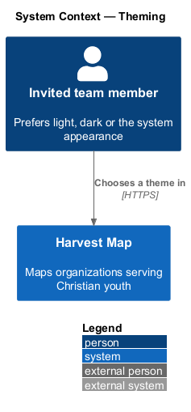
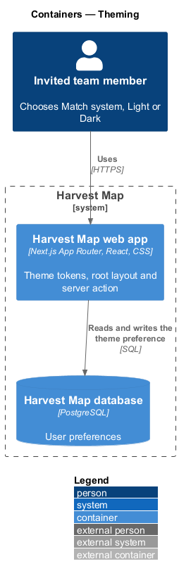
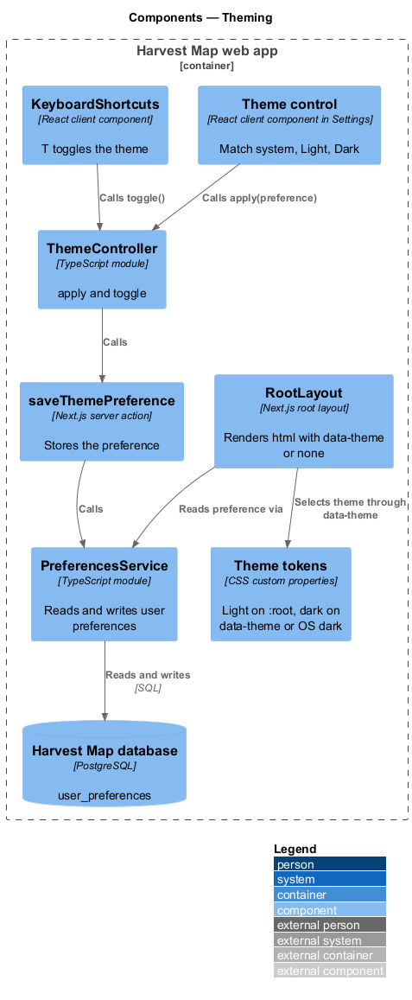
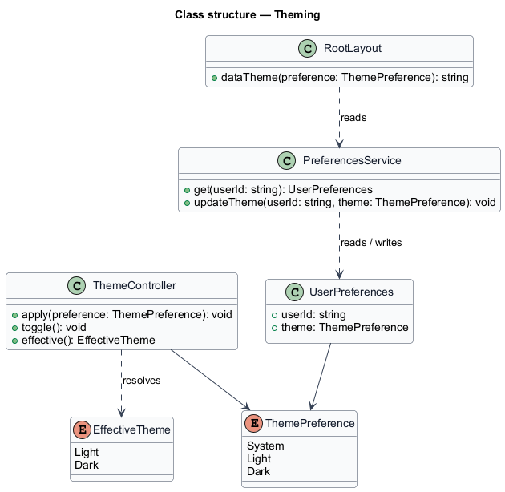
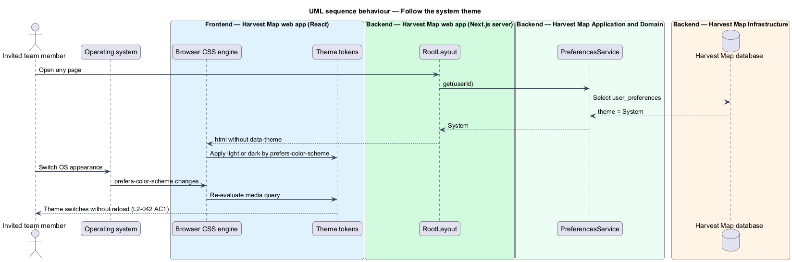
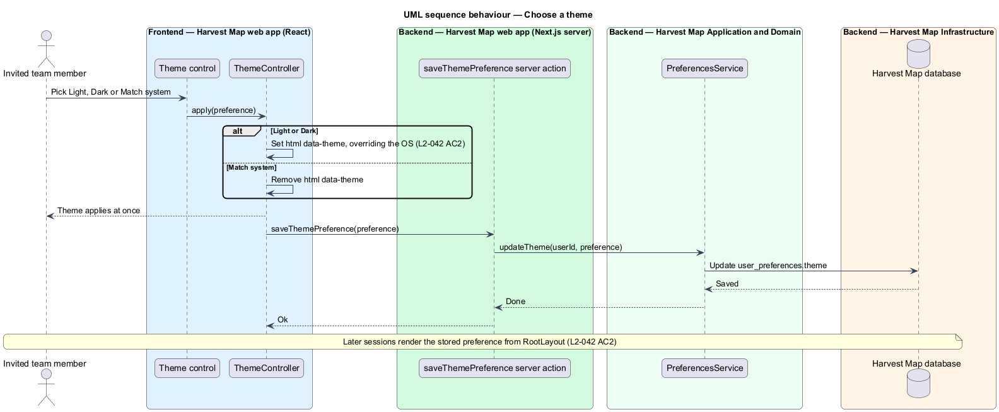
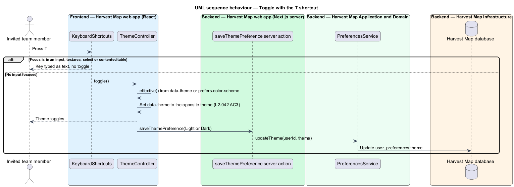

# Theming

## Overview

Harvest Map is a web application that maps organizations serving Christian youth. Team members work in bright offices and dark rooms, and many set their operating system to switch between light and dark appearance. This feature gives Harvest Map a light and a dark theme and lets each team member follow the system or pin one.

**theme** — set of colour values applied to the whole interface; Harvest Map has a light theme and a dark theme

**theme preference** — per-user setting with three values: Match system, Light or Dark

**effective theme** — the theme on screen: the pinned theme for Light or Dark, or the operating system's appearance for Match system

The feature belongs to the shell subsystem and applies to every page. The Theme control lives in Settings > Appearance (`L2-038`), and the `T` keyboard shortcut toggles the theme (`L2-029`). Each mock carries a light and a dark rendering, and `docs/mocks/assets/tokens.css` defines both themes.

## Description

The slice runs from the root layout and a client controller to the PostgreSQL database, where the preference persists.

- **Theme tokens** — semantic colour custom properties from `docs/mocks/assets/tokens.css`. The light theme is the default on `:root`. The dark theme applies under `[data-theme="dark"]`, and under `@media (prefers-color-scheme: dark)` when the root does not carry `[data-theme="light"]`. Contrast overrides apply under `prefers-contrast: more` and `forced-colors: active`.
- **`RootLayout`** — Next.js root layout. It reads the signed-in user's `ThemePreference` on the server and renders `<html data-theme="light">`, `<html data-theme="dark">`, or `<html>` with no `data-theme` for Match system. The first paint therefore uses the right theme.
- **`ThemeController`** — client module. `apply(preference)` sets or removes `data-theme` on `<html>` at once, and `toggle()` resolves the effective theme and applies the opposite one as Light or Dark. Both call `saveThemePreference`.
- **`saveThemePreference`** — Next.js server action. It stores the preference for the current user.
- **`PreferencesService`** — server module that reads and writes the user's preferences, shared with Settings (`L2-038`).
- **`UserPreferences`** — row in the `user_preferences` table; this slice uses its `theme` column.
- **Match system** — with no `data-theme` attribute the CSS media query follows the operating system, so an OS change switches the theme without reload and without script.

The theme preference for a person who is not signed in, for example on `/sign-in`, is `<TO SUPPLY>`; without one the CSS follows the operating system.

## Requirements

| L2 ID | Refines (L1) | Requirement |
|-------|--------------|-------------|
| `L2-042` | `L1-015` | AC1. Given the Theme setting "Match system", when the OS theme changes, then the app switches between light and dark without reload. |
| `L2-042` | `L1-015` | AC2. Given Light or Dark chosen, when set, then it overrides the OS and persists. |
| `L2-042` | `L1-015` | AC3. Given `T` is pressed (L2-029), when no input is focused, then the theme toggles. |

## Diagrams

### System context

An invited team member chooses a theme in Harvest Map. The operating system supplies its appearance to the browser; no external system takes part.

### Containers

The Next.js web app renders the theme attribute and runs the server action. The PostgreSQL database stores the preference.

### Components

`RootLayout` reads the preference through `PreferencesService` and sets `data-theme`. The Theme control and the `T` shortcut call `ThemeController`, which updates the attribute and calls `saveThemePreference`.

### Class structure

`ThemeController` applies a `ThemePreference` and resolves an `EffectiveTheme`. `PreferencesService` persists `UserPreferences`, which holds the preference.

### Behaviour — follow the system theme

With Match system the root carries no `data-theme`, and the CSS media query swaps the tokens when the OS appearance changes (`L2-042` AC1).

### Behaviour — choose a theme

Picking Light or Dark sets `data-theme` at once, overrides the OS and persists for later sessions (`L2-042` AC2).

### Behaviour — toggle with the T shortcut

Pressing `T` with no input focused applies the opposite of the effective theme and persists it (`L2-042` AC3).

